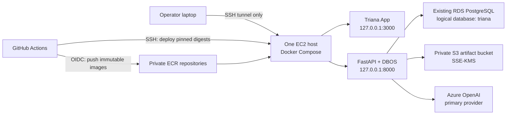

# LABS-08 AWS and CI/CD readiness runbook

Date: 2026-08-05

Status: **read-only inventory and implementation proposal; no AWS resources were changed**

This runbook records the smallest AWS deployment shape for the backend-backed
HRAI vertical slice. It is subordinate to the accepted LABS-08 backend
architecture and does not authorize resource creation by itself.

The intended first deployment is one EC2 host running the Triana App and
FastAPI backend as containers, one logical Triana database on the existing RDS
PostgreSQL instance, and a private S3 artifact bucket. Azure OpenAI remains the
primary LLM provider. ECS, ALB, Lambda, SQS, Terraform, public application
ports, and application authentication are deliberately absent from this cut.

## Target topology



Only TCP 22 is an intended public EC2 ingress. The Next.js and FastAPI ports
bind to loopback and are reached through SSH local forwarding. RDS and S3 are
never public application endpoints.

## Read-only AWS inventory

Inventory was performed with local profile `akarsh-dev` in `ap-south-1`. STS
identified account `895469091637` and caller
`arn:aws:iam::895469091637:user/akarsh_dev`. The identifiers below are not
credentials.

### Existing RDS candidate

| Property | Observed value |
|---|---|
| DB instance | `simplydev` |
| Engine | PostgreSQL `16.13` |
| State | `stopped` |
| Class | `db.t4g.micro` |
| Storage | 20 GiB `gp2` |
| Storage encryption | disabled |
| Public accessibility | disabled |
| Multi-AZ | disabled |
| VPC | `vpc-099118ff91f48a7e2` |
| Subnet group | `grow-simplee-infra` |
| Security group | `sg-01da6b66092e0fef4` |
| Automated backup retention | 7 days |
| Deletion protection | enabled |
| IAM database authentication | disabled |

This instance can host a separate logical `triana` database after it is
started and capacity is checked. It is not ready as-is:

- a stopped RDS instance cannot serve imports or the application;
- storage is unencrypted, and creating a logical database does not correct
  that property;
- `db.t4g.micro` is a small shared host, so connection limits, free storage,
  CPU credit behavior, and existing workload headroom must be measured before
  calling it suitable;
- the Triana database owner must be separate from the RDS administrative user;
- schema migrations must run as an explicit deploy step, not at API startup.

The unencrypted legacy instance is an accepted-risk decision for the owner,
not something this runbook can silently waive. An encrypted snapshot restore
or a new encrypted instance is the later correction if encryption at rest is
required for RDS.

### EC2 and VPC facts

Two running instances exist in the RDS VPC:

| Instance | Type | Network | Observed role |
|---|---|---|---|
| `i-0f88fd13c2c588264` | `t4g.small` | public address present, subnet `subnet-03f6fd0823428f299` | instance profile `EC2_SSM_ROLE`; security group name identifies an OpenVPN access server |
| `i-0183e495649573e32` | `g4dn.xlarge` | no public address, subnet `subnet-09e7c2e5c4d8d1fd5` | instance profile `ecsInstanceRole`; unrelated GPU workload |

Neither existing host should be repurposed without explicit owner approval.
The smallest clean setup is a dedicated Triana EC2 instance in the same VPC.

The candidate public subnet `subnet-03f6fd0823428f299` is associated with
route table `rtb-08e98fe978849eae1`, which has an Internet Gateway default
route. Its subnet setting does not automatically assign public addresses, so
the EC2 launch must explicitly request one or attach an Elastic IP if stable
SSH addressing is required.

RDS security group `sg-01da6b66092e0fef4` currently accepts security-group
sources from itself and `sg-00add18ad4aa23980`. A new dedicated Triana EC2
security group is therefore not automatically able to reach PostgreSQL. The
infrastructure change must add one PostgreSQL ingress rule whose source is the
new Triana EC2 security group. Do not authorize PostgreSQL by CIDR and do not
make the RDS instance public.

Recommended instance choice for the first cut:

- `t3.small` on x86_64 minimizes Docker-image and native-wheel compatibility
  surprises;
- `t4g.small` can be selected for lower ARM cost only after the backend and app
  images build and pass on `linux/arm64`;
- use a small encrypted `gp3` root volume and Docker log rotation;
- attach a dedicated instance profile scoped to ECR pull, the Triana S3
  prefix, the Triana KMS key, and operational logs only.

### S3, KMS, and ECR facts

The account contains many unrelated buckets and repositories. Read-only
inventory found:

- no bucket whose name contains `triana`;
- no KMS alias beginning `alias/triana`;
- the AWS-managed `alias/aws/s3` alias exists;
- no ECR repository whose name contains `triana`.

The implementation therefore needs new dedicated resources rather than reuse
by name:

- one private bucket, globally unique name supplied at provisioning time;
- one customer-managed KMS key with alias `alias/triana-artifacts`, because
  the accepted design calls for SSE-KMS rather than implicit SSE-S3;
- ECR repositories `triana/backend` and `triana/app`;
- block all S3 public access, enforce bucket-owner ownership, enable
  versioning, and require TLS plus SSE-KMS in the bucket policy;
- grant the EC2 instance role object access only to the Triana bucket and KMS
  key; CI requires ECR push but no raw-artifact read permission.

The raw conversation artifacts remain readable through the tunneled backend
API to a trusted SSH user. That does not require a public S3 URL or broad S3
permissions.

## Provisioning checkpoint

Provisioning is a separate, reviewed mutation. Before it runs, freeze exact
names, tags, region, instance architecture, and the database owner. The
provisioning lane should stop unless STS returns account `895469091637` and
the selected region is `ap-south-1`.

The bounded resource set is:

1. start and inspect `simplydev`;
2. create logical database `triana` and a least-privilege application role;
3. create one S3 bucket and one customer-managed KMS key;
4. create two private ECR repositories;
5. create a dedicated EC2 instance role and security group;
6. add the new EC2 security group as a PostgreSQL source on the RDS security
   group;
7. launch one EC2 instance in the RDS VPC with encrypted storage;
8. install Docker Engine, Compose v2, AWS CLI v2, and the deployment user;
9. install only public SSH host access; keep ports 3000, 8000, and 5432 closed
   to public ingress.

Do not create ECS services, an ALB, public DNS for the application, Lambda,
SQS, Redis, a NAT gateway, or Terraform state for this checkpoint.

## Container and runtime layout

The deployment directory on EC2 should contain only operator-owned runtime
configuration and a small Compose manifest. Source code is not the deploy
artifact.

```text
/opt/triana/
  compose.yaml
  .env                 # EC2-only, mode 0600, never Git
  releases/
    <git-sha>.env       # image digests and deployment metadata, no secrets
```

The Compose project contains:

- `app`: the production Next.js image, loopback port 3000;
- `backend`: FastAPI plus the initial DBOS workflow, loopback port 8000;
- no local PostgreSQL, queue, Redis, reverse proxy, or object-store emulator.

The app calls the backend on the EC2 Docker network or through a server-side
loopback URL. Browser-visible API calls cannot point at an unreachable Docker
hostname. Select and test one of these two arrangements before freezing the UI
contract:

1. Next.js server-side proxy to the backend, exposed only through tunneled
   port 3000; or
2. a second SSH tunnel for backend port 8000 and a loopback browser API URL.

The first option is the simpler operator experience and does not make Next.js
an evidence authority.

Use `restart: unless-stopped`, health checks, memory limits, log rotation, and
read-only container filesystems where the framework permits. Persist no raw
trace artifact on the container filesystem after verified S3 publication.

## CI proposal

The repository currently has no `.github/workflows` directory. Existing local
quality contracts are:

- `./scripts/verify-governance.sh --working-tree`;
- `./triana-labs/scripts/verify.sh`;
- `npm run verify:local` in `triana-app`.

When `triana-backend` is frozen, it must add one versioned local verification
command that CI invokes unchanged. CI must not invent a lighter hosted-only
gate.

Add two workflows after the backend slice is GREEN.

### Pull-request CI

`ci.yml` runs without cloud credentials:

1. repository governance and secret scan;
2. locked Triana Labs verification;
3. `npm ci` and `npm run verify:local` for Triana App;
4. locked backend format, lint, strict typing, and acceptance command;
5. build both container images without pushing them;
6. retain machine-readable test reports and image-build metadata.

Use path filters only to skip provably unrelated jobs. A docs-only change
still runs governance. Pin every third-party action to an immutable commit SHA,
set timeouts, cancel superseded runs, and use least-privilege workflow
permissions.

### Main-branch deploy

`deploy.yml` runs after CI passes on `main` and uses a protected GitHub
environment:

1. use GitHub OIDC to assume a narrowly scoped AWS build/deploy role;
2. build the backend and app images once;
3. push immutable Git-SHA tags to their dedicated ECR repositories;
4. resolve and record the two ECR image digests;
5. serialize deployments with a GitHub concurrency group;
6. connect over SSH with strict host-key verification and a dedicated deploy
   key;
7. write only the new image digests into the release metadata;
8. run explicit, backward-compatible database migrations once;
9. run `docker compose pull` and `docker compose up -d`;
10. verify loopback health for backend and app on EC2;
11. leave the prior release metadata intact for rollback.

Do not bake `.env`, Azure credentials, RDS passwords, SSH private keys, raw
traces, or S3 objects into an image, Actions artifact, build log, or Compose
file. GitHub OIDC replaces long-lived AWS access keys. The EC2 deployment key
and pinned host key remain protected environment secrets until deployment is
moved to SSM or a self-hosted runner.

GitHub-hosted runner source addresses change. Direct SSH deployment therefore
requires either broad port-22 reachability with key-only authentication or a
separate network mechanism. For this fast cut, if port 22 is broadly
reachable, compensate with all of the following:

- prohibit password and root login;
- use one unprivileged deploy user and one revocable key;
- enforce strict host-key checking;
- keep application ports closed and bound to loopback;
- enable connection-rate limiting and OS security updates;
- record this as launch debt.

AWS Systems Manager would remove the GitHub-runner SSH exposure, but changing
the selected SSH deployment mechanism is a later explicit decision, not an
implicit addition here.

## Release and rollback contract

Deployments identify images by digest, never only by `latest`. A deployment is
successful only when both containers report healthy and the backend reports
the expected Git SHA and schema compatibility.

Rollback means restoring the previous pair of image digests and rerunning
Compose. A database migration may ship only when the prior application remains
compatible with the migrated schema. Destructive migrations require a later
two-phase release and are outside the first cut.

If image pull, migration, container startup, or health verification fails:

- preserve the failed deployment log without secrets;
- do not rewrite the previous release metadata;
- restore the previous digests when schema compatibility permits;
- report the deployment as failed even if one container is healthy.

## Minimal operational checks

These checks protect truthful data flow rather than broad production maturity:

- imported source byte hash, S3 object identity, database artifact row, run
  row, report row, API response, and UI report ID agree;
- an RDS row referencing a missing or KMS-inaccessible S3 object makes only
  the affected report unavailable with a typed artifact error;
- a successfully uploaded S3 staging object is not published in RDS until its
  hash and metadata are verified;
- a committed RDS report with a failed final S3 copy remains a typed partial
  artifact state and cannot be served as a complete report;
- unrelated reports remain readable during one artifact failure;
- duplicate import of identical source bytes resolves to the same import
  identity and does not create an ordinary duplicate run;
- concurrent deploys and concurrent schema migrations are serialized;
- RDS unavailable, S3 unavailable, KMS denied, Azure unavailable, and disk
  full are distinct failures rather than empty successful results;
- DBOS recovery does not repeat an already committed external side effect;
- container or EC2 restart resumes only contractually resumable work;
- the UI has no fixture fallback when the backend request fails.

## Readiness gaps and exact next actions

1. **Repair the local AWS CLI.** `/opt/homebrew/bin/aws` currently fails before
   argument parsing because Python 3.14 `pyexpat` cannot resolve
   `_XML_SetAllocTrackerActivationThreshold`. Reinstall the Homebrew
   `libexpat`, `python@3.14`, and `awscli` packages or install the official AWS
   CLI v2 bundle, then prove `aws --version` and
   `aws sts get-caller-identity --profile akarsh-dev`.
2. **Confirm the legacy RDS risk.** Decide whether using the existing
   unencrypted `simplydev` instance is acceptable for this demo. If yes, start
   it and measure capacity before creating the logical database.
3. **Freeze x86 versus ARM.** Default to `t3.small` unless both images prove
   `linux/arm64` support.
4. **Provision the bounded resource set.** Use an independently reviewed AWS
   CLI script with an account/region guard; do not improvise resource names in
   CI.
5. **Create CI only after local gates exist.** The backend workflow and its
   acceptance command must be frozen before a deploy workflow can claim
   parity.
6. **Record a current cost envelope.** The target IAM user is denied
   `pricing:GetProducts`, so this inventory cannot truthfully quote current AWS
   rates. Use the AWS Pricing Calculator or grant read-only Price List access
   before provisioning. Include EC2 compute and EBS, RDS runtime and storage,
   S3 storage/requests, one customer-managed KMS key and requests, ECR storage,
   public IPv4, and data transfer. Azure OpenAI cost remains separate.

## Discovery evidence

Read-only checks performed on 2026-08-05:

- STS caller identity for every configured profile, with three valid profiles;
- RDS inventory in each valid profile's configured region;
- EC2 instances, subnets, route tables, and security-group relationships in
  the candidate RDS VPC;
- S3 bucket-name and region inventory;
- KMS alias inventory;
- ECR repository inventory;
- AWS Price List request, which failed with `AccessDeniedException`;
- repository CI and local verification command inspection.

No EC2, RDS, S3, KMS, ECR, IAM, VPC, GitHub, Azure, or DNS resource was
created, updated, started, stopped, or deleted.
