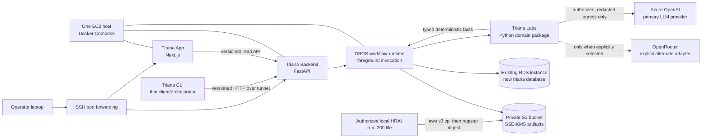
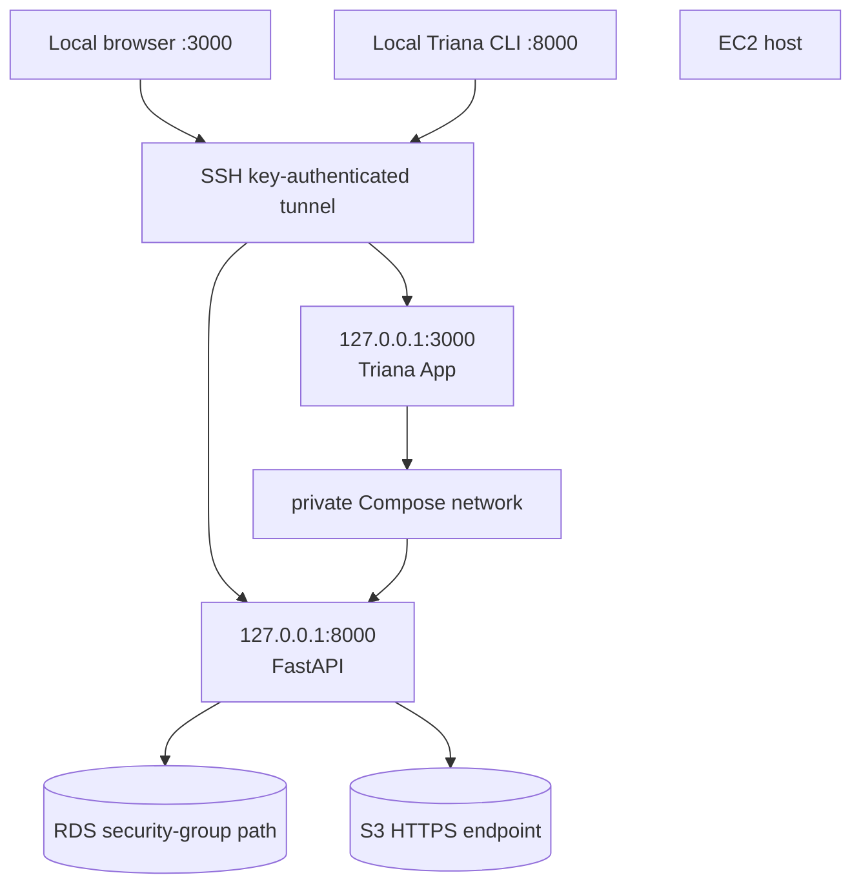
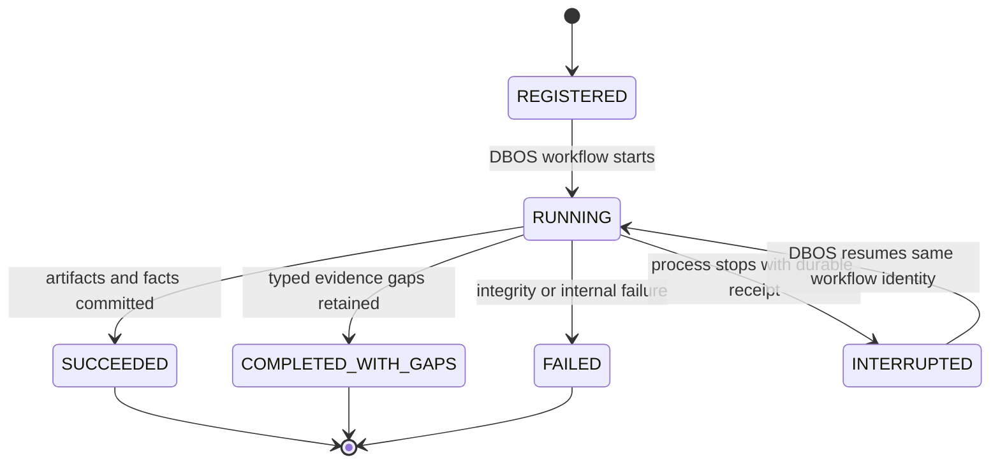
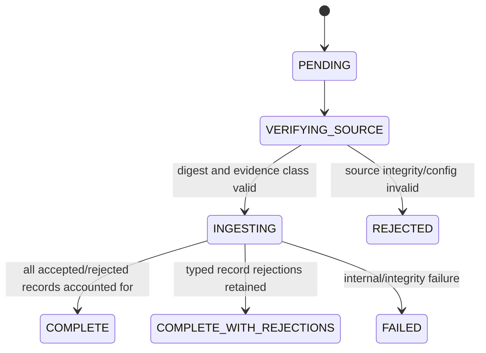
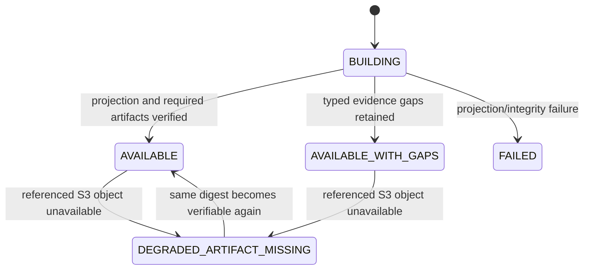

# LABS-08 private backend architecture

Date: 2026-08-05

Status: **owner-frozen CP1 architecture for the bounded HRAI demo**

This document is the HLD and LLD for the first backend-backed Triana Labs
vertical slice. It is intentionally an operator-owned demo deployment, not a
public SaaS control plane. It stores and serves the existing authorized HRAI
`run_200` corpus, its Triana Labs analysis facts, and a read-only report to the
Triana App. It does not authorize general customer-data hosting, public HTTP
access, accounts, or a new product verdict.

The active Labs authority remains `triana-labs/CHARTER.md`. The suspended
Release Review contracts in `triana-core/` remain unchanged. Where this design
adds managed infrastructure, it does so only for this private owner-operated
demo and does not alter the public Preview's local-first promise.

## Outcome and acceptance boundary

The first useful result is one reproducible path:

```text
authorized HRAI run_200 source bytes
  -> content-addressed S3 object
  -> registered import and version in the Triana RDS database
  -> Triana Labs deterministic analysis facts
  -> persisted backend report projection
  -> versioned FastAPI response
  -> Triana App rendering with no fixture fallback
```

The source corpus is the existing 200-line HRAI historical-traffic artifact
with SHA-256
`76e0c2c2c2e777845f6fcda9907d7e386f8f3510ce4834126fc39d16889bf01b`.
Its evidence class is `SYNTHETIC_EXISTING_TRACE_CORPUS`: it is real retained
HRAI trace data, but it is not production, customer, Blitz, or real-user
evidence. The backend and UI must preserve that exact label.

The minimum ship gate proves:

1. the exact source object exists in S3 with the expected digest and encryption;
2. one idempotent import registers exactly 200 source records, including 186
   `COMPLETED` and 14 `HARNESS_ERROR` source outcomes;
3. Labs-produced typed facts and their lineage are stored in RDS;
4. the stored report projection references those facts and S3 artifacts;
5. API values match the stored rows and artifact hashes; and
6. the UI renders only that API response, with missing backend data shown as a
   typed unavailable state rather than simulated or fallback data.

These counts describe source ingestion, not a product pass rate or human
ruling. A deeper test platform, broad eval program, and production-readiness
claim remain backlog.

## High-level design



There is one deployable application boundary on one EC2 host. The Next.js app,
FastAPI API, and initial DBOS runtime are separate processes or containers but
not independently scaled services. The database and object store are managed
AWS services. The LLM provider remains Azure OpenAI by default.

### Network topology



- Docker-published application ports bind to `127.0.0.1`, never
  `0.0.0.0`. No ALB or public application listener exists.
- App endpoints have no application authentication in this checkpoint because
  they are reachable only by a trusted user holding the EC2 SSH key and an
  active tunnel. SSH remains key-authenticated; password and root login are
  disabled.
- Raw conversations are readable to that trusted tunneled user through the
  versioned API. They are not exposed through a public object URL.
- The EC2 instance role, not static AWS credentials, reads and writes the
  scoped S3 prefix and KMS key.
- The existing RDS security group admits the EC2 security group on the database
  port. The RDS instance is not made public by this slice.

An operator opens the two local endpoints with an equivalent command:

```bash
ssh -N -L 3000:127.0.0.1:3000 -L 8000:127.0.0.1:8000 <ec2-host>
```

Host naming, SSH key path, AWS region, VPC, and RDS engine/version are
deployment inputs and must be discovered rather than guessed.

## Component responsibilities

| Component | Owns | Must not own |
|---|---|---|
| Triana CLI | local validation, upload/register/run commands, request IDs, concise operator output | analysis semantics, report arithmetic, ambient credential discovery, hidden fallback |
| Triana Labs | trace validation, deterministic membership/support/identity/lineage/accounting/gaps and typed analysis facts; bounded LLM proposal workflows | database schema, HTTP projection, application auth, invented human rulings |
| Triana Backend | ingestion orchestration, durable workflow invocation, RDS persistence, S3 references, API/report projection, artifact availability states | reimplementation of Labs analysis, upgraded fidelity labels, aggregate verdicts |
| DBOS | durable workflow identity, step/transaction history, recovery boundary, invocation status | evidence semantics, authorization truth, hidden retry-to-green |
| Triana App | navigation, filtering, formatting, disclosure, raw conversation display | independent counts, classifications, fidelity, lineage, or fixture fallback |
| RDS | relational metadata, state transitions, typed facts, report projections, idempotency records, cache index | large raw artifacts or secrets |
| S3 | immutable/content-addressed source, conversation, provider, and report artifacts | authoritative workflow state or a public download surface |
| Azure/OpenRouter adapters | explicit provider transport and reported usage | identity, denominators, provider selection, silent fallback, persistent rulings |

### CLI, Labs, backend, and UI connection

The CLI and App are clients of the backend's versioned HTTP contract. They do
not query RDS or S3 directly. The backend imports the `triana_labs` Python
package through a small application service interface; it does not shell out
to the CLI. The CLI remains useful for local workflows and operator commands,
but it is not a second business-logic implementation.

The first operator command spelling is:

```text
triana backend import-s3 --bucket <bucket> --key <staging-key> \
  --sha256 <digest> --agent hrai --version run-200
triana backend run --import-id <import-id>
```

Both commands call the backend through the SSH tunnel, send an explicit
idempotency key, and print the returned import/run identity. They do not run a
second local analysis path.

```text
CLI command -----------------------> FastAPI application service
                                           |
                                           v
                                   DBOS workflow boundary
                                           |
                                           v
                                triana_labs public Python API
                                           |
                                  typed facts + artifacts
                                           |
                                           v
                                  RDS + content-addressed S3
                                           |
                                           v
FastAPI report/raw-artifact API <----------+
              |
              v
        Triana App
```

The backend owns the stored report contract and projection. Every evidence
value in it must resolve to a typed Labs fact or an operational availability
fact. The backend may join, order, paginate, and format facts. It may not infer
a new analysis fact, turn a gap into zero, or create a human ruling.

## Low-level package boundaries

The intended backend package shape is deliberately narrow:

```text
triana-backend/
  src/triana_backend/
    api/              FastAPI routes, request/response models, error mapping
    application/      use cases: register import, run analysis, get report
    domain/           backend-owned IDs, states, repository protocols
    workflows/        DBOS entrypoints and step adapters
    persistence/      SQLAlchemy repositories and migrations
    artifacts/        S3 content-addressed ArtifactStore
    providers/        Azure/OpenRouter transport adapters and cache
    reports/          typed-fact-to-report projection only
    settings.py       explicit environment-reference configuration
```

Dependency direction is inward:

```text
api -> application -> domain protocols
workflows -> application/domain protocols
persistence/artifacts/providers -> domain protocols
application -> triana_labs public API
```

Framework types do not enter domain records. Route handlers do not open ad hoc
SQL transactions or calculate evidence. Labs does not import backend code.

### Required interfaces

The exact Python spelling may change during CP2, but these responsibilities may
not collapse:

```python
class ArtifactStore(Protocol):
    def put_verified(self, stream, *, expected_sha256, media_type) -> ArtifactRef: ...
    def head(self, ref: ArtifactRef) -> ArtifactAvailability: ...
    def open_verified(self, ref: ArtifactRef) -> BinaryIO: ...

class AnalysisEngine(Protocol):
    def analyze(self, source: ArtifactRef, request: AnalysisRequest) -> AnalysisResult: ...

class WorkflowExecutor(Protocol):
    def start_or_get(self, workflow_id: str, request: ImportRunRequest) -> WorkflowReceipt: ...

class ModelProvider(Protocol):
    def complete(self, request: ProviderRequest) -> ProviderResponse: ...
```

`AnalysisResult` contains typed facts, typed gaps, artifact candidates, exact
input identities, component versions, and provider accounting. It does not
contain a database session or HTTP response. The report projector consumes
only persisted instances of those types.

## Data model

Use a new logical database named `triana` on the existing RDS instance. Keep
application-owned tables in schema `app`; let DBOS use its documented schema or
table namespace. Runtime startup never creates or mutates schema. Alembic runs
as an explicit deployment step under one migration lock.

The first application schema is:

| Table | Purpose and critical keys |
|---|---|
| `app.workspaces` | One seeded `default` workspace. `workspace_id` is carried now for future migration only; it is not a tenancy or authorization boundary. |
| `app.agents` | Stable agent identity within a workspace, e.g. `hrai`. Unique `(workspace_id, agent_key)`. |
| `app.agent_versions` | Version identity and source commit/config references. Unique `(agent_id, version_key)`. |
| `app.artifacts` | S3 bucket/key, SHA-256, byte count, media type, KMS key reference, artifact kind, availability state. Unique digest/kind identity. |
| `app.imports` | Source artifact, evidence class, parser version, requested/completed counts, state, typed rejection summary, idempotency key. |
| `app.runs` | Agent version, import, Labs version, workflow ID, state, started/finished timestamps, exact request identity. |
| `app.analysis_facts` | Versioned typed Labs facts as JSONB plus fact kind, schema version, deterministic fact ID, lineage and run. No backend-authored semantic default. |
| `app.run_artifacts` | Run-to-artifact relation with purpose such as source, normalized traces, conversations, provider evidence, or report. |
| `app.reports` | Immutable report version, projection schema version, source run, report artifact/reference, report state, projection hash. |
| `app.provider_cache` | Exact provider-request identity, provider/model/endpoint fingerprint, response artifact, validation/parser version, usage and cache state. |

JSONB is used for versioned typed facts and projection payloads, not as a
substitute for relational identity, state, uniqueness, or lineage. Every table
has `created_at`; state-changing rows also have `updated_at`. Operational
timestamps are not hidden identity entropy.

Foreign keys are restrictive by default. Demo data is not cascade-deleted by
ordinary application operations. Corrections create a new import, run, fact,
or report version; they do not rewrite prior evidence.

### Deterministic identities and idempotency

- Artifact identity is SHA-256 over exact bytes plus artifact kind where the
  Labs contract requires domain separation.
- Import idempotency is derived from source artifact digest, parser/adapter
  version, evidence class, and agent version.
- Run identity is derived from import identity, Labs code/config identities,
  provider selection, and explicit run parameters. A normal repeat request
  returns the existing run; an operator must supply an explicit new-attempt
  intent to create a new attempt.
- DBOS workflow IDs use that deterministic request identity. Random UUIDs may
  be correlation IDs but not idempotency keys.
- Report identity binds the run, all included fact IDs, projection schema
  version, and referenced artifact digests.

Concurrent identical requests race on database uniqueness and converge on the
same import/run/report. A duplicate is not silently created after a timeout or
client retry.

## Artifact publication protocol

S3 is private, versioning is enabled, public access is blocked, and default
encryption is SSE-KMS using a dedicated key or a deliberately selected existing
key. The EC2 instance role receives only the required bucket prefix and KMS
operations. Bucket names and KMS ARNs are configuration, never committed.

Recommended key layout:

```text
staging/<operator-request-id>/<source-name>
objects/sha256/<first-two-hex>/<full-sha256>
runs/<run-id>/manifests/<manifest-sha256>.json
```

Publication order is:

1. stream bytes while calculating SHA-256 and size;
2. upload to the content-addressed object key with SSE-KMS and checksum
   metadata;
3. `HEAD` and verify key, size, checksum metadata, encryption, and KMS key;
4. in one RDS transaction, insert or reuse the artifact row and bind it to the
   import/run/report; and
5. publish the database state transition only after all required artifact
   references exist.

There is intentionally no pretend distributed transaction between RDS and S3.
If S3 succeeds and RDS fails, the unreferenced object is a safe orphan and may
be garbage-collected later. An RDS reference is never intentionally committed
before its required object passes verification.

An operator may upload the initial file with AWS CLI to `staging/`, then call
the backend registration command with the staging key and expected digest.
Registration copies or re-uploads it into the content-addressed namespace and
verifies it before creating the import.

## DBOS workflow boundary

DBOS is retained, but the first checkpoint proves only a small durable boundary.
The API starts or retrieves one workflow by deterministic workflow ID and waits
for its result in the foreground. There is no queue and no independent worker
fleet. The initial workflow may call the whole import/analyze/persist sequence
synchronously, but it must preserve step and state evidence and must not hide
re-execution.



DBOS recovery may repeat a step, so every external effect is idempotent:
content-addressed S3 writes, unique RDS inserts, provider cache keys, and Labs
publication identities. DBOS retries do not create a favorable new Labs
attempt. A provider retry or a new simulation attempt remains governed by the
Labs contract and must receive a new explicit attempt identity.

The next decomposition, after the synchronous proof is useful, is:

```text
register source -> normalize -> derive facts -> provider proposals
-> persist artifacts/facts -> project report -> publish availability
```

Each arrow becomes a durable step only when its inputs, outputs, retry safety,
and failure semantics are independently frozen. Building a generic workflow
platform is not a LABS-08 exit condition.

## State and failure semantics

### Import



### Report availability



Missing, denied, checksum-mismatched, or deleted S3 content localizes failure
to the affected artifact and reports. The API returns a typed artifact
unavailable response for that raw conversation or report section and marks the
report degraded. Other reports and metadata remain available. The affected
report is never served as fully valid, but this condition does not globally
block imports, runs, or unrelated reads.

Other required behavior:

| Condition | Behavior |
|---|---|
| source hash differs | reject registration before analysis |
| malformed record | retain exact rejected-record count/reason; never drop it from denominators |
| same source ID, different bytes | integrity conflict |
| duplicate normal request | return existing import/run/report |
| concurrent duplicate request | converge through unique key |
| RDS unavailable before commit | fail operation; no success response |
| RDS commits, response is lost | client retry resolves by idempotency key |
| S3 upload succeeds, RDS fails | leave unreferenced object; no visible import |
| report projection fails | preserve facts and artifacts; report state is failed |
| Labs returns typed gaps | persist gaps and continue to `COMPLETED_WITH_GAPS` |
| Labs invariant/hash failure | abort; do not convert to evidence gap |
| provider unavailable | typed provider gap or failure according to Labs contract; no alternate provider |
| UI/API version mismatch | explicit unsupported-version state, never fixture fallback |

## LLM provider and caching design

Azure OpenAI is the selected primary provider. OpenRouter exists behind the
same `ModelProvider` protocol only for an explicitly selected model that is not
available through Azure. The provider, endpoint, deployment/model, and API
version are request identity. There is no automatic failover or cross-provider
cache hit.

The cache has three layers:

1. **Provider prefix caching:** keep the stable, authorized instruction/schema
   prefix byte-stable and before variable evidence so Azure or another provider
   can apply its own supported prompt-cache mechanism. Provider-reported cache
   tokens are recorded; a hit is never assumed.
2. **Durable exact-response cache:** RDS indexes a request identity and S3
   stores the secret-scanned response bytes and normalized envelope. Both valid
   and typed-invalid responses may be retained for exact replay, but replay
   re-runs current validation and preserves the original attempt identity.
3. **Process-local read-through cache:** a bounded in-memory cache may hold
   non-secret artifact and request metadata. It is an optimization only; a
   miss or process restart cannot change correctness.

The exact request-cache identity includes:

```text
provider + exact endpoint + deployment/model + API version
+ prompt/template version + response-schema version
+ redaction/egress-policy version + normalized provider-bound payload hash
+ temperature/seed/tool configuration + output/token limits
```

Redaction and provider-named egress validation happen before the payload is
hashed or cached. Secrets and raw credentials never enter a key or log. A cache
entry from Azure cannot satisfy an OpenRouter request, and a response validated
under a newer parser is not silently relabeled as having passed the older one.

## Versioned API boundary

The initial API prefix is `/api/v1`. CP2 freezes exact schemas, but the resource
shape is limited to:

```text
POST /api/v1/imports                    register verified source artifact
GET  /api/v1/imports/{import_id}        import state and denominators
POST /api/v1/runs                       start-or-get deterministic workflow
GET  /api/v1/runs/{run_id}              workflow/run state
GET  /api/v1/agents                     configured agents and versions
GET  /api/v1/reports/{report_id}         canonical report projection
GET  /api/v1/imports/{import_id}/records/{record_id}
                                         verified raw source record
GET  /api/v1/conversations/{conversation_id}
                                         retained execution conversation
```

Mutation requests require an explicit idempotency key. Responses include
schema version, resource identity, source/run/report lineage, and typed
availability. Pagination order is deterministic. Error bodies contain safe
codes and correlation IDs, not exception strings, credentials, SQL, S3 URLs,
or raw trace content.

The report endpoint returns the canonical `labs_report` document itself,
beginning with `artifact_kind: "labs_report"` and `schema_version: 1`; it does
not wrap the report in a second mutable envelope. The source-record endpoint
returns `schema_version`, `import_id`, `source_artifact_sha256`, `record_id`,
`evidence_class`, typed `availability`, and the exact verified raw HRAI JSON
record. The conversation endpoint returns `schema_version`, `report_id`,
`report_hash`, typed `availability`, and the exact retained execution
conversation referenced by that report. Both raw forms remain tunnel-only.
CP2 owns the complete field fixtures and independently derived expected values.

The UI data-access layer has exactly one configured backend origin. Production
builds fail if fixture mode is enabled. Development fixtures, if retained for
component tests, are explicit and cannot activate after a failed API call.

## Deployment and CI/CD

### One-host deployment

Docker Compose starts pinned images for the App and Backend/DBOS runtime. It
binds the App and API only to loopback, mounts no source-data directory, and
uses environment references supplied on the host. Logs go to bounded Docker or
CloudWatch storage after safe structured redaction. Database migrations run as
a separate deployment command before the new application containers become
active.

The EC2 instance role provides S3/KMS/CloudWatch/SSM access scoped to the demo.
Database credentials come from an existing managed secret or an operator-owned
host secret file with restrictive permissions; they are not baked into images,
Compose files, GitHub secrets as plaintext files, or the repository.

### Minimal delivery pipeline

```mermaid
flowchart LR
    Push["Topic branch / main commit"] --> CI["GitHub Actions\nrepository verify"]
    CI --> Build["Build pinned app/backend images"]
    Build --> ECR["Amazon ECR"]
    ECR --> Deploy["GitHub OIDC -> AWS\nSSM Run Command"]
    Deploy --> Migrate["Alembic migration lock"]
    Migrate --> Pull["EC2 pulls image digests"]
    Pull --> Smoke["loopback health + report smoke"]
    Smoke --> Promote["record deployed digests"]
```



- Pull requests run governance, backend lint/type/unit/basic acceptance,
  Triana Labs verification, App tests/build, migration checks, and secret
  scanning. CI invokes the same repository command used locally.
- Main deployment uses GitHub OIDC for short-lived AWS credentials, pushes
  immutable image digests to ECR, and invokes a checked-in deployment script
  through SSM Run Command. SSM is deployment transport, not application access.
- Deployment is serial. It migrates, starts the pinned digests, checks
  loopback health and one stored report, and records the deployed digests.
- Rollback means redeploying the previous image digests. A migration that is
  not backward-compatible requires an explicit expand/migrate/contract plan;
  the pipeline must not guess a database rollback.
- The first pipeline is allowed to be simple. It does not create cloud
  resources, change RDS topology, or become Terraform by stealth.

## Cost envelope

This is a planning envelope, not an AWS quote. Region, architecture, current
RDS capacity, traffic, log retention, and existing discounts have not been
inventoried. Verify them with AWS Cost Explorer/Pricing Calculator before
deployment.

| Incremental item | Planning assumption | Rough monthly envelope excluding LLM |
|---|---|---:|
| EC2 | one small burstable Linux instance, on continuously | USD 15–35 |
| EBS | 20–40 GiB general-purpose root volume | USD 2–6 |
| S3 | demo-scale artifacts and requests | USD 1–5 plus request/transfer growth |
| KMS | one customer-managed key plus low request volume | USD 1–3 |
| ECR and logs | a few retained images and short log retention | USD 0–8 |
| Existing RDS | existing base bill excluded; new logical database only | USD 0 incremental only if current capacity is sufficient |
| Data transfer | SSH/operator and provider traffic | variable; expected small for the demo |

The target incremental envelope is roughly USD 20–60 per month before Azure
OpenAI/OpenRouter and before any RDS resize. The dominant uncertainty is
whether the existing RDS instance has safe connection, storage, and CPU
headroom. No new NAT gateway, ALB, ECS service, Redis, or VPC endpoint is
introduced because each would add cost and operating surface before measured
need.

## Ranked edge cases and required controls

| Priority | Edge | Control |
|---:|---|---|
| P0 | wrong corpus or evidence label | expected digest and explicit evidence-class agreement before registration |
| P0 | backend invents analysis values | facts originate in Labs types; projection traceability and no-arithmetic tests |
| P0 | duplicate import/run after timeout | deterministic idempotency plus unique RDS keys and DBOS workflow ID |
| P0 | public app/API exposure | loopback-only bindings and deployment assertion against `0.0.0.0` |
| P0 | secret/raw content in logs | pre-sink redaction, safe error contract, negative tests |
| P0 | RDS reference to missing object | S3-first verified publication; degraded report state on later loss |
| P0 | partial import hides rejected rows | accepted/rejected/physical counts must reconcile exactly |
| P1 | DBOS replays an external effect | content-addressed writes, unique inserts, explicit provider attempt IDs |
| P1 | provider fallback changes meaning | provider is request identity; no automatic alternate adapter |
| P1 | cache crosses model/policy/version | closed cache key and validation-version binding |
| P1 | stale UI silently shows fixtures | production build/runtime fixture guard and typed API unavailable state |
| P1 | migration races app startup | explicit migration job and lock before container promotion |
| P1 | concurrent report reads during degradation | immutable report version plus independent artifact availability |
| P2 | orphan S3 object after RDS failure | safe orphan inventory and later bounded garbage collection |
| P2 | local process cache stale | metadata-only optimization with RDS/S3 as authority |
| P2 | existing RDS lacks headroom | pre-deploy connection/storage/CPU inventory; resize is a separate decision |

## Testing and evaluation gates

LABS-08 ships a basic truthful vertical-slice test first. It does not build the
complete infrastructure test program before showing the HRAI report.

### Required now

1. Contract test for exact HRAI digest, 200 physical rows, 186 completed, 14
   harness errors, and the exact evidence class.
2. Import integration test proving S3 verification precedes the RDS reference
   and duplicate registration returns the same import.
3. Analysis persistence test proving every stored report value resolves to the
   expected Labs fact and source/run/artifact lineage.
4. API-to-UI test proving the rendered values equal the API payload and that an
   API failure does not activate fixtures.
5. Missing-object test proving only the affected report/conversation degrades
   while another report remains readable.
6. Deployment smoke proving loopback-only listeners, database migration state,
   S3/KMS access, report readback, and no committed secret or data file.

### Explicit backlog

- broad property/fuzz testing of every importer and API field;
- load, soak, chaos, restore, KMS-rotation, cross-region, and large-corpus tests;
- full DBOS crash matrix and multi-worker concurrency;
- complete provider/model/prompt evaluation and cache-efficiency benchmarking;
- authentication, tenant isolation, quotas, billing, retention, legal hold, and
  deletion workflows;
- high-availability, zero-downtime schema migration, autoscaling, and disaster
  recovery objectives.

Backlog does not permit wrong values now. Integrity, lineage, idempotency,
typed missing artifacts, no fixture fallback, and the exact source denominators
are launch blockers.

## Checkpoint plan and merge discipline

Every checkpoint is a separate bounded change and commit in an isolated
worktree. A checkpoint enters the integration branch only after its own exact
verification and structured handoff. CP2 test ownership remains independent
from CP3–CP6 production ownership.

| Checkpoint | Deliverable | Exit evidence |
|---|---|---|
| CP0 | Triana App copied into the root monorepo | commit `08a8338` |
| CP1 | this canonical HLD/LLD, decisions, cost/failure/test boundaries | governance and documentation inspection |
| CP2 | corrected independent minimal acceptance contract and frozen hashes | valid RED against CP1/base; no production edits |
| CP3 | RDS schema/migrations and S3 content-addressed import | storage/idempotency integration GREEN |
| CP4 | initial DBOS foreground workflow proof | deterministic workflow/recovery evidence GREEN |
| CP5 | FastAPI report and raw-conversation readback | API/storage lineage GREEN |
| CP6 | Triana App backend wiring with no fallback | API-to-UI acceptance and build GREEN |
| CP7 | one-EC2 Compose deployment and minimal CI/CD | loopback/deploy/report smoke GREEN |
| CP8 | exact HRAI source-to-UI run | stored hashes/counts/facts and visible UI reconciled |

The orchestrator merges in dependency order, inspects conflicts rather than
auto-resolving them, and runs the combined repository gate after each merge.
An infrastructure lane may prepare scripts and documentation in parallel, but
it may not create a conflicting schema, API contract, or semantic fact model.

## Explicit non-goals for the initial launch

- ECS, ALB, Lambda, SQS, Redis, Temporal, Kubernetes, or a second EC2 worker;
- Terraform or a general infrastructure platform;
- public HTTP exposure, accounts, application authentication, or billing;
- multi-tenancy behavior or tenant security claims;
- public presigned raw-conversation URLs;
- automatic Azure-to-OpenRouter failover;
- a generic DBOS platform, queue, scheduler, or multi-worker fleet;
- a second analysis engine in the backend;
- baseline/candidate regression, PASS/BLOCK/SHIP, or aggregate Triana verdicts;
- edits to the five frozen `triana-core` contract families;
- general hosted customer-data ingestion or a public SaaS launch.

These items require measured need and a separate accepted decision. Their
absence is a scope decision, not an assertion that the architecture can never
grow.
