# Why Triana is not Braintrust — argument mind map

Status: working strategic map, not a product decision
Updated: 2026-07-30

The map begins with the external objection and goes deeper layer by layer. It
deliberately preserves the strongest counterargument: Braintrust can extend
into much of the workflow.

```mermaid
flowchart TD
    Q["Why isn't Triana just Braintrust—or an extension of evals?"]

    Q --> F["Layer 1 · What is an evaluation?"]
    Q --> B["Layer 2 · What does Braintrust primarily own?"]
    Q --> T["Layer 3 · What is Triana trying to own?"]
    Q --> O["Layer 4 · Where do they overlap?"]
    Q --> I["Layer 5 · Why might Triana exist independently?"]

    F --> FO["Offline evaluation"]
    F --> FN["Online evaluation"]

    FO --> FO1["Run selected cases before deployment"]
    FO --> FO2["Compare prompts, models, agents, or configurations"]
    FO --> FO3["Use datasets plus deterministic, human, or model-based scorers"]
    FO --> FO4["Answers: How did this candidate perform on these tests?"]

    FN --> FN1["Score or inspect production traces"]
    FN --> FN2["Detect failures, drift, edge cases, cost, and latency"]
    FN --> FN3["Feed production examples back into datasets"]
    FN --> FN4["Answers: What is happening in production?"]

    B --> B1["Traces and production feedback"]
    B --> B2["Datasets and test cases"]
    B --> B3["Scorers and classifiers"]
    B --> B4["Experiments and candidate comparison"]
    B --> B5["CI evaluation and online scoring"]
    B --> B6["Core object: the evaluation lifecycle"]

    T --> T1["Start with the exact Release Change"]
    T --> T2["Bind it to a human-approved Release Obligation"]
    T --> T3["Use one Protected Case as the V1 executable obligation"]
    T --> T4["Join required and received evidence across systems"]
    T --> T5["Expose gaps, identity limits, and comparability"]
    T --> T6["Apply Release Policy and present the Release Review"]
    T --> T7["Link the human decision without mutating the evidence"]
    T --> T8["Future: outcome → calibrated future protection"]

    O --> O1["Braintrust can already support much of this workflow"]
    O --> O2["Braintrust plus GitHub glue may be sufficient"]
    O --> O3["A single-stack customer may not need Triana"]
    O --> O4["PASS or BLOCK by itself is not differentiation"]

    I --> I1["Cross-stack neutrality"]
    I --> I2["Incident → protection → release → outcome lineage"]
    I --> I3["A distinct recurring release-owner workflow"]
    I --> I4["Evidence selected for this particular change"]
    I --> I5["History that changes future release requirements"]
    I --> I6["Independent budget and mandatory usage"]

    I1 --> STACK["Braintrust, LangSmith, custom harnesses, GitHub, incidents, and business metrics"]
    I2 --> MEMORY["Institutional knowledge survives vendor and employee changes"]
    I3 --> BUYER["Someone repeatedly owns the decision and feels the pain"]
    I4 --> IMPACT["Not merely running every existing eval"]
    I5 --> COMPOUND["Every incident and release improves the next decision"]
    I6 --> COMPANY["If these are absent, Triana is probably a feature"]
```



## The fundamentals

An evaluation produces evidence.

A Release Review organizes:

- what exactly changed;
- which human-approved obligation applies;
- what evidence was required;
- what evidence was received;
- which evidence is relevant to this change;
- whether the evidence is sufficient;
- which gaps remain;
- who has authority;
- what exception was accepted;

The human Release Decision determines:

- whether to approve, hold, or accept an exception.

Future production observations determine:

- what was actually exposed;
- whether the pre-release evidence predicted production;
- what proposal should be reviewed for the next similar release.

Braintrust strongly owns evaluation production and lifecycle management.
Triana's thesis is that the second set of questions forms a separate
cross-platform workflow and accumulating organizational record.

## Object distinction

```text
Braintrust:
Dataset → Task → Scorer → Experiment → Score

Triana:
Release Change → Release Obligation → Evidence
→ Release Recommendation → Human Release Decision
→ future Production Outcome → future protection
```

## Answer ladder

### Ten seconds

> Braintrust tells you how a candidate performed. Triana tells you whether this
> exact change has satisfied the organization's obligations and is ready for a
> human release decision.

### Thirty seconds

> Braintrust primarily manages the evaluation lifecycle: traces, datasets,
> scorers, experiments, CI evaluation, and production scoring. Triana starts
> with the exact Release Change, binds it to a human-approved Release
> Obligation, joins the required evidence from Braintrust and the rest of the
> stack, exposes gaps, applies the customer's Release Policy, and presents the
> evidence for a human Release Decision. Braintrust can be an evidence source
> underneath Triana.

### When challenged

> Braintrust could build much of this, and a team completely standardized on
> Braintrust may not need Triana. We are testing whether mature teams need a
> neutral release ritual and record across evaluation platforms, custom
> harnesses, GitHub, incidents, business metrics, and human approvals. We test
> that by reconstructing actual releases, not by asking customers to agree with
> the category.

## The discovery pivot

After answering, ask:

> Show me the last consequential release in Braintrust today. Where is the
> complete change identity, which obligations applied, what evidence was
> required versus merely available, what remained missing, who approved the
> trade-off, and where does the later production outcome live?

The demonstrated workflow—not the theoretical product capability—decides
whether Triana has an independent boundary.

## Map expansion backlog

1. Braintrust-native customer workflow, step by step.
2. Mixed-stack customer workflow, step by step.
3. Which release questions remain after an eval result exists.
4. Which of those questions have a recurring owner and budget.
5. Which persisted object compounds over multiple releases.
6. Braintrust's most credible extension path.
7. Triana's fatal redundancy criteria.
8. Customer, investor, and technical-audience answer variants.
