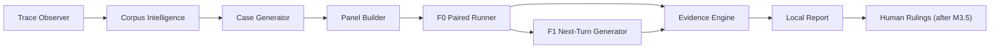

# Triana Labs Preview v1 — canonical execution plan (v4)

Date: 2026-07-31
Status: **active accepted execution plan under `triana-labs/CHARTER.md`**
Canonical planning base: `b963b85`
Owner: Akarsh
Execution orchestrator: primary coding agent operating under `AGENTS.md`

## 2026-08-01 launch-sequence amendment

The owner accepted a narrower 36-hour first-launch sequence. This amendment
supersedes the plan's immediate baseline/candidate component order through the
first public developer preview; it does not delete the longer-term comparison
architecture described below.

The launch deliverable is a local, initially synthetic-only
`GENERATED_MULTI_TURN_SIMULATION` path:

```text
authorized conversational traces
  -> structural and semantic corpus intelligence
  -> grounded proposed personas, intents, and turn policies
  -> distinct generated cases and selected panel
  -> one existing conversational/tool agent via one bounded runner protocol
  -> adaptive multi-turn simulated-user conversations
  -> inspectable transcripts, evaluation evidence, cost, fidelity, and gaps
  -> versioned local evaluated memory for later runs
```

The launch path has no baseline/candidate arms, F0/F1 label, regression claim,
release verdict, global memory, automatic training, universal-agent promise,
hosted ingestion, or SaaS surface. Automated graders remain evidence lanes;
human annotations calibrate them and alone create accepted local rulings. Exact
checkpoint contracts, evaluation datasets, judge thresholds, memory promotion,
runner protocol, provider choice, budgets, and UI/report cut are frozen in
slice packets only after owner discussion. All unchanged privacy, authority,
provenance, test-first, change-budget, and typed-gap rules in this plan remain
binding.

### Closed Checkpoint 1 — LABS-04 Grounded Case Factory

The first launch checkpoint's historical wire is
`internal/LABS04_WIRE_CONTRACT.md`. It
proves or falsifies the trace-to-simulation-design step only:

```text
verified synthetic Observer bundle + linked structural intelligence
  -> deterministic provider-bound evidence projection
  -> one-shot semantic proposal
  -> bounded critique and one revision
  -> deterministic citation/support/identity/diversity/budget gates
  -> five proposed adaptive simulation cases and a blind review packet
```

LABS-04's completed closing experiment uses the owner's Microsoft Foundry
Fireworks `FW-GLM-5.2` deployment, version `1`, through a restricted four-tool
LangChain `create_agent` runtime. Deterministic orchestration replaces the
failed five-case monolith with five bounded one-case slots; no retry or model
fallback exists. Logical invocations and actual provider HTTP exchanges are
reported separately under a USD 25 conservative ceiling. The non-test smoke corpus
is the first 50 physical lines of the tracked HRAI v2 `run_200`
historical-traffic export at source commit
`728f6c5058efe40a16e2aecc9b528b3353f4df4f`, selected SHA-256
`4bb5839771bffe13b33b30cb42cf8cfc4ab1513e9012c10da0923bf58e1e991c`,
labeled synthetic rather than real-user evidence.

Mechanically green generation is not product passage. The 2026-08-02 closing
run produced five requested, valid, and distinct cases with no gaps, repairs,
or duplicate clusters and therefore clears the deterministic machinery gate.
The supported closure routes `triana cases generate` to this runtime only from
an explicit restricted config and adds immutable `triana cases resume`; legacy
config dispatch remains explicit and there is no fallback.
On 2026-08-02, the owner answered yes to all six frozen usefulness questions
for all five cases and confirmed that no accepted case depends on a hidden or
fabricated fact. LABS-04 therefore passed `LABS04_USEFULNESS_V1`. This clears
the gate to discuss and freeze LABS-05; it does not itself authorize target-
agent execution by itself. Judges, memory, UI, real-data support, DeepEval,
and generic agent frameworks remain unauthorized.

### Frozen Checkpoint 2 — LABS-05 Adaptive Multi-Turn Runner

LABS-05 is frozen in `internal/SLICE_PACKET.md` and
`internal/LABS05_TARGET_CONNECTOR_V1.md`. It runs exactly three owner-reviewed
cases as U1/A1/U2/A2/U3/A3 episodes. U2 and U3 are proposed by pinned Foundry
Fireworks `FW-GLM-5.2` only after consuming the immediately preceding opaque
target response and normalized reported tool observations. The first named
target is the existing HRAI Recruiter Chat ReAct HTTP protocol at commit
`728f6c5`, invoked through restricted `HTTP_JSON_V1`; strict
`EXECUTABLE_JSONL_V1` is the customer bridge for other endpoints. The target
owns its prompt, model, tools, orchestration, and target-side state.

The deterministic controller owns identity, sequencing, latest-observation
binding, termination, budgets, logical versus HTTP accounting, atomic evidence
custody, trajectory fingerprints, dedupe, and typed gaps. The exact ceiling is
six simulator and thirty-six target HTTP exchanges, forty-two total, USD
`23.000000`, 180 seconds per episode, and 600 seconds total. Automated
verification uses fakes only; a live run is separately owner-authorized.
Passage requires three valid inspectable nonduplicate trajectories and the
owner's `LABS05_ADAPTATION_V1` turn-level ruling.

Persistent/global memory, model judges, UI, real-data support,
baseline/candidate comparison, hosted execution, generic SDKs, and broad eval
expansion remain outside this checkpoint.

The superseding local implementation completed on 2026-08-03 with 131 focused
connector acceptance tests and 539 repository-wide tests plus the complete
versioned verification gate GREEN. The supported surface remains
synthetic-only. HRAI is the first localhost HTTP mapping, not a Triana-owned
four-tool reconstruction.

Target-internal model calls, retries, token/cost usage, tool traces, and global
state remain target-owned and become typed unavailable evidence when the
endpoint does not report or isolate them. A2A and generic SDK/framework
adoption remain deferred. The owner-authorized one-turn localhost smoke did not
reach chat: HRAI startup could not reach its configured Postgres endpoint and
session creation returned HTTP 500 when its Redis hostname failed DNS. No
session, chat turn, or tool call occurred. The smoke therefore does not clear
the three-trajectory or `LABS05_ADAPTATION_V1` gates; no rerun is authorized by
this record.

On 2026-08-03 Akarsh subsequently authorized the single private real-data
canary frozen in `internal/LABS05_REAL_DATA_CANARY_2026-08-03.md`. That bounded
exception is execution evidence for LABS-05 only. General real-data support,
public artifacts, and repeat execution remain deferred.

The canary attempted three episodes and produced two valid distinct
trajectories plus one partial trajectory. Akarsh's four available adaptation
rulings were Y, N, Y, Y; two required items were unavailable. LABS-05 is
therefore closed as completed-with-gaps and unpassed. The rejected item exactly
echoed the target and inverted user/assistant roles because the simulator did
not receive the verified persona, intent, or turn-policy projection and had no
semantic anti-echo/role gate. The proposed successor eval and smallest repair
are recorded in
`internal/LABS05_SIMULATOR_FIDELITY_REVIEW_2026-08-03.md`; they require a new
frozen slice before implementation or live execution.

## 1. The commitment

The first deliverable is this plan. No Triana Labs implementation worker may
start until the next slice-specific `internal/SLICE_PACKET.md` replaces the
historical Slice 0A packet and freezes that slice's public behavior, change
budget, tests, authority, privacy boundary, provenance, and exact verification.

Subject to the explicit owner gates in this plan, the committed product
deliverable is:

> A public, local-first Triana Labs Preview for conversational, tool-using
> agents. A developer supplies production-derived traces plus explicit
> baseline and candidate execution adapters. Triana derives an inspectable,
> fidelity-labeled case panel; executes both arms freshly against identical
> historical prefixes for three paired trials; optionally continues after
> divergence with a labeled corpus-grounded next-turn generator; and produces
> a deterministic, divergence-first report containing paired transcripts,
> pass^3 stability, honest denominators, comparability, lineage, cost,
> trajectory diversity, typed gaps, and no unsupported verdict.

The repository deliverable includes:

1. versioned public contracts and generated schemas for Labs artifacts;
2. a documented JSONL input path and an optional OTel-shaped mapping;
3. explicit subprocess and, only if owner-approved, HTTP runner adapters;
4. an HRAI reference adapter and redacted demonstration corpus;
5. deterministic panel identity, pairing, outcome, stability, comparability,
   alignment, denominator, diversity, and report machinery;
6. corpus-derived persona, intent, and turn-policy artifacts with provenance
   and fidelity labels;
7. an OpenRouter-compatible next-turn provider boundary with explicit
   provider-named authorization, egress validation, metering, and hard caps;
8. a local CLI and one-command demonstration;
9. a static divergence-first HTML report plus machine-readable report JSON;
10. a paired-transcript view adapted only through the recorded UI allowlist;
11. tests, fixtures, reproducible evidence, installation documentation,
    privacy documentation, provenance entries, and a single local/CI gate;
12. an external M3.5 installation record proving or falsifying the self-serve
    claim before persistent rulings or promotion work begins;
13. a deliberately thin acquisition page for a bounded five-team
    design-partner cohort, with qualification rather than a generic product
    account signup.

M4 persistent rulings and ProtectedCase draft promotion are conditionally
committed: they are built only after M3.5 passes. Hosted services, release
verdicts, deployment control, and live side-effectful world simulation are not
part of this commitment.

## 2. Governing authority and conflict rules

For Labs execution, precedence is:

1. `triana-labs/CHARTER.md`;
2. later explicit entries in `internal/DECISION_LOG.md`;
3. this plan;
4. shared architecture, contracts, engineering, and provenance documents where
   the first three have not superseded them.

`docs/PRODUCT.md` is the suspended Release Review V1 boundary. It does not
authorize Labs behavior. The five implemented V1 contracts in `triana-core/`
remain frozen shared infrastructure and are not modified by this plan.

When evidence and prose conflict:

- checked-in contract fixtures and generated evidence prove machinery;
- the active authority defines intended meaning;
- real-data results are reported as observed and never rewritten to satisfy a
  narrative;
- chat, issue text, a model response, or a favorable demo result cannot
  silently change the product boundary.

## 3. Product outcome, user, and value moment

### 3.1 Eligible user

The user operates a conversational AI agent with:

- observable user, assistant, and ordered tool activity;
- a bounded historical conversation prefix;
- a safe local or staging command that can run baseline and candidate;
- enough reset or stub control to repeat a case without uncontrolled effects;
- permission to use the supplied traces for the configured local/provider
  processing;
- an explicit baseline identity and candidate identity;
- a desire to understand behavioral movement, not receive an automatic ship
  decision.

### 3.2 Ineligible or refused input

Preview refuses or narrows its claim for:

- offline batch, coding, research, or unbounded autonomous workflows;
- raw audio/telephony quality without a qualifying text/tool projection;
- production-only state that cannot be safely reset or stubbed;
- live tools with uncontrolled financial, legal, communication, or destructive
  side effects;
- traces whose use or provider egress is not authorized;
- traces that cannot be redacted before hashing and provider calls;
- arms without a closed comparable execution fingerprint;
- generated or public data presented as real customer behavior;
- fewer than three valid trials per arm for a tier-1 stability claim;
- a missing observation presented as evidence of no change.

### 3.3 First value moment

The report shows one of two honest outcomes:

- a stable, consequential field-level divergence with the exact paired
  transcripts, first divergence point, pass^3 evidence, fidelity, lineage, and
  denominators; or
- an honest no-difference/inconclusive result that shows what ran, what was
  comparable, what varied, what was missing, and why no stronger claim exists.

Neither outcome is a PASS/BLOCK/SHIP verdict.

## 4. Fixed product semantics

### 4.1 Fidelity tiers

- **F0 — shared-prefix resampling:** baseline and candidate receive the same
  recorded historical prefix and execute freshly. The strongest claim is the
  first observed divergence under shared context.
- **F1 — simulated continuation:** after F0 divergence, the next-turn
  generator supplies user turns from corpus-derived persona, intent, turn
  policy, scenario truth, and conversation state. Every F1 observation is
  labeled simulation.
- **Generated-corpus evidence:** any case, grounding artifact, or expected
  vocabulary derived from generated data carries a generated fidelity label.
- A row may carry multiple labels, but the UI and report may never collapse F0,
  F1, public-corpus, customer-corpus, and generated evidence into one
  undifferentiated claim.

### 4.2 Baseline meaning

The baseline is reference behavior, not ground truth.

- `OBSERVED_REFERENCE`: default when no acceptance evidence exists.
- `ACCEPTED_REFERENCE`: only explicit acceptance evidence or a human ruling.
- `KNOWN_FAILURE`: only explicit confirmed failure evidence or a human ruling.
- A divergence from `KNOWN_FAILURE` is displayed as a candidate-improvement
  candidate, never as an automatic improvement verdict.
- A universal-invariant hit is a high-priority flag until a human confirms a
  persistent ruling.

### 4.3 Trial validity

Before outcome construction, each attempt is classified:

- `VALID`: agent-origin behavior was observed under the declared contract.
- `INVALID_TIMEOUT`
- `INVALID_PROVIDER_FAILURE`
- `INVALID_HARNESS_FAILURE`
- `INVALID_MALFORMED_TRACE`
- `INVALID_UNSAFE_EXECUTION_REFUSAL`
- `INVALID_EGRESS_REFUSAL`
- `INVALID_BUDGET_EXHAUSTED`

Invalid attempts:

- remain visible with attempt identity and typed cause;
- count in attempted and gap denominators;
- never form an outcome;
- are never replaced in place by a retry;
- cannot create a terminal-status flip or tier-1 finding.

Retries create new attempt identities. The original failure remains in the
artifact.

### 4.4 Outcome fields

For every valid trial:

```text
outcome := (
  commitment,
  terminal_status,
  tool_name_sequence,
  declared_projection,
)

field_state[T] := NOT_APPLICABLE | MISSING | PRESENT(T)
```

Meanings:

- `commitment`: a domain-observable consequential terminal action.
- `terminal_status`: agent-origin `COMPLETED` or `ABANDONED`; provider and
  harness failures are trial-invalidity states, not terminal behavior.
- `tool_name_sequence`: exact ordered tool names with duplicates preserved.
- `declared_projection`: case-specific, human-declared observable.

Rules:

- field display precedence is declared projection, commitment, terminal
  status, then tool sequence;
- precedence selects the primary display reason only;
- every changed applicable field remains in the report;
- `NOT_APPLICABLE` skips the field;
- `MISSING` marks outcome evidence incomplete at that field, retains lower
  fields as partial observations, and forbids a complete-outcome claim;
- matching mechanical fields produce “no change detected in observed fields,”
  never “behavior unchanged”;
- latency, cost, token use, and turn count are contextual aggregates, not
  outcome fields.

### 4.5 Stability

Default `k = 3` valid trials per arm.

Tier-1 stable flip for a field requires:

```text
baseline: pass^3 on O1
candidate: pass^3 on O2
O1 != O2
```

Rules:

- stability is calculated independently per outcome field;
- fewer than three valid trials on either arm is `INSUFFICIENT_TRIALS`;
- a candidate behavior that appears at pass@3 but not pass^3 is a reliability
  change on the weak-evidence shelf;
- baseline instability is shown as baseline instability, not used as a
  candidate regression claim;
- harmless instability in a lower-precedence field does not destabilize an
  independently unanimous higher field;
- the report prints “pass^3 both arms” and raw trial counts;
- no rerun is allowed solely to obtain a desired tier.

### 4.6 Comparability

The deterministic comparability fingerprint closes over:

- case and historical-prefix identity;
- input/fixture content identity;
- reset policy;
- tool/world contract version;
- baseline and candidate adapter protocol versions;
- runtime, code, prompt, model, provider, tool, retrieval, and configuration
  identities where observable;
- simulator version;
- persona, intent, and turn-policy versions;
- scenario-truth version;
- randomization policy and paired trial index;
- redaction policy version;
- outcome-projection version.

Any undeclared difference is `NON_COMPARABLE`. Known declared differences are
retained in lineage and may be the intended candidate delta. An unresolved
difference cannot support a clean causal claim.

### 4.7 Divergence localization

After validating comparability, event sequences are aligned over:

- event type;
- role;
- tool name;
- normalized consequential arguments;
- explicit observation gaps.

The first unequal aligned event is the divergence point. Alignment never
changes terminal outcome classification. Insertions, deletions, repeated tool
calls, missing results, reordered independent events, and redacted argument
fields remain explicit rather than being silently normalized away.

### 4.8 Aggregate context

- All numeric aggregates use one fixed two-sided comparable case intersection.
- Baseline values are calculated per paired trial index.
- The baseline's observed range is “observed baseline variation,” not a
  statistical noise estimate.
- Candidate movement inside that range is labeled accordingly.
- Categorical values receive no range-based demotion; pass^3 governs them.
- Reports state the number of measures tested.
- Panels below 30 cases display counts, not percentages.
- Per-arm totals never substitute for paired denominators.

### 4.9 Trajectory diversity

The panel records raw run count and effective distinct-trajectory count.

- Similarity inputs and algorithm version are identity-bearing.
- Exact duplicates are deduplicated.
- Near duplicates are either down-weighted or retained with a duplicate-cluster
  label according to the owner-approved M2 contract.
- Deduplication never erases the underlying attempts.
- Duplicate rate, threshold, cluster sizes, and effective N are reported.
- A diversity shortfall weakens the panel claim; it does not become a pass.
- Similar text with different consequential tool behavior cannot be treated as
  a duplicate solely from lexical similarity.

## 5. Authority map

| Concern | Deterministic code | LLM/provider | Human |
|---|---|---|---|
| Contract validation, identity, hashing | owns | none | approves contract changes |
| Case and trial pairing | owns | none | none |
| Denominators and pass^3 arithmetic | owns | none | none |
| Comparability and fidelity labels | owns | supplies declared identity only | approves contract |
| Corpus clustering | validates inputs, records algorithm/version | may propose semantic labels | may review labels |
| Persona, intent, turn policy | versions and validates artifact | proposes from authorized corpus | may correct/approve |
| Next user turn | validates boundary, budget, lineage | generates | judges realism sample |
| Outcome projection | executes approved projection | may propose a projection | declares/approves semantics |
| Finding explanation | binds only to computed facts | may draft | may edit |
| Baseline acceptance/failure | stores explicit evidence | none | creates ruling |
| Persistent ruling | identity/storage only | may propose | confirms |
| Release meaning | none | none | decides |

An LLM output cannot change identity, pairing, a denominator, comparability,
stability, fidelity, or a persistent ruling.

## 6. Privacy, custody, egress, and spend

### 6.1 Custody

- Raw traces, customer code, fixtures, and credentials remain local.
- Nothing is sent to Triana.
- Public artifacts contain only redacted synthetic or explicitly approved
  content.
- Local artifact paths are excluded from logs and portable identities unless
  represented by an approved content hash.

### 6.2 Required order of operations

```text
read local input
→ validate authorization/configuration
→ redact
→ validate redaction result
→ validate provider-named permitted egress
→ hash the redacted provider-bound payload
→ enforce spend/token/turn budget
→ call provider
→ validate response
→ persist lineage and metering
```

Hashing raw content before redaction is forbidden for Labs provider-bound
artifacts because it can preserve a fingerprint of unauthorized content.

### 6.3 Fail-closed conditions

No provider call occurs when:

- provider is unnamed or differs from configured authorization;
- content class is not explicitly permitted;
- redaction fails or leaves a configured sentinel;
- key is absent, malformed, or assigned to another provider;
- endpoint is not the exact configured endpoint;
- projected or accrued spend exceeds the hard cap;
- request would exceed token, turn, case, or panel budget;
- corpus license/consent forbids the transformation;
- a logging sink would receive provider-bound content;
- TLS or provider response validation fails.

### 6.4 Metering

Meter by panel, case, arm, trial, continuation, model, input tokens, output
tokens, provider-reported cost, locally calculated estimate, and refusal
reason. The initial hard ceiling is USD 50 per panel until owner-reviewed M0
evidence changes it. A missing price cannot be treated as zero; the call is
refused unless a conservative configured bound exists.

## 7. Artifact and package architecture

Proposed Labs boundary, finalized per slice before code:

```text
triana-labs/
  schemas/               versioned generated JSON Schemas
  src/triana_labs/
    contracts/           Labs-only artifact models
    privacy/             redaction and egress policy
    adapters/            trace and agent protocol boundaries
    corpus/              clustering and derived assets
    panel/               selection, strata, scenario truth
    execution/           paired runner and attempt ledger
    simulation/          F1 provider boundary and diversity
    comparison/          outcomes, stability, alignment, aggregates
    report/              report model and static projection
    cli/                 thin orchestration and rendering
  tests/
    acceptance/          independent test-author ownership
    fixtures/            independent test-author ownership
    adversarial/         orchestrator ownership
  examples/
    hrai/                permitted, ledgered reference adapter
    minimal/             synthetic installable example
  web/                   report UI only after UI stack decision
  docs/                  install, contracts, privacy, adapters, report
```

`triana-core/` may be consumed through its public canonicalization/hashing
interfaces. Labs must not edit or reinterpret the five V1 contracts. If the
needed public kernel seam does not exist, the slice stops for a bounded shared
infrastructure decision instead of reaching into private internals.

### 7.1 Frozen product component map

The active product is **Triana Labs**. The user-facing CLI command is
`triana`; the active Python package namespace is `triana_labs`. The suspended
proprietary product line is **Triana Release Review**. `triana-core` is the
frozen internal integrity kernel shared by the product lines, not a
customer-facing product name. Its existing package and license boundary are
not silently changed; public distribution requires an explicit migration or
licensing slice.



The component boundaries and inspectable outputs are:

| Component | Responsibility | Primary inspectable output |
|---|---|---|
| Trace Observer | Normalize authorized traces and state what evidence is usable, rejected, redacted, or missing | `corpus/manifest.json`, `normalized_traces.jsonl`, `rejected_traces.jsonl`, `corpus_profile.json` |
| Corpus Intelligence | Derive supported clusters, personas, intents, turn policies, distress signals, support counts, ambiguity, fidelity, and lineage | `intelligence/clusters.json`, `personas/*.json`, `intents/*.json`, `turn_policies/*.json`, `derivation_report.json` |
| Case Generator | Convert observed prefixes, derived assets, failure anchors, scenario truth, and optional change context into executable candidate situations | `cases/case_candidates.jsonl` |
| Panel Builder | Select a bounded, stratified, diverse, identity-stable case set and explain inclusion/exclusion | `panels/panel.json`, `panels/panel.html` |
| F0 Paired Runner | Execute baseline and candidate freshly for three paired trials against identical historical prefixes | `runs/<run-id>/attempts.jsonl`, `execution_summary.json` |
| F1 Next-Turn Generator | Continue divergent cases with corpus-grounded labeled user simulation and measure trajectory diversity | `continuations.jsonl`, `trajectory_clusters.json`, `diversity_report.json` |
| Evidence Engine | Own field outcomes, pass^3 stability, comparability, alignment, denominators, variation, gaps, and finding classification | `runs/<run-id>/report.json` |
| Local Report | Render the evidence artifact without recalculating product logic | `runs/<run-id>/report.html` |
| Human Rulings | After M3.5, persist only human-confirmed meaning across compatible runs | append-only ruling artifacts |

The intelligence layer has two explicit parts:

1. **Offline corpus intelligence:** observes the trace corpus and generates
   supported behavioral assets and candidate cases.
2. **Runtime continuation intelligence:** generates the next realistic user
   turn only after an F0 divergence.

Deterministic code owns corpus membership, support counts, asset/case identity,
lineage, selection, denominators, comparability, stability, fidelity, and
diversity arithmetic. An LLM may propose semantic labels, case descriptions,
scenario-truth candidates, and user turns; it cannot invent support, silently
select the panel, or create accepted truth.

Every portable artifact has:

- `artifact_kind` and schema version;
- stable identity and lineage;
- producing component and version;
- input identities;
- fidelity;
- authorization/redaction policy version where applicable;
- deterministic seed or explicit provider nondeterminism;
- timestamps only when operationally needed, never as hidden identity entropy.

## 8. Public interface plan

The intended CLI surface is:

```text
triana traces validate <jsonl-or-manifest>
triana corpus derive <trace-manifest> --out <directory>
triana panel build <trace-manifest> --assets <directory> --out <panel>
triana preview run <config>
triana preview report <run-manifest> --out <directory>
triana preview demo
```

The CLI is the primary setup and execution surface. The human-facing product
output is a generated local static HTML report backed by the same
machine-readable report artifact. A hosted product dashboard, user account,
trace-upload flow, and cloud execution are not required for Preview v1.

Installation and integration are designed to be delegated to a coding agent.
The repository therefore ships an agent-readable setup contract and a
copyable task that instructs the coding agent to:

- install without changing the customer's agent behavior;
- adapt traces to PreviewTrace;
- configure safe explicit baseline and candidate commands;
- run the deterministic environment/authorization diagnostic;
- stop on unclear reset safety, trace authorization, or provider egress;
- keep the customer adapter within the M3.5 line budget.

The CLI includes an initialization path that creates a minimal versioned
configuration, adapter template, synthetic example, and exact validation
command, plus a diagnostic path that reports trace validity, runner readiness,
reset safety, provider authorization, projected maximum cost, and every
blocker to the first report. Final command spelling is frozen in the relevant
slice packet.

The final spelling is frozen in the relevant slice packet. The interface
obeys:

- stdout is the requested artifact or a concise human result;
- structured safe logs go to stderr;
- success returns zero;
- validation, refusal, invalid execution, partial evidence, and internal
  failure have distinct exit behavior;
- partial evidence may produce a report with a non-zero “completed with gaps”
  status only if the CLI contract explicitly freezes that behavior;
- no command silently discovers credentials, baseline, candidate, provider,
  authorization, fixture, or reset policy from ambient state;
- configuration is one versioned YAML authoring file converted to canonical
  JSON before identity;
- secrets are environment references or OS-secret-store references, never
  stored values in config or artifacts.

### 8.1 Bounded acquisition

Preview does not initially offer a generic “create account” funnel. The public
acquisition surface is a small landing/application page for five
design-partner teams. v0 or an equivalent UI generator may be used for this
disposable marketing page or report mockups, but generated UI is not a source
of product logic, evidence arithmetic, or contract authority.

The page promises a concrete outcome: bring a trace export plus runnable
baseline and candidate, and leave with a behavioral-difference report. It
shows one report image, the three-step local workflow, exact qualification
criteria, and one primary call to apply for the bounded cohort. A repository
link becomes the secondary action when publication gates pass.

The application captures:

- conversational agent and tool-use shape;
- available trace format;
- whether baseline and candidate run safely from a checkout;
- release frequency;
- one recent change or failure worth comparing;
- willingness to spend 60–90 minutes on an observed installation.

The cohort is capped at five accepted teams and one or two onboardings per
week. Selection excludes workflows requiring production credentials,
unbounded side effects, or founder-written integrations. The measured funnel
is application → qualified team → completed installation → report →
would-use-again, not account creation.

## 9. Edge-case register

This register is mandatory input to slice acceptance tests. A slice may add
cases but may not silently remove a relevant row.

### 9.1 Input and schema

| Edge case | Required behavior |
|---|---|
| empty corpus | refuse panel construction with typed reason |
| one trace or one stratum | build only if contract permits; display counts and weak coverage |
| malformed JSON/JSONL | reject exact record and path; no partial hidden ingestion |
| duplicate event/case/trial ID | integrity rejection |
| unknown schema version/kind | unsupported-contract rejection |
| invalid UTF-8, BOM, control data | deterministic rejection |
| huge record/deep nesting | hard resource-limit rejection |
| timestamps missing | allowed only when ordering is independently explicit |
| timestamps tied/out of order | preserve event order rule or reject contradiction |
| unknown event kind | reject, never drop |
| missing tool result | typed observation gap |
| orphan tool result | integrity rejection |
| multiple terminal events | integrity rejection |
| redacted required field | `MISSING`, not empty-string evidence |
| duplicate trace content under different source IDs | content lineage plus duplicate cluster |
| same source ID with different content | identity conflict |
| partially parsed source export | explicit rejected-count and no hidden denominator loss |

### 9.2 Corpus derivation

| Edge case | Required behavior |
|---|---|
| tiny or homogeneous corpus | low-diversity label; no invented personas |
| multilingual/code-switched traces | retain language fidelity; declare unsupported normalization |
| no user-authored turns | F1 derivation unavailable |
| system/bot text mistaken for user | role validation and rejection/gap |
| PII concentrated in cluster label | redact before label generation/persistence |
| rare distress marker | preserve support count and fidelity; no frequency inflation |
| conflicting intents in one trace | multi-label or ambiguity state, never arbitrary single truth |
| empty cluster after redaction | drop with explicit count/reason |
| public and customer corpora mixed | separate provenance/fidelity contributions |
| generated examples dominate | display generated share and block “customer-grounded” claim |
| unstable clustering across same input/seed | slice-blocking deterministic failure |

### 9.3 Panel construction

| Edge case | Required behavior |
|---|---|
| duplicate scenario selected twice | one case identity; selection evidence retained |
| stratum has fewer cases than quota | no replacement from another stratum without declared rule |
| change weighting overwhelms coverage | enforce declared caps and show weights |
| scenario truth absent | field state missing; F1 may be refused |
| known-failure baseline | direction-aware report handling |
| no acceptance evidence | baseline remains observed reference |
| case count below 30 | counts, never percentage-only display |
| random sample reordered input | identical panel under same seed |
| seed changed | new panel identity and lineage |
| manual case override | human action and reason identity-bearing |

### 9.4 Execution

| Edge case | Required behavior |
|---|---|
| baseline command missing | refuse paired run; not first-observation unless contract allows it |
| candidate command missing | refuse run |
| non-zero process exit | invalid harness/agent attempt by frozen mapping |
| timeout before agent output | invalid timeout |
| timeout after observable agent action | preserve observation, but trial validity follows frozen rule |
| partial stdout/malformed trace | invalid malformed trace; retain safe diagnostics |
| stderr contains secrets | redact before logs/artifacts |
| process spawns children | bounded termination and cleanup policy |
| reset fails | abort affected pairing; non-comparable/unsafe |
| side effect detected | immediate refusal and safe teardown |
| arms use different fixture | non-comparable |
| paired seed differs | non-comparable/integrity failure according to contract |
| provider rate limit | provider gap, never terminal behavior |
| retry succeeds | both original and retry attempts remain |
| fewer than k valid trials | insufficient-trials gap |
| cost cap reached mid-panel | stop new calls; keep partial report and exact gaps |
| user interrupts | preserve durable completed attempts; mark interrupted remainder |

### 9.5 Outcomes, alignment, and reporting

| Edge case | Required behavior |
|---|---|
| all fields not applicable | no observable outcome claim |
| high-precedence field missing | incomplete outcome; lower fields shown as partial |
| high field stable, tool order unstable | stable high-field flip plus lower-field instability |
| baseline and candidate both unstable | weak-evidence section, never tier 1 |
| baseline stable, candidate 2/3 | reliability-change section |
| same outcome, different path | path divergence shown; no outcome flip |
| different outcome, no aligned event | alignment gap plus outcome change |
| redacted consequential args | missing/partial alignment evidence |
| insertion/deletion shifts sequence | alignment records edit, not mass false divergence |
| repeated identical tool names | duplicates preserved |
| numeric movement inside baseline range | contextual demotion |
| denominator zero | explicit zero-evaluable gap; never 0% pass |
| no findings | honest no-change/inconclusive report still generated |
| all cases non-comparable | report is gaps-only and explains fingerprint differences |
| report renderer fails | machine-readable report retained; UI failure is not evidence failure |
| explanation model fails | deterministic report remains; explanation gap shown |

### 9.6 F1 simulation and diversity

| Edge case | Required behavior |
|---|---|
| provider unauthorized | no call |
| provider/model changes | new fingerprint; never comparable silently |
| prompt/assets exceed context | deterministic truncation contract or refusal |
| generator returns empty/system/tool turn | schema rejection and typed generation gap |
| unsafe or PII-restoring generation | reject before persistence/use |
| candidate requests unrecorded world action | F1 world-coverage gap |
| recorded stub contradicts scenario truth | non-comparable/fixture gap |
| all continuations converge | diversity failure with effective N |
| lexical variation, same trajectory | near-duplicate cluster |
| lexical similarity, different action | retain distinct trajectories |
| provider response repeated from cache | record cache policy and identity |
| budget exhausted mid-conversation | stop continuation; partial F1 evidence only |
| model refusal | typed generator refusal, not user behavior |
| human realism sample disagreement | retain ratings and fail/narrow the F1 claim |

### 9.7 Privacy and provenance

| Edge case | Required behavior |
|---|---|
| customer owns key but no egress consent | refuse |
| provider alias hides endpoint | refuse until exact provider/endpoint is named |
| redactor crashes | fail closed |
| hash created before redaction | privacy gate failure; artifact invalid |
| raw Blitz quote enters public fixture | block publication |
| derived Blitz asset not synthetic | internal only |
| Agentagon file outside UI exception | refuse reuse |
| allowlisted UI file lacks ancestry confidence | reimplement or stop |
| dependency license incompatible/unknown | do not adopt |
| source contains upstream Agentagon port | do not reuse |
| logs contain raw prompt/path/URL query | test failure and publication blocker |

## 10. Delivery sequence and slice contracts

Every implementation slice follows the three-role serial protocol:
orchestrator entry gate, independent test author with valid RED, orchestrator
test freeze, independent implementation author, and orchestrator exit verdict.
The exact slice packet controls code; this plan controls sequencing and exits.

### First-alpha review checkpoints

The first alpha executes through product-component checkpoints, not isolated
plumbing layers. The milestone labels below remain evidence gates, but the
review order is:

1. **Observe the corpus:** produce the manifest, normalized/rejected traces,
   evidence profile, redaction facts, and exact refusal counts.
2. **Derive corpus intelligence:** produce inspectable clusters, personas,
   intents, turn policies, support counts, ambiguity, lineage, and fidelity.
3. **Generate candidate cases:** produce executable cases with source
   prefixes, asset references, scenario truth, declared outcome projection,
   baseline status, tool/world contract, and fidelity.
4. **Build the panel:** produce a human-inspectable panel showing coverage,
   duplicate clusters, selection reasons, exclusion reasons, and identities.
5. **Run F0:** produce an append-only paired attempt ledger for baseline and
   candidate at k=3.
6. **Run bounded F1:** for divergent cases only, produce labeled
   continuations, provider lineage, metering, and diversity evidence.
7. **Calculate and render evidence:** produce deterministic `report.json` and
   a local `report.html` with paired transcripts and explicit gaps.

Each checkpoint ends with a small review handoff: commit hash, changed files,
recommended code-reading order, production/test line counts, exact reproduction
command, output artifact paths, verification evidence, unverified behavior,
and the next checkpoint proposal. The orchestrator stops for owner review
before expanding to the next component.

The bounded first-alpha target is:

- 25–100 authorized source traces;
- 5–10 generated candidate cases;
- 3–5 selected panel cases;
- k=3 paired F0 trials per arm;
- F1 on at most two divergent cases;
- one provider/model and one subprocess agent protocol;
- one machine-readable report and one generated local HTML report.

This bound is an alpha scope ceiling, not permission to fabricate favorable
coverage. Small, homogeneous, missing, unsafe, or unusable evidence remains
visible and may reduce the produced panel.

### P0 — planning and authority alignment

Outcome: no implementation begins against ambiguous or stale authority.

Deliverables:

- this canonical execution plan;
- active charter and README references aligned;
- append-only decision recording plan-first delivery;
- no Labs implementation or dependency changes.

Acceptance:

- governance verifier passes;
- links resolve;
- active and suspended boundaries are unambiguous;
- diff matches the planning change budget;
- commit uses Conventional Commits and records evidence.

### M0A — source/provenance and safe rerun preparation

Inputs:

- exact HRAI repository commit and files;
- exact current HRAI trace exporter contract;
- baseline, candidate, and A/A control refs;
- operator-authorized provider, endpoint, models, and USD 50 cap;
- redaction policy and synthetic/publication rules.

Outputs:

- provenance entries for each reused/reimplemented file;
- frozen M0 slice packet;
- redaction and egress threat model;
- runner dry-run fixture with no provider call;
- cost projection and abort thresholds.

Acceptance:

- source ancestry/license checks recorded;
- raw customer/Blitz data cannot enter the repo;
- provider call is impossible without explicit authorization;
- dry run proves exact request count and maximum spend;
- A/A control, baseline, and candidate identities are closed.

### M0B — honest HRAI dataset

Inputs: M0A contract and authorized execution.

Outputs:

- baseline ×3, candidate ×3, and control ×3 attempts per selected case;
- immutable attempt ledger including failures/retries;
- redacted local dataset manifest;
- baseline self-agreement report;
- spend and provider usage report;
- publication-safe synthetic sample, not raw customer data.

Acceptance:

- every attempt has side, trial index, case/prefix identity, runtime
  fingerprint, reset policy, and provider identity;
- redaction is verified before hashes and provider calls;
- no rerun-to-green;
- actual spend does not exceed cap;
- real results are reported even if they weaken the demo;
- no implementation milestone is declared from an unreviewed trace.

### M1A — Labs contract kernel and public adapter envelope

Inputs: representative redacted shapes from M0, not copied raw content.

Outputs:

- owner-approved `PreviewTrace` and supporting Labs artifacts;
- strict models and checked-in JSON Schemas;
- JSONL authoring format;
- explicit optional OTel mapping;
- canonicalization/identity integration through public `triana-core` seams;
- adapter conformance CLI and fixtures.

Acceptance:

- minimal and complete valid fixtures;
- missing/unknown/duplicate/resource/tamper cases;
- ordered event semantics;
- frozen V1 schemas unchanged byte-for-byte;
- input adapter can be implemented within the M3.5 200-line ceiling;
- independent test goldens do not come from production code.

Owner gate before tests: exact minimum event vocabulary and whether OTel is a
normative input or a documented mapping only.

### M1B — corpus understanding and derived assets

Inputs: validated, redacted, authorized corpus manifest.

Outputs:

- explainable deterministic clustering baseline;
- versioned persona, intent, and turn-policy files;
- scenario-truth extraction proposal/record;
- Blitz-informed internal mining report;
- public synthetic regenerations labeled `generated, blitz-informed`;
- support counts, corpus mix, ambiguity, and fidelity per asset.

Acceptance:

- identical inputs/seed produce identical membership and artifact identities;
- no unsupported persona/intent is invented as customer truth;
- mixed-source provenance remains separable;
- small/homogeneous/multilingual/no-user-turn cases are covered;
- a human can inspect and correct every derived artifact;
- no raw Blitz conversation or quote enters public output.

### M1C — panel builder

Inputs: validated traces, derived assets, declared change context, seed, and
diversity budget.

Outputs:

- versioned case-panel manifest;
- strata, selection weights, scenario truth, baseline status, and fidelity;
- duplicate and coverage diagnostics;
- declared raw N and planned effective N.

Acceptance:

- order-independent deterministic selection for the same seed;
- no silent stratum substitution;
- case/prefix identity is stable;
- known failure and unaccepted baseline states are distinct;
- panels under 30 use count-oriented report semantics;
- every excluded case has a typed reason.

### M2A — runner protocol and paired F0 execution

Inputs: panel, baseline/candidate adapter configs, fixtures, reset policy, k=3.

Outputs:

- owner-approved subprocess protocol;
- optional HTTP protocol only if separately approved;
- paired attempt ledger;
- timeout, termination, cleanup, reset, safe-side-effect, retry, and
  interruption behavior;
- structured redacted logs and cost/latency context.

Acceptance:

- both arms receive identical historical prefix and paired randomization;
- commands/endpoints are explicit and fingerprinted;
- invalid trials never become outcomes;
- retries append rather than replace;
- reset or side-effect failure stops unsafe execution;
- nondeterministic stub fixtures produce configured valid/invalid patterns;
- process-tree and interruption tests leave no orphaned execution.

Owner gate before tests: subprocess wire protocol, HTTP inclusion, exit-code
mapping, partial-output rule, and bounded process-tree cleanup policy.

### M2B — deterministic diff engine

Inputs: paired validated F0 attempts and closed fingerprints.

Outputs:

- typed field states and outcomes;
- pass^3 stability and weak-evidence classification;
- comparability result;
- event alignment and first divergence;
- denominator ledger;
- observed baseline variation;
- direction-aware baseline context;
- deterministic finding/report model.

Acceptance:

- constructed nondeterministic fixtures reproduce expected tier-1 false
  positive bounds;
- every edge case in sections 4 and 9.5 has black-box coverage;
- same input produces byte-identical output twice;
- invalid/non-comparable/insufficient evidence never enters a finding;
- all changed applicable fields remain visible;
- no verdict language is produced.

### M2C — next-turn generator and F1 continuation

Inputs: authorized derived assets, scenario truth, conversation so far,
provider config, budgets, and frozen tool/world stubs.

Outputs:

- provider-neutral request/response contract;
- OpenRouter-compatible adapter;
- prompt/version lineage;
- redaction/egress gate;
- metering and hard budgets;
- F1 continuation attempts;
- trajectory similarity clusters and effective distinct N.

Acceptance:

- no unauthorized provider call is possible;
- every continuation is fidelity-labeled;
- unrecorded world action becomes a gap;
- duplicate convergence is measured and visible;
- 30-item realism sample uses a frozen rating rubric and blinded ordering
  where practical;
- realism and diversity meet owner-approved thresholds or F1 claims are
  narrowed/failed without blocking truthful F0 output.

Owner gate before tests: generation model(s), realism rubric/pass threshold,
trajectory representation, similarity threshold, duplicate budget, and
deduplicate-versus-down-weight policy.

### M3A — report schema and static projection

Inputs: deterministic M2 report model and selected paired transcripts.

Outputs:

- versioned machine-readable report;
- static HTML report;
- divergence tiers, weak evidence, gaps, lineage, fidelity, denominators,
  cost, variation, and trajectory diversity;
- paired-transcript overlay;
- print/export-safe rendering.

Acceptance:

- UI performs no independent arithmetic or classification;
- every visible claim resolves to machine-readable evidence;
- gaps-only and no-finding reports render successfully;
- keyboard, narrow viewport, long content, redaction, missing-field, and
  large-panel cases pass;
- renderer failure cannot destroy the machine-readable report;
- adapted UI provenance is recorded per file and commit.

Owner gate before UI edit: exact allowlisted source files after ancestry and
license inspection, plus final web stack/package manager.

### M3B — one-command public demo and documentation

Inputs: publication-safe synthetic corpus and all M1–M3 machinery.

Outputs:

- `triana preview demo`;
- install, quickstart, adapter, runner, privacy, report, and troubleshooting
  documentation;
- agent-readable setup instructions and a copyable integration task;
- initialization and deterministic diagnostic commands;
- synthetic reference agent/config;
- generated machine-readable and HTML demo artifacts;
- single local/CI verification command;
- DIY-agent benchmark harness and result.

Acceptance:

- clean clone to report is reproducible;
- a coding agent can complete the documented setup without changing the
  customer's agent behavior or silently crossing a safety boundary;
- no secret, raw customer data, restricted source, or local absolute path is
  published;
- local and CI gates are identical;
- published claims regenerate from checked-in inputs and commands;
- DIY benchmark uses identical inputs and records time, findings,
  denominators, repeatability, and cost;
- if Triana does not beat the DIY agent on a structural axis, M3 fails or the
  product scope is corrected.

### M3.5 — stranger installation gate

Participant:

- operates a real conversational AI agent;
- did not build or contribute to Triana;
- has authority to use the selected traces and execution environment.

Measured protocol:

1. start timer before install documentation is opened;
2. record every clarification and founder intervention;
3. install from a clean environment;
4. adapt a real trace export;
5. configure baseline and candidate;
6. produce and inspect a report;
7. stop timer when the participant can explain the report;
8. count adapter lines excluding comments/generated files;
9. ask whether it found a useful difference or credible no-difference;
10. ask whether the existing process missed anything and whether they would
    use it for another release.

The initial cohort is limited to five qualified teams and paced at one or two
onboardings per week. The application funnel and cohort operations may use a
thin landing page, but the installation and report remain local CLI
experiences.

Pass requires:

- report within 90 minutes;
- no more than 200 adapter lines, target 100;
- no bespoke founder-written integration;
- participant understands fidelity, denominators, and gaps;
- participant considers another use plausible.

Failure blocks M4. It produces a narrow installation/adapter/problem-scope
correction plan; it does not authorize hosted infrastructure or bespoke
services.

### M4A — persistent rulings

Starts only after M3.5 passes.

Outputs:

- versioned ruling identity over case lineage plus divergence class;
- append-only local store;
- explicit human confirmation/reversal;
- deterministic application to a changed candidate;
- audit history and conflict handling.

Acceptance:

- Triana never creates a ruling;
- stale/incompatible ruling identity does not auto-apply;
- corrections append rather than rewrite;
- concurrent/conflicting confirmations are visible;
- the second candidate run surfaces prior confirmed classes and separates new
  classes.

### M4B — ProtectedCase draft promotion

Outputs:

- draft only, using shared kernel contracts;
- source lineage, proposed behavior, evidence, and missing human fields;
- explicit human completion and approval path.

Acceptance:

- no draft is valid as an approved ProtectedCase;
- the five frozen V1 contracts are not modified;
- a human action is required to complete semantic truth;
- missing required meaning remains typed and visible.

## 11. Change-budget policy by slice

Every slice packet must replace placeholders with exact paths. The default
maximum budgets are:

| Slice | Production boundary | Test boundary | Dependencies |
|---|---|---|---|
| P0 | active docs only | governance inspection | none |
| M0A/B | bounded adapter/run scripts and private artifact manifests | safe synthetic fixtures | exact existing provider client or owner-approved one |
| M1A | `triana-labs/contracts`, schemas, CLI validation | contract acceptance/fixtures | prefer shared kernel only |
| M1B/C | corpus/panel modules | synthetic corpus fixtures | owner-approved clustering dependency only if justified |
| M2A | execution/adapters | process/HTTP stub fixtures | standard library preferred |
| M2B | comparison/report model | deterministic constructed fixtures | none expected |
| M2C | simulation/privacy/provider | fake provider and diversity fixtures | exact provider/tokenizer dependency if required |
| M3A/B | report/web/docs/demo | browser/render/install fixtures | owner-approved web stack only |
| M3.5 | evidence record and docs corrections | external protocol artifact | none by default |
| M4 | ruling/promotion modules | append/conflict/migration fixtures | none expected |

Explicitly untouched in every Labs slice unless a separate approved packet
states otherwise:

- `triana-core` frozen public schemas and behavior;
- suspended V1 product meaning;
- historical research;
- unrelated repository formatting;
- restricted Agentagon surfaces;
- raw customer/Blitz data;
- hosted infrastructure.

Any worker stops before:

- editing outside assigned paths;
- adding a dependency;
- changing a contract or acceptance meaning;
- expanding a protocol;
- weakening a test;
- copying from an unrecorded source;
- moving raw or sensitive data into the repository.

## 12. Verification and evidence plan

Each slice defines one local command invoked unchanged by CI. The aggregate
gate eventually covers:

1. governance, decision memory, provenance, and secret scanning;
2. locked dependency installation and license inventory;
3. formatting, lint, and strict typing;
4. schema drift and contract round trips;
5. unit and independent black-box acceptance tests;
6. fixed property seeds and repeatability in fresh processes;
7. tamper, malformed input, resource, and failure injection;
8. redaction, egress, log-safety, and negative architecture guards;
9. subprocess cleanup and provider fake tests;
10. package/build and clean-install parity;
11. static report render and browser smoke checks;
12. artifact-to-document claim consistency;
13. DIY-agent benchmark evidence at every milestone exit.

No skipped lane is reported as passing. A provider/live-data lane can be
explicitly unverified when authorization is absent, but it cannot be the sole
evidence for a required milestone.

## 13. Debugging and failure discipline

Every implementation debugging iteration records:

```text
Observed failure:
Smallest reproduction:
Current hypothesis:
Evidence that would falsify it:
One change attempted:
Result:
Regression test or fixture:
```

One causal intervention is allowed per iteration. A falsified speculative
change is removed or isolated before the next hypothesis. Tests are never
weakened to hide missing, unstable, unsafe, or non-comparable evidence.

## 14. Open owner decision gates

These are the only known material decisions blocking later slices:

1. M1A minimum PreviewTrace/JSONL vocabulary and whether OTel is normative or
   mapping-only.
2. M2A subprocess protocol; whether HTTP ships in v1; exit/partial-output and
   process-tree cleanup rules.
3. Public repository license and contribution policy before publication.
4. M2C generation model, realism rubric/pass threshold, similarity algorithm
   and threshold, duplicate budget, and dedup/down-weight rule.
5. M3 UI source-file allowlist after file ancestry/license inspection, and web
   stack/package manager.
6. Operator spend cap after the initial USD 50 cap is measured.
7. M3.5 participant selection meeting the independence and real-agent rules.

The orchestrator may recommend exact options with evidence. No worker may
invent one. Each accepted choice is appended to the decision log and reflected
in the relevant canonical document before tests freeze.

## 15. Risk, stop, and kill conditions

| Risk | Detection | Required response |
|---|---|---|
| demo has no favorable regression | M0 observed data | report honestly; do not rerun-to-green |
| F1 realism is poor | M2C 30-item review | narrow/disable F1 claim; preserve F0 |
| trajectory diversity collapses | effective N and clusters | report failure; revise generator/panel within scope |
| provider cost is excessive | metering versus cap | stop calls; evaluate cheaper bounded configuration |
| adapter exceeds 200 lines | M3.5 count | simplify public contract; no founder integration |
| report matches DIY agent without structural advantage | benchmark | kill or materially change the tool |
| privacy/egress cannot be proven | negative gates | block provider calls and open-source release |
| provenance cannot clear | ledger/ancestry review | reimplement cleanly or exclude source |
| user cannot understand evidence labels | M3.5 debrief | correct report vocabulary/layout before M4 |
| no external recurring interest | five-user evidence | do not expand into platform infrastructure |

M3.5, privacy, provenance, and DIY-agent failures are release blockers, not
backlog items that can be offset by more features.

## 16. Explicit non-goals

- hosted ingestion, storage, authentication, billing, or managed execution;
- product accounts, hosted trace upload, or a hosted execution dashboard;
- dashboards or generic observability;
- general eval import, scorer authoring, or prompt management;
- automatic ground truth, impact inference, release recommendation, or
  production-incidence prediction;
- SHIP/BLOCK/PASS verdict language;
- live side-effectful tool/world execution in F1;
- universal support beyond conversational, tool-using agents;
- Guard, Learn, rollout, deployment, rollback, or enforcement;
- persistent rulings or promotion before M3.5;
- microservices, Kubernetes, workflow engines, or performance work without a
  measured bottleneck;
- changes to the frozen V1 contract families.

## 17. Definition of done

The committed Preview deliverable is complete only when:

- M0 through M3 pass with retained machine-readable evidence;
- M3.5 passes with an independent real-agent developer;
- every public claim can be regenerated from declared inputs and commands;
- every finding links to paired transcripts, field evidence, stability,
  comparability, fidelity, lineage, and denominators;
- gaps-only and honest no-difference results are first-class;
- privacy, egress, log-safety, provenance, and license gates pass;
- the public install path stays within time and adapter budgets;
- the DIY benchmark shows a structural advantage;
- code, tests, schemas, artifacts, docs, decision log, and decision memory
  agree;
- the actual diff of every slice reconciles with its frozen change budget;
- all worker and orchestrator uncertainty handoffs are complete.

M4 is complete only after that definition is satisfied and the second-run
persistent-ruling test passes.

## 18. Required handoff at every slice exit

```text
What changed:
Why each changed file was necessary:
Change-budget reconciliation:
What was verified (exact commands and artifacts):
What remains unverified:
Assumptions made:
Unexpected findings:
Dependencies added and why:
Out-of-scope problems deliberately left alone:
Known risks or uncertainty:
Human action still required:
```

Use `none` explicitly. The orchestrator distinguishes observed facts, reasoned
inferences, and unresolved uncertainty and alone declares a slice complete.
