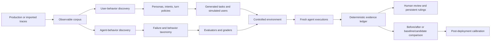
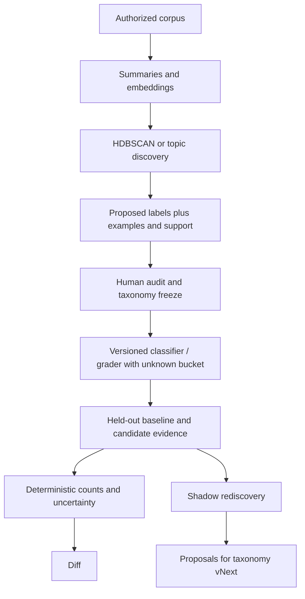

# Triana raw research cookbook

Status: **RESEARCH COOKBOOK — NON-AUTHORITATIVE; INCLUDES OWNER-DIRECTED PLANNING**

Date assembled: 2026-08-06  
Planning addendum: 2026-08-07

Purpose: collect the external research, product references, internal work,
existing implementation, abstractions, contradictions, provenance limits, and
the current minimal/grand planning frames that may inform Triana. This cookbook
does not supersede the Labs charter, current plan, or decision log.

External links were checked on 2026-08-06. Summaries below are paraphrases, not
copied implementation or prose. Repository truth remains governed by
[`triana-labs/CHARTER.md`](../../triana-labs/CHARTER.md), the current plan,
[`docs/PROVENANCE.md`](../../docs/PROVENANCE.md), and the append-only decision
log.

## Evidence labels used in this notebook

- **Source claim** — what the cited source reports. It is not automatically a
  fact about Triana.
- **Triana abstraction** — a concept Triana has already expressed in its own
  contracts, plans, or clean-room implementation.
- **Triana evidence** — something actually exercised or inspected in this
  repository.
- **Hypothesis** — plausible direction that is neither accepted nor proven.
- **Boundary** — a claim, provenance, privacy, or authority limit.

## Owner-directed planning addendum — 2026-08-07

This section records the selected planning frame, not implementation passage.
Akarsh authorized Agentagon reuse repository-wide and selected a four-slice
path whose first public value loop is Trace-to-Eval Preview.

### Minimal plan — first thing out

```text
authorized trace path or self-serve upload
  -> deterministic normalization and complete accounting
  -> evidence coverage and typed gaps
  -> proposed semantic populations and observed behaviors
  -> at most three grounded measurement candidates
  -> exact conversation/trace evidence
  -> human Track / Edit / Defer
  -> stable frozen measurement definition
  -> the same JSON/Markdown/UI projection
```

The first release does not require a customer to import an existing eval suite,
configure deployment simulation, or supply baseline/candidate executions. It
must leave the customer with an evidence-grounded evaluator asset that can be
reused on a later release. Blitz exercises the trace-only path. HRAI and TAU²
exercise the same discovery mechanism plus internal controlled execution and
comparison.

The first customer-facing claim is bounded:

> Give Triana authorized conversational traces. It maps observed behavior,
> shows the evidence, and helps turn the most useful patterns into versioned
> evals that can be rerun against future releases.

The release does not claim that observed behavior is correct, accepted, safe,
or release-blocking. A human ruling supplies normative authority.

### The four slices

#### Slice 0 — authorization and generalized quality corpus

- Treat Agentagon, Kairos/Kairos-AI, HRAI, and the existing Triana components
  as permitted source-mining surfaces under exact ledgering and data/license
  boundaries.
- Freeze one capability-based benchmark-case contract rather than
  dataset-specific product branches.
- Assemble a deterministic synthetic contract pack plus private/hash-addressed
  TAU², HRAI, and Blitz manifests.
- Establish the existing Agentagon/Triana gate and a competent coding agent as
  baselines.
- Produce a machine-readable and human-readable quality report.

Slice 0 is a test bench for the product machinery, not a customer-facing eval
platform and not a replacement for the existing frozen-measurement gate.

#### Slice 1 — canonical Triana engine

- One Python-owned engine performs normalization, evidence coverage, semantic
  discovery, deterministic membership/accounting, candidate qualification,
  Track/Edit/Defer review, freeze, and optional execution/diff.
- Agentagon supplies the cold-start discovery and measurement lifecycle
  mechanisms; Kairos supplies typed evidence gaps, bounded semantic audit,
  blind-quality machinery, and later deterministic recurrence identity.
- Dataset names never control product logic. Capability declarations determine
  which evidence and claims are available.

#### Slice 2 — backend, UI, CLI, and coding-agent projections

- DBOS invokes the same engine used locally.
- S3 retains immutable large artifacts; RDS indexes runs, identities, review
  decisions, and frozen measurements.
- The existing conversation viewer becomes the shared evidence surface.
- UI, CLI, and coding-agent setup consume the same canonical artifacts and do
  not independently recreate analysis logic.

#### Slice 3 — comparative proof and launch

- Blitz proves trace-only usefulness and human acceptance without outcome or
  regression claims.
- HRAI proves A/A restraint and controlled model/prompt behavior movement.
- TAU² proves outcome grounding against official reward/database state plus
  bounded semantic failure explanation.
- A same-input, same-model, same-budget coding-agent control tests whether
  Triana adds durable value beyond a capable one-off analysis.
- The launch artifact includes the bounded quality report, known gaps, and
  unsupported claims.

### Generalized corpus contract

The quality corpus is a benchmark for Triana, not training data and not a new
customer evaluator requirement. Each case declares available capabilities and
optional truth lanes:

```text
case identity and source hash
  + input capability set
      TRACES
      HARNESS_OUTCOME
      RUNNABLE_HARNESS
      MODEL_OR_CONFIG_CONTROL
      PAIRED_EXECUTION
      HUMAN_RULING
  + optional truth
      deterministic accounting
      official outcome
      must-link/cannot-link population pairs
      expected observable signal
      first-broken-link label
      Track/Edit/Defer usefulness ruling
  + allowed and forbidden claims
  + privacy, custody, split, and lineage
```

Missing truth remains missing. It does not become a negative label. This lets
the same harness evaluate trace-only design-partner evidence, benchmark runs
with deterministic outcomes, and controlled agent executions without
hard-coding HRAI, TAU², or Blitz into the engine.

### Quality and correctness base to freeze before implementation

The immediate discussion must settle five independent lanes:

1. **Contract correctness:** complete accounting, resolvable evidence, stable
   identity, deterministic replay, and typed refusal.
2. **Semantic correctness:** blind population-pair agreement,
   claim-to-evidence support, abstention quality, and repeated-run stability.
3. **Measurement usefulness:** top-three Track/Edit/Defer rate, time to an
   accepted evaluator, executability, and explicit numerator/denominator.
4. **Comparison correctness:** A/A false-alert restraint, controlled A/B
   detection, official-outcome preservation, and frozen-definition replay.
5. **Product ROI:** matched comparison against a competent coding agent on
   evidence integrity, durable artifacts, repeatability, time, and cost.

The baseline hierarchy is official harness truth where present, blind human
rulings for semantics, deterministic-only and embedding/clustering ablations
for mechanism lift, the existing customer eval lane for uncovered value, and a
competent coding agent for product ROI. Thresholds must be frozen before final
benchmark results are inspected.

### Grand plan — deployment learning loop

The minimal release is the entry point to the longer deployment-simulation and
behavior-memory thesis:

```text
production evidence
  -> observed user and agent behavior map
  -> human-reviewed frozen measurements
  -> production-derived case/environment mining
  -> shared-prefix baseline/candidate execution
  -> bounded adaptive multi-turn simulation
  -> comparable repeated-trial behavioral diff
  -> bounded L4 explanation over ambiguous failures
  -> human-confirmed new / recurring / fixed behavior memory
  -> export to the customer's eval and release infrastructure
  -> post-deployment calibration against later production evidence
```

The grand plan preserves separate lanes for representative behavior,
known/rare targeted failures, deterministic outcome/state checks, semantic
judgment, simulator fidelity, environment fidelity, and human normative
authority. The first release does not pretend to have completed this loop.

## Raw system map under discussion

This is an inventory, not a committed product shape.



The map intentionally combines several research lines. No single cited system
implements every box.

---

## OpenAI Deployment Simulation

### Primary sources

- OpenAI, **“Predicting model behavior before release by simulating
  deployment,”** 2026-06-16:
  <https://openai.com/index/deployment-simulation/>
- Marcus Williams et al., **“Predicting LLM Safety Before Release by
  Simulating Deployment,”** arXiv:2607.07184, submitted 2026-07-08:
  <https://arxiv.org/abs/2607.07184>
- Experimental HTML of the paper:
  <https://arxiv.org/html/2607.07184>

### Source claims and mechanism

- Sample recent, de-identified conversation prefixes from an older production
  deployment.
- Hold the prefix fixed through a user turn, remove the old assistant response,
  and freshly generate the next response with the candidate model. The paper
  describes comparisons such as candidate `X` over traffic from deployment
  `Y` as `X -> Y`.
- Audit simulated responses for novel undesirable behaviors, then update and
  freeze the behavior taxonomy and graders before using it for measurement.
- Estimate pre-deployment prevalence on the deployment-like prefix
  distribution. After launch, apply the same measurement stack to real traffic
  and test taxonomy coverage, direction of change, and rate calibration.
- The reported study covered about 1.3 million de-identified conversations and
  20 undesirable-behavior categories across GPT-5-series Thinking deployments.
- The article reports a median multiplicative prevalence error of 1.5x, with
  tail errors around 10x. It reports stronger directional accuracy than its
  challenging-prompt baseline for categories with large changes.
- The method did not simply dominate every baseline. The paper reports that its
  overall likelihood advantage over a naive previous-deployment-rate forecast
  was not statistically significant, even though it was useful on meaningful
  changes and better than challenging prompts on several categories.
- The authors isolate environment/resampling fidelity and prompt-distribution
  shift. Environment fidelity explains much of the largest error in their
  experiments.
- For tool-heavy coding-agent trajectories, the tool simulator received richer
  affordances: the original final-turn rollout, the historical repository,
  stored tool-call/response pairs, and read-only connectors. A discriminator's
  ability to distinguish the simulation approached chance only after that
  richer environment was provided.
- Public traffic can still be informative but is weaker. The article reports
  WildChat-seeded estimates as less accurate than recent production prefixes.
- Deployment Simulation complements rather than replaces targeted evals,
  adversarial testing, and red-teaming. It is not designed to discover events
  too rare to appear in the sampled population.
- The published method currently concentrates on regenerating one assistant
  response. The authors did not find meaningful improvement from multiple
  simulated turns in their preliminary experiments, while leaving multi-turn
  fidelity open.

### What Triana has abstracted from it

- **F0/shared-prefix resampling:** baseline and candidate freshly execute the
  same historical prefix. This avoids treating a stored old response as a fresh
  baseline execution.
- **Same-model resampling as a fidelity check:** if an agent/version cannot
  reproduce its own observed distribution within uncertainty, a candidate diff
  cannot be interpreted confidently.
- **Comparability before verdict:** prefix, environment, tools, execution mode,
  and grader lineage are typed evidence, not incidental metadata.
- **Discovery then frozen measurement:** a model may help discover a taxonomy,
  but measurement requires a versioned/frozen classifier or grader and an
  unknown bucket.
- **Post-release checkability:** a predicted behavior-rate change is stronger
  when the same taxonomy and measurement procedure can be applied after launch.
- **Population and tail lanes are different:** representative replay measures
  sufficiently common behavior; targeted/adversarial evals cover known severe
  and rare risks.

### What Triana has not proven

- No full F0 baseline/candidate deployment forecast has been executed.
- No pre-registered prevalence forecast has been validated on later production
  traffic.
- No calibrated error decomposition exists for Triana's environment fidelity,
  prefix shift, graders, or full forecast.
- The current 57-conversation TAU² canary is much too small to establish
  deployment-rate calibration. With zero observations, the rule-of-three
  heuristic gives an approximate 95% upper bound of `3/57 = 5.3%`; it says
  nothing useful about one-in-a-million tail events.
- Triana's proposed F1 multi-turn continuation is an additional system and claim
  beyond the published OpenAI single-response result.

---

## OpenAI Presence

### Primary source

- OpenAI, **“Introducing OpenAI Presence,”** 2026:
  <https://openai.com/index/introducing-openai-presence/>

### Source claims and product shape

- Presence is an enterprise system for bringing voice and chat agents into
  production workflows, not merely an observability dashboard.
- A deployment begins with a bounded job. The enterprise supplies policies,
  standard operating procedures, allowed actions, approval boundaries, and
  escalation conditions.
- The product combines guardrails, approved actions, simulations, evaluation
  tools, production sessions, and a Codex-powered improvement process.
- Production sessions and escalations reveal gaps; Codex proposes changes;
  teams test and approve them before controlled expansion.
- The public description is high-touch: OpenAI and selected integrators work
  with customers to identify workflows, connect systems, establish permissions
  and policies, test, and deploy. This is not evidence of a general self-serve
  trace-upload product.

### What Triana abstracts from it

- An agent's behavior is meaningful only relative to a job, permissions,
  policy, environment, and human escalation boundary.
- The loop extends beyond “run an eval”: production evidence should create
  inspectable improvement proposals and controlled retesting.
- Normative truth comes from the organization or a human ruling. Traces reveal
  behavior and gaps; they do not invent what the agent should have done.

### Boundary

- Presence is adjacent evidence for an end-to-end agent operations loop. It
  does not prove that Triana should copy its product surface, sell to the same
  buyer, or ship the entire loop in one release.

---

## Parloa / AMP

### Primary source

- OpenAI customer story, **“Parloa builds service agents customers want to
  talk to,”** 2026-05-07: <https://openai.com/index/parloa/>
- Parloa product site: <https://www.parloa.com/>

### Naming correction

Parloa is a company and its AI Agent Management Platform uses OpenAI models.
It is not an OpenAI product named “Parola.” The OpenAI page is a customer story.

### Source claims and mechanism

- Subject-matter experts define agent role, instructions, tools, and boundaries
  in natural language.
- One model simulates a caller while another runs the configured service agent.
- Teams inspect the generated conversations before deployment.
- Evaluation combines deterministic checks and LLM-as-a-judge scoring for
  instruction following, tool use, and task completion.
- Separate post-conversation workflows summarize the interaction, classify
  customer intent, and evaluate behavior against defined rules.
- The platform mirrors real production agents and measures realistic concerns,
  including instruction following, API-call consistency, latency, and
  performance.
- Deterministic API chains and event logic remain available where execution
  order must be predictable.

### What Triana abstracts from it

- A useful conversational-agent evaluation can combine a simulated user, the
  real configured agent, deterministic state/outcome assertions, and semantic
  judgments.
- The conversation transcript is the primary inspectable object, while scores
  and summaries are projections over it.
- Agent behavior and user behavior are separate observables. A simulator can
  generate user behavior; it must not grade its own realism or silently supply
  normative correctness.
- Flexible conversation and deterministic workflow verification belong in
  separate evidence lanes.

### Boundary

- The public customer story does not expose Parloa's full algorithms,
  calibration data, or source code. It supports a product pattern, not an
  implementation copy.

---

## Population behavior discovery and macro evaluation

### OpenAI Macro Evals cookbook

Primary source:

- OpenAI Cookbook, **“Macro Evals for Agentic Systems”:**
  <https://developers.openai.com/cookbook/examples/partners/macro_evals_for_agentic_systems/macro_evals_for_agentic_systems>

Source mechanism:

- Preserve rich trace evidence and lower-level eval findings per run.
- Turn each trace into a text/evidence document suitable for population-level
  analysis.
- Use embedding/topic-clustering machinery to discover recurring behavior
  patterns across many runs.
- Keep four concepts separate: the scenario or `case_type`, terminal
  `run_outcome`, local `eval_finding`, and recurring `behavior_pattern`.
- The goal of the discovery layer is not necessarily a perfect universal
  taxonomy. It is to reveal repeated patterns that can be inspected and traced
  back to individual evidence.

Triana abstraction:

- A lower-level L4-style failure judge answers “what appears wrong in this
  trajectory?” A population layer answers “what repeats, where, and how often?”
  They should not be collapsed.
- Embeddings and density/topic clustering are useful in a **discovery lane**.
  A release diff needs a frozen, versioned measurement lane so cluster drift is
  not mistaken for agent drift.
- Every cluster or pattern needs support counts, representative trace links,
  source lineage, an unknown/unassigned population, and explicit instability.

### Clio

Primary sources:

- Anthropic, **“Clio: Privacy-Preserving Insights into Real-World AI Use”:**
  <https://www.anthropic.com/research/clio>
- Alex Tamkin et al., arXiv:2412.13678:
  <https://arxiv.org/abs/2412.13678>

Source mechanism:

- Summarize conversations, embed the summaries, cluster related use, label
  clusters, and arrange them in a hierarchy for population exploration.
- Add privacy layers such as de-identification instructions, minimum support
  thresholds, aggregation, and a final specificity/identification check.
- Use the resulting aggregate view to understand actual use, compare slices,
  and search for unknown unknowns without making raw conversations the default
  analyst surface.

Triana abstraction:

- “User behavior” can mean the empirical distribution of requests, intents,
  styles, and interaction policies—not a hand-authored static persona list.
- Hierarchical corpus intelligence is a discovery and navigation system. By
  itself it is not a before/after causal comparison, an eval, or a statement of
  correct agent behavior.

Privacy counterevidence:

- Meenatchi Sundaram Muthu Selva Annamalai et al., **“CLIOPATRA: Extracting
  Private Information from LLM Insights,”** arXiv:2603.09781:
  <https://arxiv.org/abs/2603.09781>
- The paper attacks heuristic privacy layers in an LLM insight system via
  malicious inserted conversations. Its result is a warning that redaction,
  thresholds, aggregation, and an LLM privacy audit are not a formal privacy
  guarantee.
- **Triana boundary:** local-first processing, provider-named egress,
  pre-egress validation, and explicit disclosure remain product invariants.
  “Clio-like” is not sufficient privacy evidence.

---

## User simulation and conversational-agent benchmarks

### tau-bench

- Shunyu Yao et al., **“tau-bench: A Benchmark for Tool-Agent-User Interaction
  in Real-World Domains,”** arXiv:2406.12045:
  <https://arxiv.org/abs/2406.12045>

Raw contribution:

- Simulated user, conversational tool agent, domain policy, and database-backed
  environment.
- Deterministic evaluation compares the final database state with an annotated
  goal state.
- `pass^k` measures whether behavior remains successful across repeated trials,
  making nondeterministic consistency a first-class result.

Triana abstraction:

- Judge state and outcomes wherever possible, not just eloquence of the final
  response.
- Run repeated trials and expose the denominator. One impressive transcript is
  not reliability.

### tau-squared-bench

- Victor Barres et al., **“tau-squared-bench: Evaluating Conversational Agents
  in a Dual-Control Environment,”** arXiv:2506.07982:
  <https://arxiv.org/abs/2506.07982>
- Upstream implementation: <https://github.com/sierra-research/tau2-bench>

Raw contribution:

- Both user and agent can act on a shared world through tools.
- Tasks are compositionally generated from atomic components.
- The user simulator is constrained by observable state and tool affordances.
- The benchmark separates reasoning errors from communication/coordination
  errors.

Triana abstraction:

- A next-turn generator cannot fabricate unavailable world state or silently
  perform an action that the environment does not authorize.
- Scenario truth, user knowledge, tool permissions, and world mutation are
  independent contracts.

### Mind the Sim2Real Gap

- Xuhui Zhou et al., **“Mind the Sim2Real Gap in User Simulation for Agentic
  Tasks,”** arXiv:2603.11245:
  <https://arxiv.org/abs/2603.11245>

Source result:

- The study ran the full tau-bench protocol with 451 people on 165 tasks and
  compared 31 LLM simulators.
- Reported LLM simulators were overly cooperative, stylistically uniform, and
  deficient in realistic frustration and ambiguity, creating an easier
  evaluation than real humans.
- More capable general models were not automatically more faithful user
  simulators.

Triana abstraction:

- Simulator success is not simulator fidelity.
- Human-rated realism, adherence, adaptation, non-echoing, and outcome pressure
  need their own held-out evaluation. They cannot be inferred from agent task
  completion.

### RealUserSim

- Ming Zhu et al., **“RealUserSim: Bridging the Reality Gap in Agent
  Benchmarking via Grounded User Simulation,”** arXiv:2605.20204:
  <https://arxiv.org/abs/2605.20204>

Source result:

- The authors mine more than 14,000 authentic conversations into 7,275
  executable behavioral profiles.
- They report very low style match for unconstrained generic simulators and a
  meaningful but still incomplete improvement from grounding simulators in
  real behavioral profiles.
- They identify “directive amplification”: explicit persona directives can
  become exaggerated caricatures rather than faithful human variation.

Triana abstraction:

- Production-data mining is not discarded when traces become eval inputs. It
  supplies empirical persona, intent, style, and turn-policy priors to the
  simulator.
- The simulator should retrieve bounded behavioral evidence rather than rely on
  a broad stereotype prompt.
- Fidelity must be measured against held-out real conversations, with leakage
  controls and multiple behavioral dimensions.

### Additional simulator-validation references

- Google Research, **“ConvApparel: A Benchmark Dataset and Validation Framework
  for User Simulators in Conversational Recommenders”:**
  <https://research.google/pubs/convapparel-a-benchmark-dataset-and-validation-framework-for-user-simulators-in-conversational-recommenders-2/>
- **“Synthetic Users, Real Differences: an Evaluation Framework for User
  Simulation in Multi-Turn Conversations,”** arXiv:2605.02624:
  <https://arxiv.org/abs/2605.02624>

Raw use for Triana: maintain a separate simulator-evaluation suite covering
realism, instruction/persona adherence, conversational adaptation, diversity,
task pressure, and downstream effect on the agent evaluation—not a single
“looks human” score.

---

## Eval engineering, environments, and coding-agent workflow

### LangChain Eval Engineering Skill

Primary sources:

- Vivek Trivedy, **“Towards Automating Eval Engineering,”** 2026-07-22:
  <https://www.langchain.com/blog/towards-automating-eval-engineering>
- Repository:
  <https://github.com/langchain-ai/langchain-skills/tree/main/config/skills/eval-engineering>
- Exact commit inspected during this research pass:
  <https://github.com/langchain-ai/langchain-skills/commit/873da02f9fa39840217b47ff2cb46f2c09440f67>

Source mechanism:

- A coding-agent skill inspects the agent repository—prompts, tools, hooks,
  models, services—and optionally mines traces.
- It proposes agent abilities worth testing and interviews the user to select
  and refine them.
- The resulting executable eval uses a task instruction, controlled
  environment, and verifier.
- The agent trajectory and verifier trajectory are both audited to detect
  invalid tasks, bad proxies, and reward hacking.
- The iterative loop is: mine traces, identify a failure, build an eval,
  improve the agent, rerun.

What Triana can abstract without copying:

- Traces tell us the observed tool contracts, failures, and recurring user
  requests. The repository tells us what the agent can access. The human tells
  us which behavior counts as good.
- A self-serve flow can bootstrap the annoying infrastructure and guide the
  expert through capability selection without pretending to infer normative
  truth automatically.
- Task, environment, verifier, and agent trajectory should be separately
  inspectable.
- Outcome/state checks should be deterministic where possible; semantic judges
  should be used only for genuinely semantic criteria and remain identified.

Provenance boundary:

- At inspection time, GitHub did not expose a recognized repository license for
  `langchain-ai/langchain-skills` or `langchain-ai/langsmith-skills` through the
  repository metadata/license endpoint.
- Therefore this notebook records public ideas and links only. It does not copy
  the skill's prose, scripts, prompts, or file structure into Triana. Literal
  reuse requires an explicit license/permission check and a provenance entry.

### LangSmith skills

- Documentation: <https://docs.langchain.com/langsmith/skills>
- Repository: <https://github.com/langchain-ai/langsmith-skills>
- CLI/skills announcement: <https://www.langchain.com/blog/langsmith-cli-skills>

Raw contribution:

- Coding-agent-accessible skills for querying/exporting LangSmith traces,
  turning traces into datasets, and defining/attaching evaluators.
- It reduces context switching for teams already inside the LangSmith data
  model and API.

Triana hypothesis, not decision:

- An open ingestion contract could give the same guided workflow to traces from
  multiple providers or local files. “Open LangSmith” is not itself a wedge;
  provider-neutral input is only an enabling property.

### Harbor

- Repository: <https://github.com/harbor-framework/harbor>
- Documentation/cookbook: <https://harborframework.com/>
- License: Apache-2.0, exposed in the repository.

Raw contribution:

- A framework for running arbitrary agents against reproducible tasks and
  environments, recording trajectories, artifacts, reward, and errors.
- Supports local/container and multiple remote environment providers.
- A task/environment/verifier interchange could let generated evals run across
  multiple agents and models.

Open question:

- Harbor may be an export/runtime target, an implementation dependency, or
  merely a useful contract reference. No adoption decision exists here.

---

## Existing observability and evaluation platforms

These are current product references, not implementation sources.

### Braintrust

- Evaluation overview: <https://www.braintrust.dev/docs/evaluate>
- Compare experiments:
  <https://www.braintrust.dev/docs/evaluate/compare-experiments>
- Online scoring: <https://www.braintrust.dev/docs/evaluate/score-online>
- Remote evals: <https://www.braintrust.dev/docs/evaluate/remote-evals>
- GitHub Action: <https://github.com/braintrustdata/eval-action>

Raw abstraction: datasets + task + scorers; immutable comparable experiments;
offline/online loop; production failures feed future datasets; CI and remote
execution. This is strong existing eval infrastructure, so Triana cannot claim
novelty from “store traces, run scorers, compare experiments.”

### LangSmith

- Evaluation overview: <https://docs.langchain.com/langsmith/evaluation>
- Concepts: <https://docs.langchain.com/langsmith/evaluation-concepts>
- Online rules: <https://docs.langchain.com/langsmith/rules>

Raw abstraction: datasets from manual, production, or synthetic examples;
human/code/LLM/pairwise evaluators; repeated experiments; online sampling and
feedback into offline regression sets.

### Langfuse

- Evaluation concepts: <https://langfuse.com/docs/evaluation/core-concepts>

Raw abstraction: fixed datasets and experiments before deployment, scores from
LLM judges/code/humans/feedback, online trace scoring, and production edge cases
fed back into offline datasets.

### Arize Phoenix

- Documentation: <https://arize.com/docs/phoenix>
- LLM evaluations: <https://arize.com/docs/phoenix/evaluation/llm-evals>

Raw abstraction: open-source tracing and evaluation; evaluator outputs remain
connected to spans/traces for debugging.

### DeepEval

- CI/CD evaluation:
  <https://deepeval.com/docs/evaluation-unit-testing-in-ci-cd>

Raw abstraction: eval cases as test-like artifacts, regression gates in CI,
and conversation-level metrics. This is another reason “pytest for LLMs” is not
a sufficient wedge.

### Maxim

- Multi-turn simulation:
  <https://www.getmaxim.ai/docs/offline-evals/via-sdk/simulation>

Raw abstraction: configurable simulated users, workflows, evaluators, and
multi-turn offline runs already exist commercially.

### Other relevant adjacency

- Coval: <https://www.coval.ai/>
- AgentClash regression testing:
  <https://www.agentclash.dev/platform/agent-regression-testing>
- LaunchDarkly Agent Control:
  <https://launchdarkly.com/platform/agent-control/>
- Promptfoo CI/CD: <https://www.promptfoo.dev/docs/integrations/ci-cd/>

Raw abstraction: the market already contains agent testing, conversation
simulation, trace observability, online monitoring, rollout control, and CI
gates. Any eventual Triana wedge must be more specific than their union.

---

## Existing Triana source material

### Canonical active authority

- [`triana-labs/CHARTER.md`](../../triana-labs/CHARTER.md) — active Labs product
  authority and present claim limits.
- [`internal/TRIANA_LABS_PREVIEW_V1_PLAN_2026-07-31.md`](../TRIANA_LABS_PREVIEW_V1_PLAN_2026-07-31.md)
  — current plan, including launch-sequence amendments and the longer F0/F1
  architecture.
- [`internal/DECISION_LOG.md`](../DECISION_LOG.md) — accepted decisions only.
- [`docs/PROVENANCE.md`](../../docs/PROVENANCE.md) — source permissions,
  clean-room boundaries, dataset limits, and reuse ledger.
- [`internal/WORKING_MEMORY.md`](../WORKING_MEMORY.md) — hypotheses and work
  queues, not accepted truth.

### Prior thesis, wedge, and product research

- [`TRIANA_THESIS_INVESTIGATION_2026-07-29.md`](TRIANA_THESIS_INVESTIGATION_2026-07-29.md)
- [`TRIANA_WEDGE_V1_SPINE_2026-07-29.md`](TRIANA_WEDGE_V1_SPINE_2026-07-29.md)
- [`TRIANA_LABS_PREVIEW_GUARD_LEARN_CONCEPT_2026-07-30.md`](TRIANA_LABS_PREVIEW_GUARD_LEARN_CONCEPT_2026-07-30.md)
- [`BRAINTRUST_HRAI_DOGFOOD_COLD_START_2026-07-30.md`](BRAINTRUST_HRAI_DOGFOOD_COLD_START_2026-07-30.md)
- [`docs/FOUNDER_CONTEXT.md`](../../docs/FOUNDER_CONTEXT.md)

These documents contain previous hypotheses and falsification work. They do not
override later charter amendments or automatically define the next release.

### Current Labs roadmap and journey material

- [`internal/TRIANA_LABS_PUBLIC_PREVIEW_ROLLOUT_PLAN_2026-08-03.md`](../TRIANA_LABS_PUBLIC_PREVIEW_ROLLOUT_PLAN_2026-08-03.md)
- [`internal/LABS03_AGENTIC_DESIGN_COUNCIL.md`](../LABS03_AGENTIC_DESIGN_COUNCIL.md)
- [`internal/LABS06_BACKLOG_2026-08-04.md`](../LABS06_BACKLOG_2026-08-04.md)
- [`internal/LABS07_08_FULL_JOURNEY_WIREFRAMES_2026-08-04.md`](../LABS07_08_FULL_JOURNEY_WIREFRAMES_2026-08-04.md)
- [`internal/LABS07_08_BUILD_HANDOFF_2026-08-04.md`](../LABS07_08_BUILD_HANDOFF_2026-08-04.md)

### Current completed TAU57 slice

- [`internal/SLICE_PACKET.md`](../SLICE_PACKET.md)

This packet is complete and immutable as the historical slice record. It proves
a private non-auth structural dry run through real S3, RDS, DBOS, backend, and
UI. It explicitly does not prove semantic populations, an authenticated
analysis bridge, case generation, simulation, or a deployment diff.

---

## Existing Triana implementation and honest claim limits

| Capability | What exists | Evidence level | What it does not prove |
|---|---|---|---|
| Trace Observer / import contract | PreviewTrace validation, normalization, accepted/rejected accounting, artifact lineage | Implemented and tested | Universal trace compatibility or semantic quality |
| HRAI adapter | Owner-authorized adapter into PreviewTrace | Implemented under provenance ledger | General HRAI product support or permission to expose private data |
| Structural Corpus Intelligence | Deterministic structural grouping and typed semantic authority | Implemented; TAU57 exercised | Semantic user-needs taxonomy or stable behavioral clusters |
| Grounded Case Factory | Model-proposed personas, intents, turn policies, and cases with citation/support/diversity gates | Bounded owner-reviewed LABS04 evidence | Population representativeness or automatic normative correctness |
| Adaptive multi-turn runner | Executes a real target through a constrained connector and generates user turns from case context | Mechanics implemented; bounded HRAI canaries | General user-simulator fidelity, production readiness, or universal target compatibility |
| Simulator fidelity gates | Binding, role, semantic, anti-echo, stopping, diversity, and review contracts | Bounded LABS05/06 evidence | Human-population equivalence or elimination of sim-to-real bias |
| Report/evidence compiler | Typed artifacts, partial evidence, gaps, lineage, deterministic counts | Implemented for existing slices | A release verdict without comparable executions and human authority |
| UI journey | `/behavior`, `/cases`, `/run`, `/results`, `/review`; transcript-first review; reusable `ConversationViewer` | Implemented UI surface | That every screen is backed by semantic/live self-serve execution |
| Self-serve shell | Supabase magic-link auth, agents, prescribed JSONL import, exact accounting, conversation viewer, tier/entitlement concepts | Implemented checkpoint | Authenticated analysis/simulation orchestration |
| Private runtime | S3, RDS, DBOS workflow, backend, and UI exercised for the TAU57 operator canary | Real infrastructure evidence | Public production SLOs, broad tenant isolation, or self-serve launch readiness |
| TAU57 corpus | 57 accepted synthetic benchmark conversations; 54 deterministic structural groups | Reproducible private canary | Semantic populations, rare-event coverage, baseline/candidate drift, or deployment forecasting |
| F0 paired execution | Contract and roadmap | Planned | No completed end-to-end evidence yet |
| F1 next-turn continuation after divergence | Contract, component mechanics, and bounded simulator work | Partial building blocks | No calibrated deployment-simulation claim |
| Post-release forecast validation | Concept only | Not implemented | No rate-calibration evidence |

### Reusable UI element already present

- [`triana-app/components/conversation/ConversationViewer.tsx`](../../triana-app/components/conversation/ConversationViewer.tsx)

This supports the transcript-as-primary-evidence abstraction. It is a UI
component, not the semantic analysis itself.

---

## Production-dataset mining: where it fits

The work was not wasted. It occupies a different stage from a frozen eval.

1. **Observe the distribution.** Mine real user turns, agent turns, tool calls,
   outcomes, errors, and metadata from authorized traces.
2. **Discover candidate behavior.** Use summaries, embeddings, density/topic
   clustering, or semantic analysis to propose user needs, agent patterns,
   personas, intents, turn policies, and failure modes.
3. **Humanly define the normative target.** A domain expert decides which
   capability or failure matters and what “good” means.
4. **Compile a stable eval.** Freeze cases, environment, verifier, taxonomy
   version, and lineage. Separate deterministic assertions from semantic
   judges.
5. **Execute freshly.** Run the actual agent/version in a controlled environment
   repeatedly.
6. **Compare and calibrate.** Diff comparable evidence and later check forecasts
   against production.
7. **Keep discovery running in shadow.** New clusters or unknown behavior become
   proposals for the next taxonomy/eval version, not retroactive relabeling of
   the current release comparison.

This explains why traces can serve both as observational evidence and as seeds
for generated cases without claiming that the original trace is a complete
test or ground truth.

---

## User behavior and agent behavior as separate observables

### User-behavior lane

Possible observed fields:

- task/request/intent distribution;
- language, style, terseness, ambiguity, correction, frustration, persistence;
- information-disclosure policy across turns;
- tool or world actions available to the user;
- escalation, abandonment, reformulation, and recovery behavior;
- temporal/cohort/product/version slices.

Measurement constraint: a taxonomy used to compare two agent arms should be
derived from user/shared scenario evidence that is invariant across arms. If a
“user type” is labeled from how the candidate responded, the taxonomy contains
post-treatment leakage.

### Agent-behavior lane

Possible observed fields:

- instruction/policy following;
- question-asking and clarification;
- tool selection, argument quality, ordering, and error recovery;
- unsupported claims or claimed-but-unperformed actions;
- state transition and task completion;
- escalation, refusal, handoff, latency, and cost;
- semantic failure patterns not captured by deterministic state.

Discovery constraint: behavior categories can be proposed from blinded pooled
arms, frozen, and applied to held-out evidence. Discovering separate taxonomies
for baseline and candidate and then comparing their labels is not a stable diff.

### Relationship

User behavior is the pressure/distribution presented to the system. Agent
behavior is the system's response and action under that pressure. They may be
correlated but they are not interchangeable.

---

## Deterministic, model-based, and human authority

| Owner | Appropriate responsibilities | Must not silently own |
|---|---|---|
| Deterministic code | input validation, IDs, hashes, redaction gates, trial pairing, denominators, counts, stability arithmetic, comparability, lineage, state assertions, typed missing/partial states | semantic meaning not encoded in an accepted rule |
| LLM/model | candidate summaries, labels, personas, intents, turn policies, generated turns, proposed cases, semantic judgments, finding explanations | identity, pairing, denominators, comparability, persistent truth, release decision |
| Human/domain expert | choose important capabilities, define expected/prohibited behavior, approve cases and evaluator meaning, adjudicate ambiguity, create persistent rulings | hidden execution arithmetic or fabricated evidence |

An LLM judge can be useful and still be nondeterministic. Repeated judge calls,
versioned prompts/models, blind evaluation, calibration against human labels,
and uncertainty/abstention are needed if its output affects a comparison.

---

## Early embeddings/HDBSCAN and the “full labels” question

No decision is made here. The raw mechanism that reconciles discovery with a
stable diff is:



- Embedding/HDBSCAN output is useful because it can surface unknown populations
  without a fully hand-written label set.
- It is nondeterministic or unstable across model versions, embedding versions,
  hyperparameters, sampling, and small data changes.
- It should therefore produce proposed discovery artifacts, not silently define
  the measurement denominator on every run.
- A frozen taxonomy/classifier can be more rigid, but that rigidity is useful
  for repeatability. The cost is missed novelty, handled through an unknown
  bucket and a shadow discovery lane.
- Final taxonomy consistency is not automatically “stronger” if the taxonomy is
  wrong. Stability, coverage, inter-rater agreement, held-out classification,
  and unknown-rate monitoring are distinct evals.

---

## L4 failure judge: raw role

“L4” here is an internal shorthand, not a universal industry standard.

Potential role:

- consume the full transcript, tool evidence, environment state, policy/rubric,
  and deterministic assertion outcomes;
- identify a localized semantic failure or abstain;
- return a typed category, explanation, cited evidence spans, confidence, and
  grader identity/version;
- remain separate from clustering, prevalence arithmetic, and final release
  meaning.

Why it still matters:

- deterministic state can prove that a booking was not changed, but may not
  capture that the agent bullied the user, fabricated a policy, misunderstood
  the request, or gave an unusable explanation;
- population clustering can show repeated text/trajectory patterns, but cannot
  by itself say whether the pattern is harmful;
- the judge bridges local semantic interpretation, while humans calibrate it
  and deterministic code aggregates it.

Eval requirements for the judge:

- human-labeled held-out set with ambiguous/abstain cases;
- per-category precision/recall or confusion matrix, not only aggregate
  agreement;
- repeat-run consistency and cross-model/prompt robustness;
- evidence-citation validity;
- adversarial tests for position bias, verbosity, irrelevant citations,
  answer leakage, and reward hacking;
- frozen version during a baseline/candidate comparison;
- report disagreement and unknowns rather than coercing a verdict.

---

## Evaluation of the overall AI system

The system contains several models and therefore needs component and end-to-end
evals.

| Component | Candidate evaluation target |
|---|---|
| Trace normalization | deterministic schema validity, accounting conservation, role/tool ordering, provenance |
| User-behavior discovery | held-out human label agreement, cluster stability, coverage, unknown rate, slice preservation, privacy |
| Agent-behavior discovery | blinded held-out classification, evidence citation, taxonomy stability, novelty recall |
| Case generation | source support, uniqueness, executable preconditions, outcome verifiability, distribution coverage |
| User simulator | human-turn similarity across multiple dimensions, task pressure, adaptation, diversity, leakage, downstream success distortion |
| Environment/tool simulation | same-agent A/A equivalence, state-transition fidelity, error/tool-response fidelity, discriminator test |
| L4 judge | human agreement, repeatability, calibration, abstention, adversarial robustness |
| Comparison engine | deterministic pairing, denominators, repeated-trial stability, missing/non-comparable refusal |
| Deployment forecast | taxonomy coverage, directional accuracy, rate calibration, error decomposition after launch |
| Human workflow | acceptance rate, correction burden, time to a trusted eval, ruling consistency, auditability |

Running the same dataset ten times should not be expected to produce byte-equal
model text. The useful invariants are deterministic identity/accounting and
statistically stable, calibrated conclusions. Repeated runs must preserve all
trials rather than overwrite them.

---

## Internal source and dataset provenance

### Agentagon

- Canonical current boundary: permitted with ledger under Akarsh's explicit
  repository-wide authorization of 2026-08-07.
- Agentagon code, prompts, schemas, tests, reports, and UI may be copied,
  adapted, or reimplemented. Each implementing change still records exact
  source paths/commits, destination, method, licenses, and narrower customer or
  third-party material boundaries.
- The planning target is the smallest cold-start discovery, human review,
  frozen-measurement, and controlled-diff surface—not an unreviewed whole-tree
  vendor import.

### Kairos and Kairos-AI

- Owner-authorized source-mining repositories, subject to exact file/commit,
  license, ancestry, destination, and copied-vs-reimplemented entries in the
  provenance ledger.
- Existing Triana provenance rows already record clean-room reuse of governance,
  deterministic evaluation, repeatability, tamper checks, redaction tests, and
  evidence-to-claim practices from Kairos-AI.
- No blanket permission exists to copy an entire repository without per-surface
  inspection.

### HRAI

- The current provenance ledger records specific HRAI adapter/connector source
  surfaces and commits used for bounded Triana work.
- HRAI is evidence of a real target and trace shape, not universal product
  truth.

### Blitz data

- Design-partner evidence under the provenance ledger.
- May inform internal user-behavior mining and evaluation design.
- Raw conversations, quotes, and PII are not public material.
- Public derived assets must be synthetic and correctly labeled, including the
  existing “generated, blitz-informed” constraint where applicable.
- A behavioral finding from Blitz is evidence about that corpus, not a universal
  customer taxonomy.

### Public corpora and benchmark data

- ABCD, WildChat, tau-bench, tau-squared, and other corpora are license- and
  dataset-card-dependent.
- Public data can bootstrap development and external auditing but should remain
  visibly distinct from customer production evidence.

---

## Edge cases and holes to preserve for the next discussion

- A trace lacks the normative answer: “what happened” is not “what should have
  happened.”
- Uploaded traces may contain only assistant spans, no user-authored turns, or
  broken role ordering; user-behavior derivation must refuse or narrow.
- Fifty-seven conversations may produce dozens of brittle singleton clusters;
  cluster count is not behavioral diversity.
- Duplicate conversations or multiple traces from one conversation can inflate
  support unless conversation identity and sampling units are deterministic.
- Model-generated summaries can erase rare but decisive details before
  clustering.
- User labels derived from agent outcomes leak treatment into the supposed
  baseline distribution.
- Independently rediscovered baseline/candidate clusters are not directly
  comparable.
- A simulator may become more adversarial but less human, lowering agent success
  for the wrong reason.
- A simulator and judge using the same model family can share blind spots and
  create correlated false confidence.
- A final-state pass can hide a harmful or policy-violating path; a transcript
  judge can also falsely fail a valid state transition.
- Tool simulators can leak the expected answer, omit production failures, or
  invent affordances.
- A candidate model can change user behavior after release; historical prefixes
  freeze the old distribution and may miss adoption-induced shift.
- Taxonomy freeze improves measurement consistency but misses novelty; live
  rediscovery improves novelty but breaks longitudinal comparability.
- Small changes in embedding models, prompts, or HDBSCAN parameters can change
  clusters and labels across ten runs.
- Rare severe failures require targeted tests; representative replay alone will
  miss them.
- Online analysis of customer conversations creates prompt-injection and
  privacy-exfiltration risk even after conventional redaction.
- Entitlement/RBAC must control analysis, simulation, provider egress, shared
  reports, and team access independently—not just hide buttons.
- Imported traces may refer to tools or world state that no reproducible test
  environment can reconstruct.
- “Open to all trace providers” still leaves a hard semantic adapter problem:
  roles, sessions, tool state, attachments, errors, and outcomes differ.
- A beautiful behavior UI can outrun the authority of its data. Every label must
  expose whether it is structural, model-proposed, human-confirmed, unavailable,
  or non-comparable.

---

## Raw abstractions currently on the table

These are vocabulary for discussion, not selected scope.

1. **Trace-to-understanding:** accept heterogeneous conversational traces and
   produce inspectable user and agent behavior evidence.
2. **Trace-to-eval:** mine recurring requests/failures, interview the expert,
   and compile executable task/environment/verifier artifacts.
3. **Grounded user simulation:** derive behavioral profiles and next-turn
   policies from authorized production evidence rather than generic personas.
4. **Deployment-like replay:** resample real prefixes against a candidate in a
   faithful environment.
5. **Behavioral diff:** compare frozen user and agent behavior measurements over
   comparable repeated executions.
6. **Deployment forecast:** predict post-release behavior frequencies and
   validate them after launch.
7. **Learning loop:** turn confirmed production findings into future stable
   evals and approved changes.
8. **Open execution/data boundary:** provider-neutral trace import and agent
   execution, potentially with Harbor-compatible tasks.
9. **Guided coding-agent workflow:** keep the expert in the high-value loop for
   capability choice, task design, verifier review, and rulings while automating
   setup and evidence assembly.
10. **Transcript-first UI:** show the conversation, tool/state evidence, and
    provenance before summaries and scores.

---

## Remaining questions deliberately not answered in this cookbook

- Do we use Harbor, export Harbor tasks, or retain a native runner?
- How much of the current UI should be exposed versus feature-gated?
- When does semantic clustering graduate from proposed discovery to a trusted
  measurement taxonomy?
- What exact source paths and commits enter each implementing slice?
- What launch thresholds are frozen for semantic agreement, abstention,
  top-three usefulness, A/A restraint, controlled A/B detection, and coding-
  agent ROI?
- Which parts of the grand deployment-simulation loop are earned by Slice 3
  evidence rather than merely retained as roadmap?

Those require the quality/correctness discussion and frozen slice packets.

---

## Compact bibliography

### Deployment and production behavior

1. OpenAI. “Predicting model behavior before release by simulating deployment.”
   2026. <https://openai.com/index/deployment-simulation/>
2. Williams, Marcus, et al. “Predicting LLM Safety Before Release by Simulating
   Deployment.” arXiv:2607.07184, 2026.
   <https://arxiv.org/abs/2607.07184>
3. OpenAI. “Introducing OpenAI Presence.” 2026.
   <https://openai.com/index/introducing-openai-presence/>
4. OpenAI. “Parloa builds service agents customers want to talk to.” 2026.
   <https://openai.com/index/parloa/>

### Population intelligence and privacy

5. OpenAI Cookbook. “Macro Evals for Agentic Systems.”
   <https://developers.openai.com/cookbook/examples/partners/macro_evals_for_agentic_systems/macro_evals_for_agentic_systems>
6. Tamkin, Alex, et al. “Clio: Privacy-Preserving Insights into Real-World AI
   Use.” arXiv:2412.13678, 2024. <https://arxiv.org/abs/2412.13678>
7. Anthropic. “Clio: Privacy-Preserving Insights into Real-World AI Use.”
   <https://www.anthropic.com/research/clio>
8. Annamalai, Meenatchi Sundaram Muthu Selva, et al. “CLIOPATRA: Extracting
   Private Information from LLM Insights.” arXiv:2603.09781, 2026.
   <https://arxiv.org/abs/2603.09781>

### User simulation

9. Yao, Shunyu, et al. “tau-bench: A Benchmark for Tool-Agent-User Interaction
   in Real-World Domains.” arXiv:2406.12045, 2024.
   <https://arxiv.org/abs/2406.12045>
10. Barres, Victor, et al. “tau-squared-bench: Evaluating Conversational Agents
    in a Dual-Control Environment.” arXiv:2506.07982, 2025.
    <https://arxiv.org/abs/2506.07982>
11. Zhou, Xuhui, et al. “Mind the Sim2Real Gap in User Simulation for Agentic
    Tasks.” arXiv:2603.11245, 2026.
    <https://arxiv.org/abs/2603.11245>
12. Zhu, Ming, et al. “RealUserSim: Bridging the Reality Gap in Agent
    Benchmarking via Grounded User Simulation.” arXiv:2605.20204, 2026.
    <https://arxiv.org/abs/2605.20204>
13. Google Research. “ConvApparel: A Benchmark Dataset and Validation Framework
    for User Simulators in Conversational Recommenders.”
    <https://research.google/pubs/convapparel-a-benchmark-dataset-and-validation-framework-for-user-simulators-in-conversational-recommenders-2/>
14. “Synthetic Users, Real Differences: an Evaluation Framework for User
    Simulation in Multi-Turn Conversations.” arXiv:2605.02624, 2026.
    <https://arxiv.org/abs/2605.02624>

### Eval engineering and platforms

15. Trivedy, Vivek. “Towards Automating Eval Engineering.” LangChain, 2026.
    <https://www.langchain.com/blog/towards-automating-eval-engineering>
16. LangChain. Eval Engineering Skill repository.
    <https://github.com/langchain-ai/langchain-skills/tree/main/config/skills/eval-engineering>
17. LangSmith Skills documentation.
    <https://docs.langchain.com/langsmith/skills>
18. Harbor Framework. <https://github.com/harbor-framework/harbor>
19. Braintrust. “Evaluate systematically.”
    <https://www.braintrust.dev/docs/evaluate>
20. LangSmith. “Evaluation.”
    <https://docs.langchain.com/langsmith/evaluation>
21. Langfuse. “Evaluation Core Concepts.”
    <https://langfuse.com/docs/evaluation/core-concepts>
22. Arize Phoenix. “LLM Evals.”
    <https://arize.com/docs/phoenix/evaluation/llm-evals>
23. DeepEval. “Unit Testing in CI/CD.”
    <https://deepeval.com/docs/evaluation-unit-testing-in-ci-cd>
24. Maxim. “Simulation.”
    <https://www.getmaxim.ai/docs/offline-evals/via-sdk/simulation>
25. LaunchDarkly. “Agent Control.”
    <https://launchdarkly.com/platform/agent-control/>
26. Promptfoo. “CI/CD Integration for LLM Eval and Security.”
    <https://www.promptfoo.dev/docs/integrations/ci-cd/>
