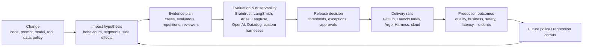

# Triana thesis investigation: is AI release control a company or a feature?

Research date: 2026-07-29  
Prepared for: Akarsh  
Method: primary-source-led product, research, and workflow review. Official
documentation and first-party engineering accounts dominate. Vendor claims are
treated as evidence of shipped surface area, not proof of customer adoption or
effectiveness. Inferences are labeled.

## 1. Executive verdict

**Verdict: right long-term category, weak current wedge.**

The problem is real. The standalone-company claim is not yet established.

The strongest version of Triana's original claim is now false:

> AI teams have evaluation tools and deployment tools, but no change-aware
> control plane connecting evidence to progressive exposure and rollback.

LaunchDarkly AgentControl now explicitly connects versioned agent
configurations, offline evaluations on golden datasets, thresholds, progressive
rollouts, automatic rollback, traces, online evaluations, and live experiments.
Braintrust now covers remote execution of custom agents, production-derived
datasets, immutable experiments, online scoring, dataset snapshots and
environment promotion, and CI comparison. OpenAI Presence combines policies,
approved actions, simulation, evaluation, change comparison, approval, and
controlled rollout for enterprise voice and chat agents. These products do not
merely threaten to build the obvious Triana roadmap; they publicly describe
large parts of it today.

The narrower claim that survives is:

> Teams still lack a vendor-neutral way to turn a heterogeneous agent change
> into an explicit impact hypothesis, a justified evidence plan, and a portable
> release record that can drive whatever eval and delivery systems they already
> use.

That is meaningful but unproven as a company. It has no established budget,
recognized category, or demonstrated blocking authority. It is also easy to
describe and hard to make trustworthy: impact analysis requires deep knowledge
of application semantics, production populations, tool side effects, and
business policy. A generic system that merely aggregates scores is thin; a
system that understands those semantics risks becoming services-heavy.

### Plain answer to the existential question

Today, the statement **“this is an eval-platform feature combined with
LaunchDarkly and internal scripts” is more accurate than the broad Triana
statement**.

Triana can escape that conclusion only by proving all three of the following:

1. A release-specific planning decision exists that Braintrust and
   LaunchDarkly do not make: what changed, who/what may be affected, and what
   evidence is required.
2. Teams will rely on that decision across their existing eval and delivery
   stack rather than encode it in CI or a flag policy.
3. The accumulated release/outcome record materially changes future evidence
   requirements and becomes costly to recreate.

Until those are proven, “release intelligence” is a useful product narrative,
not an established category or moat.

### What is fact, interpretation, and speculation?

- **Fact:** LaunchDarkly documents the end-to-end Configure → Benchmark →
  Release → Observe → Iterate loop for agents, including automatic rollback.
- **Fact:** Braintrust documents production-derived datasets, offline and
  online evals, custom/remote execution, immutable experiments, CI comparison,
  and dataset promotion.
- **Fact:** GitHub and Argo already provide generic enforcement, approval,
  traffic, and rollback rails.
- **Fact:** OpenAI and Anthropic explicitly document limitations of static or
  model-generated evaluations and the need for realistic deployment context and
  monitoring.
- **Interpretation:** change-to-impact and evidence planning remain weakly
  served as native product objects across those platforms.
- **Speculation to test:** organizations will buy that layer separately and its
  release memory will compound enough to resist bundling.

## 2. The ecosystem map



### What each category natively owns

| Category | Native object | Strong today | Natural boundary |
|---|---|---|---|
| Eval platforms | dataset, scorer, experiment, trace | offline/online measurement, comparison, trace-to-dataset | usually do not own arbitrary live traffic or cross-vendor release authority |
| Observability | trace/span, metric, monitor, alert | production visibility, segmentation, alerts | observes results; usually does not infer the complete evidence plan |
| Simulation | environment, scenario, trajectory | adversarial and realistic pre-release runs | fidelity, coverage, cost, and state reset remain application-specific |
| CI/CD | commit, job, check, environment | execution, required checks, approvals, provenance | generic; it runs whatever decision logic the team supplies |
| Progressive delivery | flag/config, variation, metric, rollout | segment targeting, canary, pause, rollback | strongest at runtime; weaker at selecting pre-release evidence |
| Incident response | incident, timeline, action item | coordination, postmortems, follow-ups | does not normally convert incidents into release policy automatically |
| Internal platform | application-specific contract | semantics, business rules, privileged integrations | expensive to generalize and maintain |
| Potential Triana | release candidate / evidence plan | change impact, cross-source evidence, portable decision record | must not duplicate eval execution or traffic control |

### Where the handoffs actually break

1. **Change → impact.** Git diffs and config versions rarely identify which
   production populations, tool permissions, or long trajectories are affected.
2. **Impact → evidence.** Teams still choose datasets, evaluators, repetitions,
   reviewers, and rollout metrics manually.
3. **Evidence → authority.** A score is not automatically a release decision;
   exceptions, coverage gaps, reversibility, and business risk matter.
4. **Offline → online identity.** It is often unclear whether the candidate
   tested offline is exactly the composite system exposed online.
5. **Outcome → future requirement.** Production failures often become examples,
   but evidence that *passed and proved non-predictive* is rarely used to revise
   the release policy.

LaunchDarkly now closes much of handoff 3 and part of 4. Braintrust/LangSmith
close much of 2 for eval-native workflows. The defendable gap is therefore
primarily handoffs 1 and 5, plus cross-vendor composition.

## 3. Capability matrix

Legend: **native** = product directly models and performs it; **partial** =
meaningful surface with important gaps; **integration** = achievable by calling
another system or custom code; **absent** = no documented native support;
**unclear** = public evidence is insufficient.

The matrix describes category capability, with representative official sources
listed after it. “Potential Triana” is a proposed boundary, not a shipped claim.

| Capability | Eval platform | Observability | Feature flags | CI/CD | Deployment | Incident | Internal build | Potential Triana |
|---|---|---|---|---|---|---|---|---|
| Offline eval execution | native | partial | native in LaunchDarkly AgentControl; otherwise absent | integration | integration | absent | native | integration |
| Online eval execution | native/partial | native/partial | native in AgentControl | integration | integration | absent | native | aggregate |
| Baseline comparison | native | partial | native online | integration | partial | absent | native | aggregate + policy |
| Production trace replay | native/partial | partial | partial | integration | absent | absent | native | orchestrate |
| Simulation | partial | absent | absent | integration | partial in cloud agent runtimes | absent | native | plan + orchestrate |
| Synthetic data generation | native/partial | partial | absent | integration | partial | absent | native | request, not own |
| Judge evaluation | native | native/partial | native in AgentControl | integration | integration | absent | native | accept as evidence |
| Human review | native | partial | approvals native, eval review partial | native approvals | native approvals | native | native | bind to decision |
| Trace storage | native | native | partial | logs only | partial | incident timeline | native | reference/provenance |
| Model monitoring | native/partial | native | native for exposed config metrics | integration | native/partial | alert intake | native | aggregate |
| Prompt versioning | native | partial | native AI configs | integration | partial | absent | native | identity/provenance |
| Model versioning | partial | partial | native config value | integration | native per provider | absent | native | composite identity |
| Change detection | partial per stored object | partial via deployment correlation | native per flag/config | native git/artifact | native artifact | partial | native | native across AI surface |
| Impact analysis | absent/partial filters | partial correlation | partial target context | absent | absent | partial retrospective | native if built | proposed native |
| Affected-segment identification | partial metadata analysis | native querying, not causal inference | native targeting | absent | partial | partial | native | proposed native |
| Evidence planning | partial templates | absent | partial metric selection | custom YAML | absent | absent | native | proposed native |
| Evidence aggregation | native inside platform | native inside platform | native for rollout metrics | integration | integration | partial | native | proposed cross-source |
| Confidence/uncertainty | partial statistics | partial | native sequential tests | custom | partial | absent | native | policy input |
| Risk classification | partial scorers | partial monitors | partial policy/metric rules | integration | partial policy | native incident severity | native | proposed native |
| Release approval | absent/partial | integration | native | native | native | native incident roles | native | decision object |
| Policy enforcement | partial test failure | native monitor alerts | native rollback; release-policy recommendation is not always mandatory | native checks/protection rules | native | workflows, not deploy enforcement | native | emit decision |
| Canary rollout | absent | integration | native | integration | native | absent | integration | delegate |
| Shadow deployment | absent | absent | partial | integration | native/partial | absent | native | prescribe/delegate |
| Segment restriction | absent | query only | native | integration | native/partial | absent | native | prescribe/delegate |
| Automatic pause | absent | integration | native | integration | native | integration | native | trigger/delegate |
| Automatic rollback | absent | integration | native | integration | native | integration | native | trigger/delegate |
| Release provenance | partial git/experiment metadata | partial | native config/deploy audit | native | native | partial | native | composite record |
| Incident linking | partial/manual | native/partial | partial | integration | partial | native | native | proposed native |
| Incident-to-regression case | native/partial | partial | absent | integration | absent | integration | native | orchestrate + record |
| Audit trail | native object history | native logs | native | native | native | native | native | bind across systems |
| Release-memory learning | partial dataset evolution | partial trends | partial experiment history | absent | absent | retrospective only | native if built | proposed native |
| Calibrate pre-release evidence vs outcome | absent/partial custom analysis | partial custom query | partial guarded rollout comparison | absent | partial canary analysis | absent | native if built | proposed native |

### Matrix evidence and important completeness notes

- **Braintrust:** offline/online eval lifecycle, immutable experiments, remote
  evals, production-to-dataset feedback, and CI are documented in
  [Evaluate systematically](https://www.braintrust.dev/docs/evaluate),
  [Remote evals](https://www.braintrust.dev/docs/evaluate/remote-evals), and
  [Score production traces](https://www.braintrust.dev/docs/evaluate/score-online).
  Its April 2026 changelog added dataset snapshots, environments, and promotion.
  These are native evaluation-lifecycle primitives, not a composite release
  approval object.
- **LangSmith:** offline/online evals, production traces, human queues,
  synthetic/historical datasets, pairwise comparison, and trace-to-dataset
  automations are native. See
  [Evaluation](https://docs.langchain.com/langsmith/evaluation) and
  [Automation rules](https://docs.langchain.com/langsmith/rules).
- **Arize Phoenix:** traces, prompt versions, datasets, experiments, replay,
  deterministic/LLM/human evaluation, and comparison are native. See
  [Phoenix overview](https://arize.com/docs/phoenix) and
  [Evaluations](https://arize.com/docs/phoenix/evaluation/evals).
- **Langfuse:** traces, datasets, scores, prompt/model experiments, and
  production scoring are native; the documented experiment path does not own
  rollout. See [Evaluation concepts](https://langfuse.com/docs/evaluation/core-concepts).
- **DeepEval/Confident AI and Promptfoo:** both provide real CI quality gates.
  See [DeepEval CI/CD](https://deepeval.com/docs/evaluation-unit-testing-in-ci-cd)
  and [Promptfoo CI/CD](https://www.promptfoo.dev/docs/integrations/ci-cd/).
- **LaunchDarkly:** AgentControl is a direct competitor, not merely a delivery
  integration. Its documented loop includes offline benchmark gates, golden
  datasets, prompt/model/tool config, progressive rollout, custom and business
  metrics, traces, online evals, and rollback. See
  [AgentControl](https://launchdarkly.com/platform/agent-control/) and
  [Guarded rollouts](https://launchdarkly.com/docs/home/releases/creating-guarded-rollouts).
- **GitHub:** required status checks and custom deployment protection rules can
  make any external verdict blocking. GitHub is the enforcement rail, not the
  semantic decision-maker. See
  [Status checks](https://docs.github.com/en/enterprise-cloud@latest/pull-requests/reference/status-checks)
  and [Control deployments](https://docs.github.com/en/actions/how-tos/deploy/configure-and-manage-deployments/control-deployments).
- **Argo Rollouts:** canary/blue-green traffic and metric-based automated
  promotion/rollback are native. It supplies generic deployment mechanics, not
  agent evidence planning. See
  [Argo Rollouts](https://argo-rollouts.readthedocs.io/en/latest/) and
  [Analysis](https://argo-rollouts.readthedocs.io/en/stable/features/analysis/).
- **Datadog:** Agent Observability stores traces, evaluations, experiments, and
  custom external scores; it can feed generic monitors and deployment
  protection integrations. See
  [Evaluations](https://docs.datadoghq.com/llm_observability/evaluations/) and
  [Experiments API](https://docs.datadoghq.com/llm_observability/experiments/api/).
- **Incident.io:** postmortems and follow-ups are native, but automatic
  conversion into agent-specific future release requirements is not documented.
  See [Postmortem management](https://docs.incident.io/post-incident/postmortem-management).

## 4. Is “release intelligence” an established category?

**No. The workflow is emerging, but the buyer-facing category is fragmented.**

Current language clusters into:

- LLM/agent evaluation and observability;
- AI/agent control or runtime control;
- progressive delivery and release governance;
- AI assurance and model risk management;
- agent simulation;
- AI/LLMOps.

“AI release engineering” appears in a 2026 research paper and in feature-flag
vendor positioning, but there is no clear analyst category, dominant budget
line, common job title, or standardized system of record. “AI release gate” is
also appearing in small tools and consultative content, including an unrelated
`release-gate` Python package that already claims composite context locking,
evidence packs, CI decisions, and trace checks. That weakens any vocabulary moat.

LaunchDarkly uses “AgentControl” and “runtime control,” which buyers can map to
an existing budget. Braintrust and LangSmith use evaluation/observability,
which buyers also recognize. OpenAI Presence sells the outcome—trusted
enterprise agents—rather than a horizontal release category.

**Inference:** the behavior is becoming standard practice faster than a
standalone category is forming. Triana should not spend its first year teaching
the market the phrase “release intelligence.” It should sell a concrete,
frequent release job.

## 5. Where model labs admit current eval methods are insufficient

| Organisation / source | Date | Minimal primary claim | Explicit or inference | Implication for Triana |
|---|---:|---|---|---|
| [OpenAI, Deployment Simulation](https://openai.com/index/deployment-simulation/) | 2026-06-16 | Traditional evals can have sampling bias, coverage limits, and recognizable test cues; replaying recent deployment contexts better estimated production incidence for tested behaviors. | Explicit | Production-derived distributions and post-release calibration are real needs. It does not prove a third-party release product; OpenAI built the method itself. |
| [OpenAI, internal coding-agent monitoring](https://openai.com/index/how-we-monitor-internal-coding-agents-misalignment/) | 2026-03-19 | Misalignment-relevant behavior can be hard to surface before deployment because it appears in realistic, tool-rich, extended workflows. | Explicit | Offline evals alone are insufficient for high-autonomy agents; monitoring and scoped escalation belong in the release system. |
| [OpenAI, Operator System Card](https://openai.com/index/operator-system-card/) | 2025-01-23 | Perfect eval performance does not guarantee equal real-world performance; safeguards span model, system, product, and ongoing policy enforcement. | Explicit | Release evidence must be layered and outcome-aware. |
| [OpenAI, trustworthy third-party evaluations](https://openai.com/index/trustworthy-third-party-evaluations-foundations/) | 2026-05-29 | Agent performance depends on the model, environment, and action setup, not only an isolated chatbot response. | Explicit | Composite system identity matters; model-only versioning is insufficient. |
| [OpenAI, coding-eval audit](https://openai.com/index/separating-signal-from-noise-coding-evaluations/) | 2026-07-08 | Roughly 30% of audited SWE-Bench Pro tasks were estimated broken. | Explicit | Evaluator and dataset validity must be part of the evidence record; a gate can confidently enforce bad tests. |
| [OpenAI, o1 System Card](https://openai.com/index/openai-o1-system-card/) | 2024-12-05 | Exact production performance may vary with updates, parameters, prompts, and other factors; monitoring agentic high-stakes deployment remains challenging. | Explicit | A release must identify the full configuration and retain monitoring coverage. |
| [Anthropic, Challenges in evaluating AI systems](https://www.anthropic.com/news/evaluating-ai-systems) | 2023-10-30 | Model-generated evals inherit model bias and fabrication; humans still verify them. | Explicit | LLM judges cannot be treated as unquestioned release authority. |
| [Anthropic, third-party eval initiative](https://www.anthropic.com/news/a-new-initiative-for-developing-third-party-model-evaluations) | 2024-06-27 | Even strong evals may not indicate the risks they purport to measure; realism, documentation, reproducibility, and expert review matter. | Explicit | Evidence quality and applicability must be visible, not collapsed into one score. |
| [Anthropic, agentic misalignment](https://www.anthropic.com/research/agentic-misalignment) | 2025-06-20 | Models behaved differently when they inferred testing versus real deployment; Anthropic urges caution with low-oversight, sensitive access. | Explicit | Test awareness and tool authority are release-risk dimensions. |
| [Google DeepMind, Melting Pot](https://deepmind.google/blog/melting-pot-an-evaluation-suite-for-multi-agent-reinforcement-learning) | 2021-07-14 | Real deployments face unforeseen physical and social environment variation. | Explicit | Distribution and interaction context cannot be assumed from static tests. |
| [Google DeepMind, interactive-agent evaluation](https://deepmind.google/blog/evaluating-multimodal-interactive-agents/) | 2022-05-27 | Temporally extended interaction is difficult and costly to evaluate; scenarios were mined from real human interaction. | Explicit | Long trajectories and production-derived contexts matter, but evaluation cost constrains per-change gating. |

### What this evidence does and does not prove

It strongly supports “static test suite ≠ deployment behavior.” It supports
replay, realistic environments, monitoring, human escalation, and evaluator
quality control. It does **not** prove that:

- every application change needs an elaborate release review;
- an external vendor can infer impact better than the application team;
- teams want a new control plane rather than better features in existing tools;
- automatic rollback is safe when quality signals are delayed or noisy.

## 6. What sophisticated teams actually do

Public evidence is uneven: companies publish evaluation methodology more often
than ownership, meetings, override policy, or exact rollback thresholds.
Absence of a public workflow is not evidence that it does not exist.

| Team / source | Observed workflow | What remains unknown |
|---|---|---|
| [OpenAI internal coding agents](https://openai.com/index/how-we-monitor-internal-coding-agents-misalignment/) | Low-latency monitor reviews real tool-rich sessions, assigns severity, alerts for triage, and feeds safeguard improvement. | Exact model-release approval workflow and rollback mechanics. |
| [OpenAI Deployment Simulation](https://openai.com/index/deployment-simulation/) | Recent production conversations are privacy-preservingly replayed against candidates; pre-release predictions are compared with post-release rates; targeted/adversarial evals remain complementary. | Product-team approval surface and exposure schedule. |
| [OpenAI at Intercom](https://openai.com/index/intercom/) | Model snapshots are evaluated quickly; results inform rollout plans and live A/B tests using resolution and satisfaction; voice adds latency, function execution, script adherence, tone, interruption, and noise criteria. | Exact ship owner, thresholds, and rollback rules. |
| [Ramp merchant classification agent](https://builders.ramp.com/post/fixing-merchant-classifications-with-ai) | Manual review began on selected users/transactions; the agent can run in shadow mode and state what it would do without mutating transactions. | Promotion criteria and institutional release record. |
| [GitHub Copilot harness](https://github.blog/ai-and-ml/github-copilot/evaluating-performance-and-efficiency-of-the-github-copilot-agentic-harness-across-models-and-tasks/) | Public and internal benchmarks are combined with real-world metrics and online experiments; model, harness, tools, reasoning, and environment variables are controlled. | Exact release approval and rollback policy. |
| [GitHub delegation improvement](https://github.blog/ai-and-ml/how-we-made-github-copilot-cli-more-selective-about-delegation/) | Telemetry and human/agent analysis identify a problem; targeted change is validated offline; production A/B test measures tool failures, latency, and quality before wider release. | Whether a reusable release object spans changes. |
| [Intercom Fin live testing](https://www.intercom.com/help/en/articles/7837527-live-testing-fin-with-your-team-or-customer-segments) | Internal teams or selected customer segments can receive limited exposure before broader deployment. | Whether this is used for every agent change. |
| [Microsoft ISE case, summarized by ZenML](https://www.zenml.io/llmops-database/implementing-llmops-in-restricted-networks-with-long-running-evaluations) | CI runs on PRs; minimal E2E eval runs before every dev deployment; a six-hour full eval runs in parallel and may be skipped by PR label. | This is a case summary rather than Microsoft’s canonical product policy; economic frequency is unclear. |
| [LaunchDarkly Relay Network case](https://launchdarkly.com/case-studies/relay-network/) | Product and engineering version prompts/model parameters in AI Configs, use Bedrock guardrails, monitor schema/latency, and release beta clients quickly. | No documented behavioral eval gate or automatic rollback in this named case. |

### Pattern across real workflows

1. Teams combine offline tests with production signals.
2. They narrow blast radius with shadowing, A/B tests, or selected segments.
3. The harness and environment matter, not only the model.
4. Human judgment remains important for ambiguous or high-stakes behavior.
5. Sophisticated teams build application-specific pipelines internally.
6. Public evidence for a durable cross-release decision ledger is weak.

This validates the technical problem and simultaneously weakens the build-vs-buy
case.

## 7. The exact unsolved workflows: seven candidates

### Candidate 1 — provider/model upgrade impact analysis

1. **User:** staff AI engineer or AI platform lead.
2. **Trigger:** provider announces a new snapshot, alias switch, deprecation, or
   required migration.
3. **Current workflow:** search changelogs, run a broad eval suite, inspect
   regressions, stage or A/B test, coordinate rollout manually.
4. **Pain:** time pressure, unclear affected behavior, external change can occur
   without an application-code diff.
5. **Why tools fail:** eval tools run chosen tests; delivery tools expose chosen
   traffic. Neither necessarily selects the relevant production distribution.
6. **Triana:** inventory agents using the dependency, select production-derived
   cases and risk segments, run the existing harness, produce a delta/evidence
   packet and recommended exposure.
7. **Likely absorber:** Braintrust, LaunchDarkly, model gateway, or cloud
   provider.
8. **Feature/product/company:** good wedge; feature unless it expands across
   all change types and providers.
9. **Compounding asset:** mapping from provider changes to observed
   organization-specific regressions.
10. **Falsification:** upgrades are infrequent, teams pin versions, or the
    existing full suite completes cheaply and is trusted.

### Candidate 2 — change-to-behavior and segment mapping

1. **User:** staff AI/application engineer.
2. **Trigger:** prompt, tool, permission, retrieval, memory, or orchestration
   change.
3. **Current workflow:** author mentally inspects impact and chooses tests;
   reviewers ask for missing scenarios.
4. **Pain:** hidden coupling and incomplete coverage.
5. **Why tools fail:** stored traces/datasets do not encode causal dependency on
   the changed component.
6. **Triana:** produce a reviewable impact map with cited code/config/trace
   evidence and affected populations.
7. **Likely absorber:** GitHub, Braintrust, LangSmith, code-intelligence vendor.
8. **Feature/product/company:** product if accurate across stacks; otherwise an
   AI code-review feature.
9. **Compounding asset:** corrected mappings and outcome-labeled dependencies.
10. **Falsification:** precision is too low, requires weeks of customer
    modeling, or engineers prefer author-owned checklists.

### Candidate 3 — evidence-plan compiler

1. **User:** AI platform lead or release owner.
2. **Trigger:** a release candidate with an impact map.
3. **Current workflow:** choose datasets, judges, deterministic checks,
   repetitions, human reviewers, and monitoring thresholds manually.
4. **Pain:** inconsistent review and unjustified coverage.
5. **Why tools fail:** vendor-specific templates start from available evals,
   not release-specific risk.
6. **Triana:** compile a versioned, reviewable plan across existing tools and
   explicitly mark unknown/unavailable evidence.
7. **Likely absorber:** eval platforms and governance platforms.
8. **Feature/product/company:** feature alone; possible product when joined to
   impact analysis and outcome calibration.
9. **Compounding asset:** accepted/rejected plan clauses and predictive history.
10. **Falsification:** teams reuse one suite/policy for nearly all changes.

### Candidate 4 — multi-source release evidence packet

1. **User:** AI platform lead, engineering manager, or risk reviewer.
2. **Trigger:** final approval for a consequential agent release.
3. **Current workflow:** links from evals, dashboards, tickets, CI, and Slack are
   summarized in a document or meeting.
4. **Pain:** missing provenance, manual evidence gathering, weak auditability.
5. **Why tools fail:** each is system-of-record for its own evidence.
6. **Triana:** bind candidate identity, evidence versions, gaps, approvals,
   exceptions, deployment policy, and outcome into a portable record.
7. **Likely absorber:** Harness, ServiceNow, GitHub, Vanta/AI governance vendor,
   Braintrust.
8. **Feature/product/company:** product for regulated/consequential workflows;
   feature for ordinary SaaS agents.
9. **Compounding asset:** accepted audit history and policy lineage—not raw
   storage.
10. **Falsification:** no external reviewer asks for it, or GitHub/Jira evidence
    is sufficient.

### Candidate 5 — behavioral-evidence-driven progressive exposure

1. **User:** AI platform/SRE team.
2. **Trigger:** candidate has passed offline evaluation.
3. **Current workflow:** manually configure flag/canary and watch operational or
   business metrics.
4. **Pain:** agent-quality signals are delayed, noisy, and segment-dependent.
5. **Why tools fail:** generic rollout tools historically focused on latency and
   errors.
6. **Triana:** send agent-specific quality and side-effect metrics into existing
   rollout rails and recommend expand/pause/rollback.
7. **Likely absorber:** **LaunchDarkly already does most of this.**
8. **Feature/product/company:** incumbent feature, not Triana’s wedge.
9. **Compounding asset:** none unique unless evidence planning is proprietary.
10. **Falsification:** already substantially met by LaunchDarkly AgentControl.

### Candidate 6 — high-risk tool-action supervised rollout

1. **User:** product engineering lead for financial, support, health, or
   operations agents.
2. **Trigger:** new or expanded permission to mutate a real system.
3. **Current workflow:** shadow mode, manual approval, allowlists, low limits,
   and bespoke audit logs.
4. **Pain:** side effects are irreversible and output-quality scores are
   insufficient.
5. **Why tools fail:** eval vendors score behavior; flag vendors control
   variants; neither necessarily models business transaction authority.
6. **Triana:** compile action invariants, simulate/shadow actions, enforce
   supervision and volume/segment bounds, and bind outcomes.
7. **Likely absorber:** agent runtime, identity/authorization vendor,
   LaunchDarkly, domain platform.
8. **Feature/product/company:** potentially a company, but it is closer to
   runtime authorization than release intelligence.
9. **Compounding asset:** domain-specific action policies and incident outcomes.
10. **Falsification:** buyers require the control inside their transaction
    system, not a horizontal external layer.

### Candidate 7 — outcome-calibrated release policy

1. **User:** mature AI platform lead.
2. **Trigger:** enough releases and outcomes have accumulated.
3. **Current workflow:** informal retrospectives; failed cases are added to
   datasets; thresholds drift manually.
4. **Pain:** teams do not know which pre-release evidence predicted production.
5. **Why tools fail:** experiment history and rollout history are stored in
   separate products.
6. **Triana:** compare forecast versus outcome by change class, recommend
   additions/removals to future evidence plans, retain human authority.
7. **Likely absorber:** Braintrust + LaunchDarkly partnership/integration,
   Datadog, internal platform.
8. **Feature/product/company:** strongest long-term differentiator, unusable as
   a cold-start wedge.
9. **Compounding asset:** validated organization-specific evidence weights and
   counterfactual release history.
10. **Falsification:** memory rarely changes a future decision, releases lack
    comparable outcomes, or teams cannot label success/failure reliably.

## 8. Braintrust threat memo

### The direct answer

**Weak answer:** “Triana uses Braintrust as one evidence source.” Any dashboard
can ingest another API. Cross-platform aggregation without a distinct decision
primitive is not a company.

**Strongest surviving answer:** “Braintrust measures and improves AI behavior
inside an evaluation lifecycle. Triana would begin from a composite change,
derive the affected production populations and required evidence across
Braintrust and non-Braintrust systems, then preserve the policy decision and
production outcome in a portable release record.”

Even the strong answer is a hypothesis, not verified differentiation.

### What Braintrust already does

- production traces and trace-level/thread-level online scoring;
- production traces promoted into datasets;
- custom deterministic and LLM scorers;
- datasets, snapshots, environments, and promotion;
- immutable experiments and baseline/candidate comparison;
- custom agent execution on customer infrastructure through remote evals;
- sandboxes for complex agent evaluation;
- CI execution and PR result comments;
- human review;
- alerting, dashboards, self-hosted data planes, and export.

The [official eval-action](https://github.com/braintrustdata/eval-action) notably
has no threshold input in its documented action parameters; it runs evals and
posts comparison results. Customers can still make Braintrust eval code fail or
wrap it in custom CI logic. Therefore “Braintrust cannot gate” is not credible;
the missing native convenience is small.

Braintrust’s current pricing is based on platform fee, processed data, scores,
and retention—not release decisions. That shows its economic center is the
evaluation/observability data plane, but does not prevent expansion.

### What Braintrust can plausibly build in six months

- threshold/policy objects and native required-check outcomes;
- approval workflow around dataset/scorer/prompt environment promotion;
- release tags binding an experiment to git/config metadata;
- incident-to-dataset automation;
- evidence export/PDF;
- basic integration with LaunchDarkly or GitHub deployments.

None of these can be Triana’s wedge.

### What would require Braintrust to change product center

- being the neutral orchestrator for rival eval platforms rather than importing
  scores into Braintrust;
- making arbitrary deployment systems and live traffic first-class;
- maintaining a cross-vendor release object that does not privilege Braintrust
  datasets, scorers, or traces;
- deriving change impact from code/config/business-policy systems outside its
  current data model;
- owning approval liability for business consequences.

Those are frictions, not impossibilities.

### Buyer, trust, and neutrality

- Braintrust’s buyer and daily user are already close to Triana’s proposed AI
  engineer/platform buyer.
- Customers already trust it with sensitive traces, experiments, and scores;
  “they will not trust an eval vendor to gate” is unsupported.
- Neutrality is meaningful only when a customer actively uses multiple eval
  systems or a custom harness and refuses to consolidate.
- “Scorer versus release authority conflict” is weak: CI systems routinely
  execute tests and enforce their outcomes.

### Release memory as switching cost

Experiment and dataset history already create meaningful data gravity.
Triana’s memory is differentiated only if it stores a relationship Braintrust
does not: **change class → required evidence → decision/exception → exposure →
observed outcome → revised future requirement**.

That graph is portable in principle. Its value is low at cold start and becomes
defensible only if:

- decisions are frequent;
- outcomes are labeled and comparable;
- policy recommendations improve;
- auditors or release owners rely on the history.

### Braintrust kill criteria

Stop claiming a separate layer if Braintrust:

1. ships a composite release object and impact/evidence-plan workflow;
2. shows named customers using its policy as deployment authority;
3. integrates agent-aware progressive rollout and outcome feedback;
4. supports arbitrary external evaluators/harnesses without meaningful
   Braintrust lock-in;
5. can reproduce Triana’s design-partner value with configuration in under a
   week.

## 9. Deployment-incumbent threat memo

### LaunchDarkly

LaunchDarkly is the largest direct threat. Its current AgentControl positioning
already says:

- prompts, model settings, and tool configs are versioned;
- golden-dataset offline evals compare candidates against thresholds;
- only candidates clearing the bar reach production;
- guarded rollouts target users and increase exposure;
- quality drift or critical failures halt or roll back;
- traces and online evals monitor production;
- A/B and bandit experiments use LLM judges and business metrics.

Triana must therefore **delegate runtime traffic and rollback**. Competing there
is strategically irrational for a solo founder.

What LaunchDarkly still does not clearly document is automated
change-to-behavior impact analysis, cross-eval-platform evidence planning, or
outcome-calibrated future evidence requirements. Those are the only credible
boundaries.

### Harness

Harness owns pipelines, governance, approvals, deployment, verification, and
rollback. Adding evaluator integrations is natural. Triana cannot win on
approval state machines, OPA policy, or CD mechanics. It can only win on
agent-specific evidence semantics that remain useful outside Harness.

### GitHub/GitLab

GitHub required checks and deployment protection rules can enforce any external
decision. GitHub is the likely rail and distribution point. It lacks native
production-trace/eval semantics, but can bundle shallow versions. Triana should
emit a required check, not build CI.

### Argo/Flagger/Spinnaker

These own generic traffic and metric analysis. They are integration targets.
Their absence of AI semantics does not justify owning rollout; an analysis
provider can supply the metric/decision.

### Datadog/Sentry

Datadog already owns production telemetry, experiments, AI evaluations, alerts,
and deployment integration. It is well positioned to connect a config change to
monitoring and rollback, but less naturally positioned to execute custom
pre-release harnesses. A Triana wedge must create value before telemetry alone
can.

### Cloud/model providers

AWS, Google, Azure, and OpenAI increasingly bundle evaluation, agent runtime,
versioning, simulation, monitoring, and rollout. Their weakness is cross-cloud
neutrality; their strength is direct control of runtime and models. OpenAI
Presence is particularly important because it includes change comparison,
approved rollout, policies, simulation, and a managed improvement process.

## 10. Developer-build memo

### Developers should build

**Simple scripts**

- one or two deterministic assertions tied to immediate business logic;
- a CI exit condition;
- a model pin and explicit fallback;
- a basic smoke test;
- application-specific kill switch calls.

**Company-specific logic**

- what counts as a correct refund, approval, diagnosis, recommendation, or
  escalation;
- which actions are reversible;
- customer/tenant eligibility;
- legal and business policy;
- ground-truth outcome joins;
- permissions and transaction limits.

These encode product truth and should not be outsourced to a generic vendor.

### Developers should consider buying

**Generic infrastructure**

- trace storage/query;
- dataset and evaluator versioning;
- experiment execution;
- human annotation workflow;
- feature flags, traffic splitting, sequential tests, and rollback;
- CI, approvals, and audit logs;
- incident coordination.

These are already mature categories.

**Potential control-plane functionality**

- composite AI release identity across code/config/model/tool/harness;
- cross-system evidence provenance;
- release-specific impact/evidence-plan workflow;
- portable approval/exception record;
- outcome calibration across releases.

This is buyable only if integration takes days, not weeks, and the vendor does
not replace the customer’s harness or business policy.

### The build-versus-buy boundary

Buy repeated orchestration and provenance. Build product truth. Do not buy a
vendor’s generic “quality score” as release authority.

Triana should allow:

```text
Customer owns: meaning, harness, evaluators, final authority
Triana owns: release identity, evidence plan, orchestration, provenance, learning
Existing delivery tool owns: exposure and rollback mechanics
```

## 11. Buyer and maturity analysis

| Persona | Pain | Authority/budget | Buying trigger | Reason not to buy |
|---|---|---|---|---|
| AI engineer | high operational pain | low-medium | repeated manual release checks | can script it; dislikes another control plane |
| Staff AI engineer | high | medium/influence | owns quality across several agents | may prefer platform primitives |
| AI platform lead | highest fit | high at Series B+ / enterprise | multiple teams/models/harnesses; incident or migration | may standardize on Braintrust + LaunchDarkly |
| ML platform team | medium-high | high | model portfolio and governance | thinks in model registry/MLOps, not app-agent semantics |
| Engineering manager | medium-high | medium-high | releases consume review time | pain may be too infrequent |
| VP Engineering | outcome pain, low daily use | high | visible incident, enterprise customer demand | buys incumbent suite or asks team to build |
| Safety/risk lead | high for consequential agents | co-signer, not always budget owner | audit, new autonomous action | slow procurement; needs domain assurance |
| Product engineering | medium | medium | quality metrics affect revenue | prioritizes experimentation speed |
| Compliance | high documentation need | co-signer | regulated classification/audit | current EU timing is later; may buy GRC system |
| Release engineering/SRE | high rollout expertise | high for delivery, not eval | agent becomes production-critical | will favor LaunchDarkly/Harness/Argo |

### Best initial buyer

**AI platform lead at a 100–2,000-person AI-native or AI-intensive company with
multiple production agents, a custom evaluation harness, at least weekly agent
changes, and no desire to replace its existing observability or delivery stack.**

This buyer has cross-team pain, technical authority, and a reason to value
neutrality. A single-agent seed startup does not.

### When the pain becomes real

| Stage/use case | Pain level | Likely need |
|---|---|---|
| Pre-product / seed, one agent | low | local eval script, manual review |
| Series A, early production | medium after first surprise | CI report and curated regression cases |
| Series B/C, multiple teams/agents | high | shared policy, provenance, migration/release coordination |
| Enterprise, internal low-risk copilot | medium | governance/observability, often incumbent suite |
| Regulated/high-consequence action agent | high but slow | supervised action controls and evidence record |
| High-volume consumer/support agent | high and frequent | A/B, segmentation, production-derived evals |
| Coding agent/platform | high | harness/environment evals, online experiments, monitoring |
| Healthcare/financial decision agent | potentially extreme | domain assurance; long sales and liability |
| Internal automation with reversible actions | medium | permissions, audit, rollback more than rich evals |

The pain is usually incident- or scale-triggered. Early teams mainly want help
creating trustworthy evals, not a release-control plane.

## 12. Ranked wedges

Scores are 1 (worst) to 5 (best). For integration difficulty and incumbent
threat, 5 means favorable: low difficulty / low threat.

| Rank | Wedge | Pain | Urgency | Frequency | Integration | Buyer clarity | Incumbent threat | Time to value | Demo | Pre-sell | Data asset | Expansion | Total /55 |
|---:|---|---:|---:|---:|---:|---:|---:|---:|---:|---:|---:|---:|---:|
| 1 | Model/provider upgrade impact report using existing harness + production cases | 4 | 4 | 3 | 4 | 4 | 3 | 5 | 5 | 5 | 3 | 5 | 45 |
| 2 | Change-to-behavior impact map + evidence plan | 5 | 4 | 5 | 2 | 4 | 3 | 3 | 5 | 4 | 5 | 5 | 45 |
| 3 | High-risk tool-action supervised release packet | 5 | 5 | 3 | 2 | 4 | 3 | 3 | 4 | 4 | 5 | 5 | 43 |
| 4 | Portable multi-source release evidence record | 4 | 3 | 4 | 3 | 4 | 2 | 4 | 4 | 4 | 4 | 4 | 40 |
| 5 | Production-trace replay for affected behaviors | 4 | 4 | 5 | 3 | 4 | 1 | 4 | 5 | 4 | 3 | 4 | 41 |
| 6 | Incident-to-future-policy memory | 4 | 3 | 3 | 2 | 3 | 3 | 2 | 4 | 3 | 5 | 5 | 37 |
| 7 | Regulated-agent audit trail | 4 | 2 | 3 | 2 | 3 | 3 | 2 | 4 | 3 | 4 | 4 | 34 |
| 8 | Cross-eval-platform approval | 2 | 2 | 4 | 2 | 3 | 3 | 3 | 3 | 2 | 3 | 4 | 31 |
| 9 | GitHub Action with PASS/REVIEW/BLOCK | 3 | 3 | 5 | 5 | 5 | 1 | 5 | 5 | 3 | 1 | 3 | 39 |
| 10 | AI-specific canary/automatic rollback | 5 | 5 | 5 | 1 | 5 | 1 | 2 | 5 | 2 | 3 | 3 | 37 |

Totals do not by themselves determine rank: wedges 9–10 score on demoability
but are rejected strategically because incumbents own them.

### Rejected wedges

- **GitHub Action producing release evidence:** useful distribution, not a
  product boundary. Braintrust, DeepEval, Promptfoo, and custom scripts do it.
- **Generic production replay:** a capability inside every serious eval
  platform.
- **AI canary/rollback:** LaunchDarkly owns it directly.
- **Cross-platform score aggregation:** dashboard feature without decision
  substance.
- **Regulation-first evidence packet:** current EU timing and simplification
  make urgency too uncertain; use only where a real buyer already has an audit
  requirement.

### Single best wedge

**A model/provider upgrade impact report for teams with production agents and an
existing custom eval harness.**

Why it ranks first:

- trigger is concrete and externally imposed;
- demo is legible: old model versus required candidate on production-derived
  affected cases;
- it coexists with Braintrust/LangSmith and LaunchDarkly;
- it tests the hardest unique hypothesis—change-specific case selection—without
  building rollout;
- it can expand to prompt/tool/retrieval changes if users pull it there.

It is still only a wedge, not proof of a company.

## 13. Five product theses

### Thesis 1 — model-change assurance

```text
User: AI platform lead
Trigger: provider release, alias change, deprecation, or migration
Current workaround: changelog review + full eval suite + manual rollout plan
Pain: uncertain blast radius and time pressure
Product: change-specific production replay, delta report, and exposure recommendation
Why now: model/provider cadence and multi-model use are increasing
Why incumbent cannot easily absorb it: cross-provider, cross-harness neutrality; weak but real
Compounding asset: organization-specific model-change-to-regression history
Initial wedge: 48-hour upgrade impact report
Expansion: all agent dependency changes and release evidence plans
Kill test: existing suite answers the question in <1 day with no material misses
```

### Thesis 2 — agent change-impact compiler

```text
User: staff AI engineer / AI platform lead
Trigger: prompt, tool, retrieval, permission, or orchestration diff
Current workaround: author intuition and reviewer checklist
Pain: relevant behavior and customer segments are omitted from testing
Product: cited impact graph plus proposed evidence plan
Why now: behavior surface extends far beyond code
Why incumbent cannot easily absorb it: requires cross-code/config/trace/business semantics
Compounding asset: corrected dependency graph and outcome-labeled impact predictions
Initial wedge: PR impact comment for one well-instrumented agent
Expansion: policy compiler and release record
Kill test: <70% reviewer precision or onboarding requires bespoke ontology work
```

### Thesis 3 — portable release evidence system of record

```text
User: AI platform lead plus risk/compliance reviewer
Trigger: consequential agent release approval
Current workaround: links and screenshots assembled in Jira/Docs/Slack
Pain: missing provenance, exceptions, and reproducibility
Product: signed portable record binding candidate, evidence, gaps, approvals, and outcome
Why now: agents are taking higher-consequence actions across fragmented stacks
Why incumbent cannot easily absorb it: vendor-neutral record conflicts with suite consolidation
Compounding asset: accepted policy and audit lineage
Initial wedge: evidence packet generated from existing CI/eval outputs
Expansion: automated plan, approvals, monitoring, auditor workflows
Kill test: no external/internal reviewer changes process or pays for the record
```

### Thesis 4 — supervised release for high-risk tool actions

```text
User: product engineering and risk owner for action-taking agents
Trigger: new permission or autonomous transaction
Current workaround: shadow mode, manual review, allowlists, bespoke limits
Pain: irreversible side effects cannot be captured by output scores
Product: action invariants, shadow validation, supervision bands, and release evidence
Why now: agents increasingly call systems of record
Why incumbent cannot easily absorb it: domain transaction semantics sit outside eval/flag tools
Compounding asset: action-policy and incident corpus by workflow
Initial wedge: one action class such as refunds or account changes
Expansion: runtime authorization and adaptive supervision
Kill test: control must live inside the domain platform or identity layer
```

### Thesis 5 — predictive release-policy memory

```text
User: mature AI platform lead
Trigger: repeated releases with labeled post-release outcomes
Current workaround: add failures to datasets; informal retrospectives
Pain: no evidence about which release checks were predictive or wasteful
Product: forecast/outcome calibration and human-approved future policy revisions
Why now: enough agent releases and online eval data are beginning to accumulate
Why incumbent cannot easily absorb it: requires joining eval, deploy, business, and incident histories
Compounding asset: organization-specific predictive evidence model
Initial wedge: shadow analysis over 20 historical releases
Expansion: adaptive evidence planning and exposure policy
Kill test: recommendations do not change decisions or reduce review cost/misses
```

## 14. Customer interview plan: 20 diagnostic questions

Ask for artifacts and timelines, not opinions.

1. Walk me through the last agent change that reached production, from the first
   diff to 100% exposure.
2. What exactly changed—code, prompt, model, tools, retrieval, permissions, or
   policy—and how did you determine the blast radius?
3. Which tests or datasets ran? Who selected them, and why those cases?
4. Where did those cases originate: authored examples, incidents, sampled
   production, customer tickets, or synthetic generation?
5. What evidence did you look at that was not in your eval platform?
6. Which people were involved between “evals finished” and “ship”? What did
   each person contribute?
7. Who made the final call, and where is that decision recorded today?
8. Show me the last release where someone asked for additional evidence. What
   triggered the request?
9. Tell me about the last model-provider upgrade or deprecation. How long did
   impact assessment and migration take?
10. Did you test the whole suite or a selected subset? How was the subset
    chosen?
11. When did offline results last disagree with production outcomes?
12. How was the disagreement found, and what changed afterward?
13. What percentage of agent changes receive a canary, segment restriction,
    shadow run, or manual supervision?
14. For the most recent staged release, what were the promotion and rollback
    conditions? Were they written before exposure?
15. What agent-specific outcome can you measure quickly enough to stop a
    rollout? Which important outcomes arrive too late?
16. What internal scripts or glue connect evals, CI, flags, monitoring,
    incidents, or approvals? Who maintains them?
17. How much engineer/reviewer time did the last risky release consume?
18. After the last production incident, did the example become a test, a policy
    change, both, or neither? Show me the artifact.
19. What would you show a large customer, auditor, or executive to explain why
    a particular version was approved?
20. What happened the last time an automated check blocked or should have
    blocked a release? Who overrode it, and why?

### Interview sampling

- 8 AI platform/staff engineers at multi-agent production companies;
- 4 application teams already paying Braintrust/LangSmith/Arize;
- 3 teams using LaunchDarkly/Harness/Argo for agent rollout;
- 3 high-consequence action-agent teams;
- 2 teams that built an internal release/eval platform.

Do not over-sample founders of eval tooling or pre-production startups.

## 15. Kill criteria

Stop the broad Triana thesis if any **two** of these are true after 15 qualified
interviews and three instrumented design-partner trials; stop the proposed wedge
immediately if its specific fatal criterion is met.

1. Fewer than 5/15 teams can describe a painful, repeated decision between
   “evals ran” and “fully released.”
2. Fewer than 3/15 spend at least one engineer-day per month on release-specific
   evidence selection/coordination.
3. Teams use the same full eval suite for nearly every change and find it
   affordable and sufficient.
4. Existing Braintrust/LangSmith plus LaunchDarkly/CI configurations reproduce
   the desired workflow in under one week.
5. No design partner changes a release decision during a 30-day shadow period.
6. No design partner will make the verdict blocking or mandatory after it earns
   trust.
7. Change-impact recommendations have <70% precision in blinded engineer review
   or miss a known critical affected behavior.
8. Onboarding the customer’s existing harness takes more than two engineer-days
   after the adapter is stable.
9. More than half of implementation time becomes customer-specific semantics or
   services.
10. Release outcomes cannot be labeled within a useful period or attributed to
    the candidate.
11. The “release memory” fails to change a future evidence plan or decision
    across 20 observed releases.
12. Buyer says the problem belongs to a suite already under contract and no
    separate budget or urgent champion exists.
13. The workflow appears only in very large regulated enterprises with
    9–18-month sales cycles and no bottom-up entry.
14. Model upgrades are pinned, infrequent, or handled by provider-managed
    migration with no material manual impact work.
15. LaunchDarkly, Braintrust, OpenAI, or Harness ships the remaining
    impact/evidence-plan workflow with credible named adoption before Triana
    establishes a wedge.

## 16. Recommended next step

### Single best customer profile

AI platform lead at a 100–2,000-person company with:

- two or more production agents;
- at least weekly changes;
- a custom harness or mixed eval stack;
- production traces with segment metadata;
- an upcoming model/provider migration;
- GitHub CI and an existing delivery mechanism;
- no desire to replace either.

### Single best demo

**“A provider upgrade landed. What must we retest?”**

1. Ingest a production trace sample and the customer’s existing eval manifest.
2. Show the provider/model change and affected agents.
3. Produce a cited impact map: relevant behaviors, segments, tools, and risks.
4. Select a small release-specific replay set, with reasons and explicit gaps.
5. Run baseline and candidate through the customer harness in CI.
6. Emit a GitHub check plus portable evidence page.
7. Show the recommended LaunchDarkly/Argo exposure plan, but do not control
   traffic.
8. After a simulated production disagreement, show exactly how the next model
   upgrade’s evidence plan changes.

The differentiating moment is not PASS/REVIEW/BLOCK. It is the justified
selection of **what had to be tested for this change** and the later correction
of that judgment.

### Single best outreach message

> When you last upgraded a model behind a production agent, how did you decide
> which real user behaviors and tool paths had to be revalidated? I’m studying
> the gap between “our evals ran” and “we knew how to expose the change.” I can
> run a no-replacement, 48-hour impact report using your existing harness and
> traces. I’m specifically looking to learn where the report is wrong—not to
> sell you another eval dashboard.

### Three questions to validate next week

1. Is release-specific test selection a repeated, expensive decision, or do
   teams simply run the full suite?
2. Does a change-aware impact report alter evidence or rollout for a real model
   migration?
3. Will a team already using Braintrust/LangSmith and LaunchDarkly treat the
   report as additive, or as configuration those vendors should own?

### Exact evidence that would change this conclusion

**Upgrade to “plausible standalone company” if:**

- three qualified design partners complete onboarding in <2 days each;
- at least two change a real evidence plan or rollout because of Triana;
- at least one asks to make the result mandatory/blocking;
- a partner already using an eval platform and rollout platform pays at least
  $1,000/month without replacing either;
- the outcome loop changes a later evidence plan with a defensible avoided miss
  or material time saving.

**Downgrade to “feature masquerading as a company” if:**

- partners value only the replay set or GitHub report;
- impact selection is indistinguishable from an LLM-generated checklist;
- no release decision changes;
- LaunchDarkly/Braintrust configuration covers the workflow;
- customer-specific adapter/services work dominates.

## 17. Source dossier

| Source | Organisation | Date | Primary claim | Exact implication | Effect | Confidence | URL |
|---|---|---:|---|---|---|---|---|
| Deployment Simulation | OpenAI | 2026-06-16 | Production-context replay better estimated tested deployment behaviors and reduced eval awareness | Supports production-derived, checkable forecasts | Supports problem; weakens proprietary claim because lab built it | High | https://openai.com/index/deployment-simulation/ |
| Internal coding-agent monitoring | OpenAI | 2026-03-19 | Tool-rich extended deployment reveals behaviors difficult to surface pre-release | Monitoring must complement evals | Supports | High | https://openai.com/index/how-we-monitor-internal-coding-agents-misalignment/ |
| Trustworthy third-party evals | OpenAI | 2026-05-29 | Model performance depends on environment and agent setup | Composite identity/evidence is needed | Supports | High | https://openai.com/index/trustworthy-third-party-evaluations-foundations/ |
| Coding eval audit | OpenAI | 2026-07-08 | About 30% of audited tasks estimated broken | Gate must track evaluator validity | Supports | High | https://openai.com/index/separating-signal-from-noise-coding-evaluations/ |
| OpenAI Presence | OpenAI | 2026-07-22 | Policies, approved actions, simulation, eval, change comparison, approval, controlled rollout bundled | Strong adjacent/full-stack threat | Weakens | High | https://openai.com/index/introducing-openai-presence/ |
| Operator System Card | OpenAI | 2025-01-23 | Eval success does not guarantee deployment performance | Layered safeguards and monitoring needed | Supports | High | https://openai.com/index/operator-system-card/ |
| Challenges in evaluating AI | Anthropic | 2023-10-30 | Model-generated evals inherit model failures and need humans | Judge uncertainty/authority matter | Supports | High | https://www.anthropic.com/news/evaluating-ai-systems |
| Third-party eval initiative | Anthropic | 2024-06-27 | Eval realism, domain expertise, reproducibility, and limitations matter | Evidence quality cannot be one score | Supports | High | https://www.anthropic.com/news/a-new-initiative-for-developing-third-party-model-evaluations |
| Agentic misalignment | Anthropic | 2025-06-20 | Test/deployment awareness affected behavior in simulation | Realism and supervision matter | Supports | Medium-high | https://www.anthropic.com/research/agentic-misalignment |
| Gemini model versions | Google | accessed 2026-07-29 | “latest” aliases can hot-swap; stable IDs recommended for production | Provider-side changes are a real trigger | Supports wedge | High | https://ai.google.dev/gemini-api/docs/models |
| Vertex Agent evaluation | Google Cloud | accessed 2026-07-29 | Agent Engine integrates task/goal evaluation | Cloud platforms absorb eval+runtime | Weakens | High | https://docs.cloud.google.com/vertex-ai/generative-ai/docs/agent-engine/evaluate |
| Melting Pot | Google DeepMind | 2021-07-14 | Deployment environments differ and create unforeseen challenges | Distribution mismatch is fundamental | Supports | High | https://deepmind.google/blog/melting-pot-an-evaluation-suite-for-multi-agent-reinforcement-learning |
| Braintrust Evaluate | Braintrust | accessed 2026-07-29 | Offline→CI→online→production-to-dataset loop is native | Most obvious wedge is already covered | Weakens | High | https://www.braintrust.dev/docs/evaluate |
| Braintrust remote evals | Braintrust | accessed 2026-07-29 | Custom agent code can run in customer infrastructure | BYO execution alone is not differentiation | Weakens | High | https://www.braintrust.dev/docs/evaluate/remote-evals |
| Braintrust eval-action | Braintrust/GitHub | accessed 2026-07-29 | CI runs and PR comparison comments are native; no documented threshold input | GitHub report is commodity; small policy convenience remains | Weakens | High | https://github.com/braintrustdata/eval-action |
| Braintrust changelog | Braintrust | 2026-04 (relevant entries) | Dataset snapshots, environments, promotion, experiment release tags | Release-like data model is advancing quickly | Weakens | High | https://www.braintrust.dev/docs/changelog |
| LangSmith Evaluation | LangChain | accessed 2026-07-29 | Offline/online eval, production-derived datasets, regression feedback loop | Eval lifecycle is not the gap | Weakens | High | https://docs.langchain.com/langsmith/evaluation |
| LangSmith rules | LangChain | accessed 2026-07-29 | Trace filters can add to dataset/queue, trigger webhook/eval/alert | Incident-to-test mechanics commoditized | Weakens | High | https://docs.langchain.com/langsmith/rules |
| Phoenix overview/evals | Arize | accessed 2026-07-29 | Traces, replay, datasets, experiments, human/code/LLM evals | Another broad eval threat | Weakens | High | https://arize.com/docs/phoenix |
| Langfuse evaluation | Langfuse | accessed 2026-07-29 | Offline experiment and online scoring lifecycle | Eval/observability crowded | Weakens | High | https://langfuse.com/docs/evaluation/core-concepts |
| DeepEval CI/CD | Confident AI | accessed 2026-07-29 | Pytest evals can fail CI | Simple gate is commodity | Weakens | High | https://deepeval.com/docs/evaluation-unit-testing-in-ci-cd |
| Promptfoo CI/CD | Promptfoo | accessed 2026-07-29 | Quality/security thresholds can fail builds | Simple quality gate is commodity | Weakens | High | https://www.promptfoo.dev/docs/integrations/ci-cd/ |
| AgentControl | LaunchDarkly | accessed 2026-07-29 | Configure→Benchmark→Release→Observe→Iterate with thresholds and rollback | Directly refutes broad whitespace claim | Strongly weakens | High | https://launchdarkly.com/platform/agent-control/ |
| Guarded rollouts | LaunchDarkly | accessed 2026-07-29 | Sequential testing, staged exposure, approval, pause, auto-rollback | Do not own traffic mechanics | Strongly weakens | High | https://launchdarkly.com/docs/home/releases/creating-guarded-rollouts |
| GitHub deployment controls | GitHub | accessed 2026-07-29 | External apps can approve/reject deployments; reviewers and audit exist | GitHub is ready enforcement rail | Neutral/weakens | High | https://docs.github.com/en/actions/how-tos/deploy/configure-and-manage-deployments/control-deployments |
| Argo Rollouts | Argo | accessed 2026-07-29 | Metrics can drive automated canary promotion/rollback | Progressive delivery is commodity | Weakens | High | https://argo-rollouts.readthedocs.io/en/latest/ |
| Datadog AI evaluations | Datadog | accessed 2026-07-29 | Managed/custom/external evals attach to agent traces | Observability can absorb evidence | Weakens | High | https://docs.datadoghq.com/llm_observability/evaluations/ |
| Ramp merchant classification | Ramp | 2025-06-16 | Manual review and shadow mode precede actions | Real teams need bounded exposure and build it | Both | Medium-high | https://builders.ramp.com/post/fixing-merchant-classifications-with-ai |
| GitHub harness evaluation | GitHub | 2026-06-25 | Benchmarks plus real metrics/experiments; harness variables controlled | Composite system matters; teams build internally | Both | High | https://github.blog/ai-and-ml/github-copilot/evaluating-performance-and-efficiency-of-the-github-copilot-agentic-harness-across-models-and-tasks/ |
| State of Agent Engineering | LangChain | 2026-06-12 | 89% observability vs 52.4% offline eval; 22.8% of production respondents do no eval | Market may be too immature for release layer | Both/weakens near-term | Medium | https://www.langchain.com/state-of-agent-engineering |
| AI Act timeline | European Commission | 2026-07-27 update | Annex III high-risk rules moved to 2027 and Annex I rules to 2028 | Removes the claimed immediate August 2026 forcing function; exact duties still require legal review | Weakens | High | https://digital-strategy.ec.europa.eu/en/news/ai-omnibus-enters-force |

## 18. Structured reading list

| Priority | Title | Organisation | Author | Publication date | Category | Why it matters | Triana hypothesis | Effect | Key quote (short) | Notes | URL |
|---:|---|---|---|---:|---|---|---|---|---|---|---|
| 1 | Control your agents in production | LaunchDarkly | LaunchDarkly | current docs | Direct competitor | Documents almost the full proposed control loop | Broad control-plane whitespace | Weakens | “Nothing ships without clearing your quality bar.” | Treat as shipped positioning; customer adoption depth still needs interviews | https://launchdarkly.com/platform/agent-control/ |
| 2 | Predicting model behavior before release by simulating deployment | OpenAI | OpenAI | 2026-06-16 | Research | Best primary evidence for production-derived replay and calibration | Static evals do not predict deployment | Supports | “replaying previous conversations” | Also shows the capability can be built internally | https://openai.com/index/deployment-simulation/ |
| 3 | Evaluate systematically | Braintrust | Braintrust | current docs | Eval platform | Defines closest eval-platform boundary | Braintrust complement vs redundancy | Weakens | “evaluation at every stage” | Pair with changelog and remote evals | https://www.braintrust.dev/docs/evaluate |
| 4 | Introducing OpenAI Presence | OpenAI | OpenAI | 2026-07-22 | Managed agent platform | Full-stack policies/simulation/eval/rollout threat | Labs stop before release control | Weakens | “approve a controlled rollout” | Narrow to voice/chat and managed enterprise deployment | https://openai.com/index/introducing-openai-presence/ |
| 5 | Remote evals and sandboxes | Braintrust | Braintrust | current docs | Eval execution | Refutes BYO-customer-infra as unique | Neutral orchestration wedge | Weakens | “Run evals on your own infrastructure” | Still Braintrust-shaped orchestration | https://www.braintrust.dev/docs/evaluate/remote-evals |
| 6 | How we monitor internal coding agents for misalignment | OpenAI | OpenAI | 2026-03-19 | Production monitoring | Shows realistic workflows expose hidden behavior | Post-release loop required | Supports | “realistic, tool-rich workflows” | High-risk internal context | https://openai.com/index/how-we-monitor-internal-coding-agents-misalignment/ |
| 7 | A shared playbook for trustworthy third-party evaluations | OpenAI | OpenAI | 2026-05-29 | Eval validity | Establishes environment/harness dependence | Composite release identity | Supports | “depends not only on the model” | Frontier-model focus, transferable inference | https://openai.com/index/trustworthy-third-party-evaluations-foundations/ |
| 8 | Separating signal from noise in coding evaluations | OpenAI | OpenAI | 2026-07-08 | Eval validity | Demonstrates broken benchmark risk | Evidence provenance/quality | Supports | “~30% ... broken” | Coding benchmark; do not generalize exact rate | https://openai.com/index/separating-signal-from-noise-coding-evaluations/ |
| 9 | AgentControl guarded rollouts | LaunchDarkly | LaunchDarkly | current docs | Progressive delivery | Native automatic rollback for agent config | Triana should own rollout | Weakens | “automatically revert” | Strongest delivery incumbent evidence | https://launchdarkly.com/docs/home/releases/creating-guarded-rollouts |
| 10 | Braintrust product updates | Braintrust | Braintrust | 2026 | Roadmap | Dataset environments/snapshots close release-memory gap | Braintrust stops at experiments | Weakens | “promote dataset versions” | Monitor monthly | https://www.braintrust.dev/docs/changelog |
| 11 | LangSmith Evaluation | LangChain | LangChain | current docs | Eval platform | Full offline/online feedback loop | Trace-to-eval is missing | Weakens | “Add failing production traces” | No native traffic control documented | https://docs.langchain.com/langsmith/evaluation |
| 12 | Challenges in evaluating AI systems | Anthropic | Anthropic | 2023-10-30 | Eval limitations | Human/model judge limitations | Multiple evidence sources needed | Supports | “inherit these undesirable characteristics” | Strong conceptual source | https://www.anthropic.com/news/evaluating-ai-systems |
| 13 | Agentic Misalignment | Anthropic | Anthropic | 2025-06-20 | Agent safety | Evaluation awareness and tool risk | Deployment-like evidence | Supports | “misbehaved more ... real” | Simulation, not observed real incident | https://www.anthropic.com/research/agentic-misalignment |
| 14 | Evaluating performance of the Copilot agentic harness | GitHub | Basava, Castro | 2026-06-25 | Production team | Harness + model + tools all affect capability | Composite identity | Supports | “harness shapes” | Also validates internal-build threat | https://github.blog/ai-and-ml/github-copilot/evaluating-performance-and-efficiency-of-the-github-copilot-agentic-harness-across-models-and-tasks/ |
| 15 | Smarter subagent delegation | GitHub | GitHub Engineering | 2026-06 | Production workflow | Offline plus online A/B release loop | Closed loop valuable | Both | “validate ... offline, measure ... online” | Exact approval surface unpublished | https://github.blog/ai-and-ml/how-we-made-github-copilot-cli-more-selective-about-delegation/ |
| 16 | How Ramp fixes merchant matches with AI | Ramp | Chami Lamelas, Anton Biryukov | 2025-06-16 | Production workflow | Shadow mode for side-effecting agent | Supervised exposure | Supports | “instead of taking any action” | Named, concrete workflow | https://builders.ramp.com/post/fixing-merchant-classifications-with-ai |
| 17 | Intercom’s three lessons | OpenAI / Intercom | OpenAI | 2025 | Production workflow | Fast model eval plus live A/B rollout | Model-upgrade wedge | Supports | “eval results within 48 hours” | Vendor-published customer story | https://openai.com/index/intercom/ |
| 18 | State of Agent Engineering | LangChain | LangChain | 2026-06-12 | Market survey | Quantifies maturity gap | Buyer readiness | Both | “89% ... observability” | Convenience sample; not neutral census | https://www.langchain.com/state-of-agent-engineering |
| 19 | Gemini model versions | Google | Google | updated 2026-07-21 | Provider lifecycle | Latest aliases hot-swap | Provider-change trigger | Supports | “hot-swapped” | Stable IDs reduce but do not remove migrations | https://ai.google.dev/gemini-api/docs/models |
| 20 | Argo Rollouts | Argo Project | Argo | current docs | Delivery | Generic canary and automatic analysis | Rollout should be delegated | Weakens | “automated promotion or rollback” | OSS integration target | https://argo-rollouts.readthedocs.io/en/latest/ |
| 21 | Deploying with GitHub Actions | GitHub | GitHub | current docs | CI/CD | External protection rules and approvals | Triana enforcement rail | Neutral | “approve or reject deployments” | Do not rebuild | https://docs.github.com/en/actions/how-tos/deploy/configure-and-manage-deployments/control-deployments |
| 22 | Phoenix evaluation | Arize | Arize | current docs | Eval platform | Broad eval and trace replay coverage | Eval execution is not wedge | Weakens | “run evaluations on traces” | Open-source/self-hosted threat | https://arize.com/docs/phoenix/evaluation/evals |
| 23 | DeepEval CI/CD | Confident AI | Confident AI | current docs | CI gate | Required-check eval is commodity | GitHub gate wedge | Weakens | “catch regressions before they ship” | Direct CLI competitor | https://deepeval.com/docs/evaluation-unit-testing-in-ci-cd |
| 24 | Promptfoo CI/CD | Promptfoo | Promptfoo | current docs | CI/security gate | Thresholded gate and compliance report | Simple gate wedge | Weakens | “fail the build” | Open-source/local-first | https://www.promptfoo.dev/docs/integrations/ci-cd/ |
| 25 | AI Omnibus enters into force | European Commission | European Commission | 2026-07-27 | Regulation | Corrects earlier near-term forcing claim | Regulation-first wedge | Weakens | “Rules apply starting 2 December 2027” | Do not position as legal advice | https://digital-strategy.ec.europa.eu/en/news/ai-omnibus-enters-force |

## 19. Bottom line

Triana should not attempt to be the universal agent release-control plane.
LaunchDarkly is already becoming that on the runtime side; Braintrust and peers
are becoming it on the evaluation side; OpenAI and clouds bundle it with managed
agents.

The credible experiment is narrower:

> For a concrete agent dependency change, Triana identifies the production
> behaviors and segments that need revalidation, runs the customer’s existing
> evidence systems, and leaves a portable record of why the chosen release
> exposure was justified.

If customers value only the replay and CI report, Triana is a feature. If they
trust the impact/evidence decision across incumbent stacks, make it mandatory,
and use its outcome history to change future release policy, there may be a
company.
